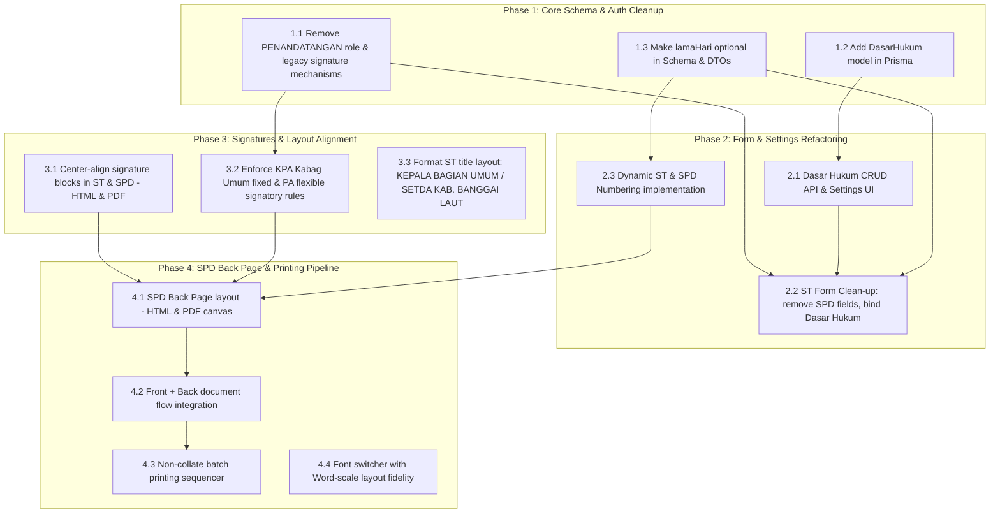

# UAT (User Acceptance Testing) Feedback & Requirements Specification

## 1. Requirements Overview

### 1.1 Tanda Tangan (Signatures)
- **Alignment:** Center alignment (`Rata Tengah`) required for bottom signatures on both ST (Surat Tugas) and SPD (Surat Perjalanan Dinas).
- **Mechanism Changes:**
  - Remove legacy signature features/mechanisms (signature image upload and storage).
  - Remove signer login accounts/roles (`PENANDATANGAN` role removal).
- **ST Signature Rules:**
  - Use the signer's official position title.
  - Example:
    ```text
    KEPALA BAGIAN UMUM
    SETDA KAB. BANGGAI LAUT
    ```
- **SPD Signature Rules:**
  - Do not use specific position titles; use **PA** (*Pengguna Anggaran*) or **KPA** (*Kuasa Pengguna Anggaran*) based on selection.
  - **KPA Rules:** Designated strictly to *Kepala Bagian Umum* (single designated official).
  - **PA Rules:** Designated to *Sekda* (Sekretaris Daerah) or other authorized officials (swappable if primary official is unavailable).

### 1.2 Penomoran (Numbering)
- **ST Numbering (Nomor ST):**
  - Dynamic structure with customizable unit code.
  - Format: `000.1.2.3/[Number]/[UnitCode]/[Year]` (e.g., `000.1.2.3/001/Bag.Umum/2026`).
  - The custom number portion is optional and can be left blank (e.g., `000.1.2.3//Bag.Umum/2026`).
- **SPD Numbering (Nomor SPD):**
  - Format: `[3-Letter Prefix][Number]/SPD/[Year]` (e.g., `001/SPD/2026` or `KPA001/SPD/2026`).
  - The custom number portion is optional and can be left blank.

### 1.3 Pengaturan & Input Data (Settings & Data Inputs)
- **Dasar Hukum (Legal Basis):**
  - Master data settings page under `Pengaturan -> Dasar Hukum`.
  - Dynamic selection and input field in the ST creation form.
- **Travel Duration:** Make "Duration of Official Travel" (*Lama Perjalanan Dinas*) optional.
- **ST Form Clean-up:** Remove SPD-specific input fields from the ST creation form.

### 1.4 Halaman Belakang SPD (SPD Back Page)
- **Document Integration:** Combine front page and back page into a single cohesive SPD document.
- **Printing Optimization:** Support batch printing for multiple documents using non-collate sequence format (all front pages printed sequentially first, followed by all back pages).

### 1.5 Dashboard
- **Status:** Layout design pending (*Menunggu rancangan*).

### 1.6 Font
- **Customization:** User font selection within the application with Word Scale layout preservation.

---

## 2. Dependency Architecture



---

## 3. Implementation Priority List & Detailed Instructions

### Priority 1: Core Schema, Auth & Role Cleanup

#### Task 1.1: Remove `PENANDATANGAN` Role & Legacy Signatures
- **Rationale:** Establishes the clean permission model before touching UI views and backend controllers.
- **Target Files:**
  - `packages/shared-types/src/index.ts`
  - `apps/api/src/auth/roles.guard.ts`
  - `apps/api/src/auth/auth.service.ts`
  - `apps/api/src/spd/spd.service.ts`
  - `apps/api/src/surat-tugas/surat-tugas.service.ts`
  - `apps/web/src/router/index.ts`
  - `apps/web/src/views/PengaturanPenggunaView.vue`
  - `apps/web/src/views/KepegawaianAsnView.vue`
- **Instructions:**
  1. Remove `PENANDATANGAN` from `Role` object and `RoleHierarchy` in `packages/shared-types`.
  2. Remove `isPenandatanganOnly` checks and row-level condition bypasses in `SpdService` and `SuratTugasService`.
  3. Remove route-level `PENANDATANGAN` entries from `meta.roles` in Vue Router.
  4. Deprecate and remove digital signature upload endpoints and storage mechanisms.

#### Task 1.2: Add `DasarHukum` Model to Database
- **Target Files:**
  - `apps/api/prisma/schema.prisma`
- **Instructions:**
  1. Add model:
     ```prisma
     model DasarHukum {
       id        String   @id @default(cuid())
       judul     String
       isi       String
       isDefault Boolean  @default(false)
       urutan    Int      @default(0)
       createdAt DateTime @default(now())
       updatedAt DateTime @updatedAt
     }
     ```
  2. Execute migration: `pnpm --filter @si-setda/api prisma:migrate`.
  3. Seed initial default statutory references in `apps/api/prisma/seed.js`.

#### Task 1.3: Make `lamaHari` Optional Across Entities & DTOs
- **Target Files:**
  - `apps/api/prisma/schema.prisma`
  - `packages/shared-types/src/index.ts`
  - `apps/api/src/spd/spd.service.ts`
  - `apps/api/src/surat-tugas/surat-tugas.service.ts`
- **Instructions:**
  1. Update `schema.prisma`: Make `lamaHari Int?` nullable in model `Spd`.
  2. Update Zod schemas in `packages/shared-types`: `lamaHari: z.number().int().positive().optional().nullable()`.
  3. Adjust automatic calculation for `tanggalKembali`: if `lamaHari` is null or omitted, do not enforce automatic addition; default `tanggalKembali` to `tanggalBerangkat` or null.

---

### Priority 2: Form Refactoring & Settings Module

#### Task 2.1: Master Settings for Dasar Hukum
- **Target Files:**
  - `apps/api/src/dasar-hukum/` (new module)
  - `apps/api/src/app.module.ts`
  - `apps/web/src/views/PengaturanDasarHukumView.vue` (new view)
  - `apps/web/src/router/index.ts`
  - `apps/web/src/components/layout/GovSidebar.vue`
- **Instructions:**
  1. Build NestJS CRUD module: `GET`, `POST`, `PUT`, `DELETE`, and `PATCH /:id/set-default`.
  2. Build management view in frontend with `GovTable`, search, modal add/edit form, and default toggle.
  3. Register route `/pengaturan/dasar-hukum` under `Pengaturan` sidebar group.

#### Task 2.2: Streamline Surat Tugas Form
- **Target Files:**
  - `apps/web/src/views/BuatSuratTugasView.vue`
  - `apps/api/src/surat-tugas/surat-tugas.service.ts`
- **Instructions:**
  1. Remove Section 5 ("Rincian Perjalanan Dinas": alat angkut, tempat tujuan, lama hari, tanggal berangkat) from `BuatSuratTugasView.vue`.
  2. Add `Dasar Hukum` multi-select / auto-complete input fetching active items from `/api/dasar-hukum`.
  3. Simplify submission payload to focus strictly on: `nomorSurat`, `dasarHukum`, `dalamRangka`, `pegawaiIds`, `tempatDikeluarkan`, `tanggalSurat`, and signatory info.

#### Task 2.3: Dynamic Numbering Rules
- **Target Files:**
  - `apps/api/src/surat-tugas/surat-tugas.service.ts`
  - `apps/api/src/spd/spd.service.ts`
  - `apps/web/src/views/BuatSuratTugasView.vue`
  - `apps/web/src/views/BuatSpdView.vue`
- **Instructions:**
  1. **ST Format:** Construct `000.1.2.3/[Number]/[UnitCode]/[Year]`.
     - Allow empty custom number portion (producing `000.1.2.3//Bag.Umum/2026`).
     - Unit code defaults to `Bag.Umum` and remains editable.
  2. **SPD Format:** Construct `[Prefix][Number]/SPD/[Year]`.
     - Allow empty custom number portion (producing `/SPD/2026` or `KPA/SPD/2026`).
     - Support custom 3-letter prefix if specified.

---

### Priority 3: Signatures Alignment & Governance Rules

#### Task 3.1: Center-Align Bottom Signatures
- **Target Files:**
  - `apps/web/src/components/spd/SpdDocument.vue`
  - `apps/web/src/views/SuratTugasDetailPrintView.vue`
  - `apps/api/src/spd/spd-pdf.service.ts`
  - `apps/api/src/surat-tugas/surat-tugas-pdf.service.ts`
- **Instructions:**
  1. Frontend CSS: Change signature container from left/right offset to text-center (`text-center`, flex justify-center, or grid-centered).
  2. PDF Canvas (`pdf-lib`):
     - Calculate center X anchor: `const signCenterX = (pageWidth - blockWidth) / 2` or column-specific centering.
     - Center each text line (title, name, NIP) using measured font widths: `x = signCenterX + (blockWidth - font.widthOfTextAtSize(text, size)) / 2`.

#### Task 3.2: Signatory Rules (PA vs KPA)
- **Target Files:**
  - `apps/web/src/views/BuatSpdView.vue`
  - `apps/web/src/components/spd/SpdDocument.vue`
  - `apps/api/src/spd/spd-pdf.service.ts`
- **Instructions:**
  1. On SPD document, render signatory label strictly as `PENGGUNA ANGGARAN` or `KUASA PENGGUNA ANGGARAN`.
  2. When `KPA` is selected:
     - Restrict signatory to *Kepala Bagian Umum*.
     - Lock signatory selector or automatically set to active Kabag Umum profile.
  3. When `PA` is selected:
     - Default to *Sekda Kab. Banggai Laut*.
     - Allow swappable dropdown to select acting official (*Plt / Plh*) if primary official is unavailable.

#### Task 3.3: Surat Tugas Title Formatting
- **Target Files:**
  - `apps/web/src/views/SuratTugasDetailPrintView.vue`
  - `apps/api/src/surat-tugas/surat-tugas-pdf.service.ts`
- **Instructions:**
  1. Render signatory title explicitly as:
     ```text
     KEPALA BAGIAN UMUM
     SETDA KAB. BANGGAI LAUT
     ```
  2. Center all lines relative to the signature block.

---

### Priority 4: SPD Back Page & Advanced Printing Pipeline

#### Task 4.1: SPD Back Page Layout Implementation
- **Target Files:**
  - `apps/web/src/components/spd/SpdBackDocument.vue` (new component)
  - `apps/api/src/spd/spd-pdf.service.ts`
- **Instructions:**
  1. Implement official Indonesian SPD back page (Tabel Rincian Visum Perjalanan Dinas):
     - Kolom I: Tempat berangkat, tanggal, tujuan, tanda tangan pejabat pemberi perintah.
     - Kolom II s/d V: Catatan kedatangan dan keberangkatan di lokasi tujuan (tanda tangan & cap pejabat setempat).
     - Kolom VI: Catatan kepulangan / tiba kembali di tempat kedudukan.
     - Kolom VII: Catatan lain-lain.
     - Kolom VIII: Pernyataan pertanggungjawaban PA/KPA.
  2. Replicate identical layout in `pdf-lib` drawing operations on Page 2 of the generated PDF.

#### Task 4.2: Seamless Document Flow Integration
- **Target Files:**
  - `apps/web/src/components/spd/SpdDocument.vue`
  - `apps/web/src/views/SpdDetailPrintView.vue`
- **Instructions:**
  1. Combine front page (`SpdDocument.vue`) and back page (`SpdBackDocument.vue`) into a continuous multi-page document container.
  2. Apply CSS page break controls:
     ```css
     .spd-page-break {
       page-break-before: always;
       break-before: page;
     }
     ```

#### Task 4.3: Non-Collate Batch Printing Sequencer
- **Target Files:**
  - `apps/web/src/views/DaftarSpdView.vue`
  - `apps/web/src/views/SpdBatchPrintView.vue` (new view)
- **Instructions:**
  1. Add bulk selection checkboxes on `DaftarSpdView.vue` with action button "Cetak Sekaligus (Batch)".
  2. Sequence rendering order:
     - Group 1: Render Page 1 (Front) of Document A, Document B, Document C...
     - Page Break separator.
     - Group 2: Render Page 2 (Back) of Document A, Document B, Document C...
  3. Ensure browser `window.print()` outputs front sheets sequentially, followed by back sheets sequentially.

#### Task 4.4: Font Customization (Word Scale Support)
- **Target Files:**
  - `apps/web/src/components/spd/SpdDocument.vue`
  - `apps/web/src/views/SpdDetailPrintView.vue`
  - `apps/api/src/spd/spd-pdf.service.ts`
- **Instructions:**
  1. Add UI selector for font choice (`Times New Roman`, `Arial`).
  2. Preserve exact millimeter/point spacing, cell paddings, and line heights matching standard Microsoft Word templates.

---

## 4. Deferred Tasks

### Dashboard Layout
- **Status:** Postponed pending client wireframe/layout design delivery.
- **Action:** No architectural or code changes until visual layout is finalized.
