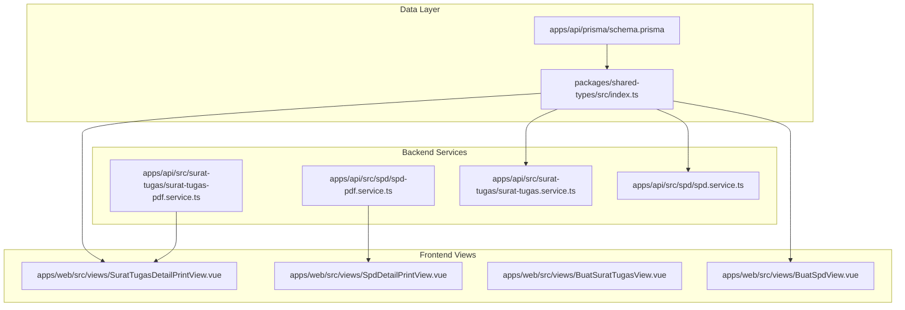
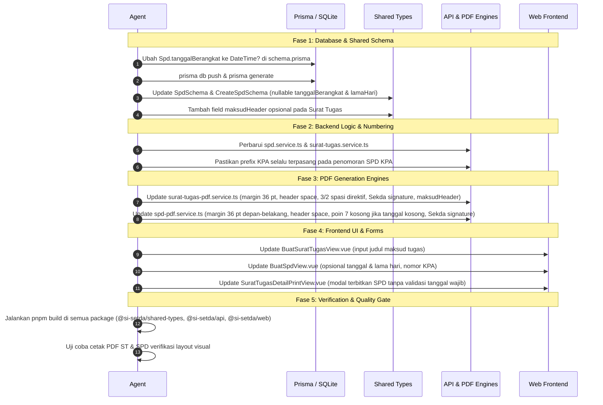

# UAT-2 Implementation Plan: Feedback & Requirements Specification

Dokumen perencanaan teknis untuk mengimplementasikan seluruh kebutuhan dan feedback pada [uat-2.md](file:///home/evan/projects/e-spd/.antigravity/uat-2.md).

---

## 1. Requirements & Gap Analysis

### 1.1 Surat Tugas (ST)

| Item | Kebutuhan UAT-2 | Status Saat Ini | Rencana Perubahan |
| :--- | :--- | :--- | :--- |
| **Header Spacing** | Tambah jarak/ruang kosong di atas dan di bawah header (`SURAT TUGAS` & `Nomor`) | Jarak kop ke judul 15 pt, judul ke nomor 12 pt, nomor ke dasar 16 pt | Naikkan jarak kop ke judul menjadi ~25 pt, jarak nomor ke dasar hukum menjadi ~32 pt |
| **Tanggal Berangkat** | Opsional (dapat dikosongkan) | Di model `SuratTugas` sudah opsional (`tanggalBerangkat DateTime?`), namun pada modal penerbitan SPD di ST detail masih memvalidasi `tanggalBerangkat` | Hapus validasi wajib isi pada modal terbitkan SPD di [SuratTugasDetailPrintView.vue](file:///home/evan/projects/e-spd/apps/web/src/views/SuratTugasDetailPrintView.vue) |
| **Page Margins** | Set margin dokumen ke **Narrow** | Margin saat ini 40 pt (kiri/kanan) | Ubah margin kiri dan kanan menjadi `36 pt` (`0.5 in` / Narrow standard). Lebar konten Legal ($612 \times 1008\text{ pt}$) menjadi $540\text{ pt}$ |
| **Teks Perintah (*Memerintahkan*)** | 3 spasi baris sebelum `MEMERINTAHKAN:`, 2 spasi baris setelah `MEMERINTAHKAN:` | Menggunakan padding tetap tunggal (~14 pt) | Gunakan kelipatan `lineHeight`: `yPos -= 3 * lineHeight` sebelum mencetak `MEMERINTAHKAN :`, dan `yPos -= 2 * lineHeight` setelahnya sebelum mencetak `Kepada :` |
| **Tanda Tangan (Signature)** | 1. Hapus teks awalan "PA" jika penandatangan adalah Pengguna Anggaran. 2. **Sekda Rule:** Jika ditandatangani Sekda, jangan tampilkan baris jabatan penandatangan, langsung tulis `SEKRETARIS DAERAH KABUPATEN BANGGAI LAUT` | Mencetak `PENGGUNA ANGGARAN,` atau jabatan penandatangan di atas baris instansi | Jika Sekda/PA: hilangkan label "PENGGUNA ANGGARAN," dan langsung tampilkan `SEKRETARIS DAERAH KABUPATEN BANGGAI LAUT` |
| **Maksud Tugas (*Dalam Rangka*)** | Tambah judul/header tanpa nomor jika terdapat rincian agenda tugas jamak | Hanya mendukung array string bernomor (1, 2, 3...) atau baris tunggal | Tambahkan input judul/pengantar opsional (misal: "Untuk melaksanakan tugas dalam rangka:"). Pada PDF, cetak teks pengantar di samping `Untuk :` tanpa nomor urut, lalu rincian bernomor di bawahnya |

---

### 1.2 Surat Perjalanan Dinas (SPD)

| Item | Kebutuhan UAT-2 | Status Saat Ini | Rencana Perubahan |
| :--- | :--- | :--- | :--- |
| **Header Spacing** | Tambah ruang kosong di atas dan di bawah judul dokumen SPD | Jarak kop ke judul 15 pt, judul ke tabel 14 pt | Tambah ruang vertikal ekstra di atas `SURAT PERJALANAN DINAS` dan di bawah baris nomor SPD sebelum tabel |
| **Penomoran SPD (*KPA*)** | Pastikan kode `KPA` tetap muncul pada string nomor surat SPD | Pada custom prefix mode atau format tertentu, prefix KPA berisiko hilang jika pengguna tidak mengetik ulang | Pastikan generator nomor default menyematkan `KPA` saat pemberi perintah adalah KPA, dan validasi/preview selalu menyertakan prefix tersebut |
| **Lama Perjalanan Dinas** | Poin 7 (Lama Perjalanan Dinas) dibuat opsional | Masih divalidasi sebagai field wajib di form web dan shared types | Ubah `lamaHari` menjadi opsional/nullable di shared types, form web, dan API service |
| **Page Margins** | Set margin ke **Narrow** (`36 pt` / `0.5 in`) untuk Halaman Depan & Belakang | Halaman depan: `tableX = 40`, `tableWidth = 532`. Halaman belakang: `tableLeft = 40`, `tableRight = 572` | Set margin kiri dan kanan menjadi `36 pt`: `tableX = 36`, lebar tabel $540\text{ pt}$ (`colWidths: [24, 190, 326]`). Halaman belakang: `tableLeft = 36`, `tableRight = 576` ($540\text{ pt}$), `tableCenterX = 306` |
| **Tanggal Berangkat** | Opsional; jika kosong, biarkan Poin 7 kosong | Schema DB `Spd.tanggalBerangkat` adalah `DateTime` (wajib / non-nullable) | 1. Ubah schema Prisma: `tanggalBerangkat DateTime?`. 2. Di generator PDF, jika `tanggalBerangkat` tidak diisi, kosongkan seluruh kolom isi pada Poin 7 |
| **Aturan Tanda Tangan** | Sesuaikan format tanda tangan dengan aturan UAT-2 (Sekda tanpa awalan PA, langsung jabatan daerah) | Masih mencetak `PENGGUNA ANGGARAN` di atas nama Sekda | Samakan aturan dengan ST: Jika Sekda, hapus label jabatan PA dan langsung tampilkan `SEKRETARIS DAERAH KABUPATEN BANGGAI LAUT` |

---

## 2. Technical Architecture & File Map

### Detail Berkas yang Dimodifikasi:
1. [schema.prisma](file:///home/evan/projects/e-spd/apps/api/prisma/schema.prisma)
   - `Spd.tanggalBerangkat`: ganti tipe dari `DateTime` ke `DateTime?`
2. [packages/shared-types/src/index.ts](file:///home/evan/projects/e-spd/packages/shared-types/src/index.ts)
   - `SpdSchema`, `CreateSpdSchema`, `UpdateSpdSchema`: jadikan `tanggalBerangkat` dan `lamaHari` opsional/nullable.
   - `SuratTugasSchema`: dukung opsional `maksudHeader` atau struktur rincian maksud tugas bertitel.
3. [apps/api/src/surat-tugas/surat-tugas-pdf.service.ts](file:///home/evan/projects/e-spd/apps/api/src/surat-tugas/surat-tugas-pdf.service.ts)
   - Narrow margins (`leftMargin = 36`, `rightMargin = width - 36`).
   - Vertical spacing header: ruang lebih longgar di atas judul `SURAT TUGAS` dan di bawah nomor surat.
   - Spasi direktif: 3 baris sebelum `MEMERINTAHKAN:` dan 2 baris sesudah `MEMERINTAHKAN:`.
   - Sekda signature: hilangkan awalan `PA`, langsung cetak `SEKRETARIS DAERAH KABUPATEN BANGGAI LAUT`.
   - Agenda/Purpose: dukung pencetakan judul/pengantar tanpa nomor di baris `Untuk :`.
4. [apps/api/src/spd/spd-pdf.service.ts](file:///home/evan/projects/e-spd/apps/api/src/spd/spd-pdf.service.ts)
   - Narrow margins (`36 pt`) pada Halaman Depan (`tableX = 36`, `tableWidth = 540 pt`) dan Halaman Belakang (`tableLeft = 36`, `tableRight = 576`).
   - Vertical spacing header di atas dan di bawah judul SPD.
   - Poin 7: Jika `tanggalBerangkat` tidak ada, biarkan isi poin 7 kosong (blank).
   - Sekda signature: hilangkan baris `PENGGUNA ANGGARAN`, langsung `SEKRETARIS DAERAH KABUPATEN BANGGAI LAUT`.
5. [apps/api/src/spd/spd.service.ts](file:///home/evan/projects/e-spd/apps/api/src/spd/spd.service.ts) & [apps/api/src/surat-tugas/surat-tugas.service.ts](file:///home/evan/projects/e-spd/apps/api/src/surat-tugas/surat-tugas.service.ts)
   - Pastikan nomor SPD mempertahankan prefix `KPA` saat pemberi perintah KPA.
   - Penanganan nilai `null`/`undefined` untuk `tanggalBerangkat` dan `lamaHari`.
6. [apps/web/src/views/BuatSuratTugasView.vue](file:///home/evan/projects/e-spd/apps/web/src/views/BuatSuratTugasView.vue)
   - Input judul/pengantar tanpa nomor saat maksud tugas memiliki multiple items.
7. [apps/web/src/views/BuatSpdView.vue](file:///home/evan/projects/e-spd/apps/web/src/views/BuatSpdView.vue) & [apps/web/src/views/SuratTugasDetailPrintView.vue](file:///home/evan/projects/e-spd/apps/web/src/views/SuratTugasDetailPrintView.vue)
   - Hapus kewajiban isi tanggal berangkat & lama perjalanan pada validasi modal/form.
   - Pastikan preview nomor SPD tetap membawa prefix `KPA`.

---

## 3. Step-by-Step Implementation Sequence

---

## 4. Acceptance Criteria & Verification

1. **Surat Tugas (ST) PDF:**
   - [ ] Margin kiri & kanan tepat `36 pt` (`0.5 in`).
   - [ ] Jarak vertikal di atas `SURAT TUGAS` dan di bawah nomor surat lebih lega (~25 pt dan ~32 pt).
   - [ ] Tepat 3 spasi baris sebelum `MEMERINTAHKAN:` dan 2 spasi baris sesudahnya.
   - [ ] Tanda tangan Sekda tidak memuat teks awalan "PA", melainkan langsung `SEKRETARIS DAERAH KABUPATEN BANGGAI LAUT`.
   - [ ] Jika ada multiple agenda, teks judul pengantar dicetak tanpa nomor urut di samping `Untuk :`.
2. **Surat Perjalanan Dinas (SPD) PDF:**
   - [ ] Margin kiri & kanan Halaman Depan dan Halaman Belakang adalah Narrow (`36 pt`).
   - [ ] Lebar tabel 540 pt (pas dengan lebar halaman Legal 612 pt dikurangi 72 pt margin).
   - [ ] Jarak vertikal ekstra pada header SPD.
   - [ ] Poin 7 di PDF SPD kosong bersih jika `tanggalBerangkat` tidak diisi.
   - [ ] Penomoran SPD untuk KPA selalu menyertakan prefix `KPA`.
   - [ ] Tanda tangan Sekda di halaman depan dan belakang sesuai aturan UAT-2 (tanpa "PA").
3. **Build & Stability:**
   - [ ] `pnpm --filter @si-setda/shared-types build` sukses.
   - [ ] `pnpm --filter @si-setda/api build` sukses.
   - [ ] `pnpm --filter @si-setda/web build` sukses.
