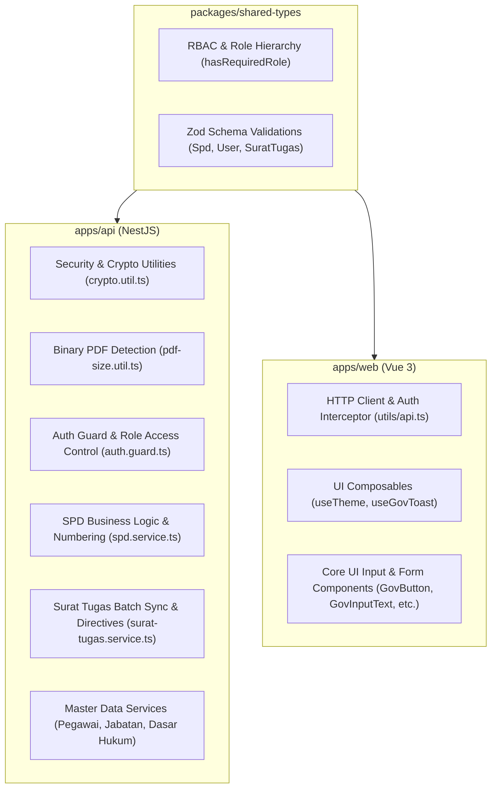
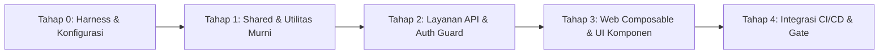

# Rencana Implementasi Unit Testing SI-SPD Monorepo

## 1. Ringkasan & Analisis Kode Sumber (Codebase Assessment)

Proyek **SI-SPD (Sistem Informasi Surat Perjalanan Dinas)** adalah monorepo TypeScript yang dikelola menggunakan **pnpm** dan **Turborepo**.

### Struktur Workspace Monorepo
| Workspace | Tech Stack | Tanggung Jawab Utama | Status Pengujian Saat Ini |
| :--- | :--- | :--- | :---: |
| `packages/shared-types` | TypeScript, Zod | DTO domain, skema validasi Zod, role & hierarki RBAC | ❌ Belum ada unit test |
| `apps/api` | NestJS 10, Express, Prisma ORM (SQLite), pdf-lib | REST API, Auth/RBAC, logika bisnis SPD & Surat Tugas, kalkulator layout PDF | ❌ Belum ada unit test |
| `apps/web` | Vite 6, Vue 3.5, PrimeVue 4, TailwindCSS | SPA Frontend, manajemen state form, HTTP client, komponen UI reusable | ❌ Belum ada unit test |

### Temuan Kritis
1. **Belum Ada Pengujian Otomatis (0% Coverage):** Belum ada test runner, skrip npm test, maupun berkas `.spec.ts` / `.test.ts`.
2. **Logika Berisiko Tinggi yang Butuh Proteksi:**
   - Algoritma auto-numbering format dinamis (`001/SPD/2026`, `KPA001/SPD/2026`, `090/.../SETDA-...`).
   - Penanganan tabrakan nomor (*collision avoidance sequence increment*).
   - Kalkulasi tanggal kepulangan (`tanggalKembali = tanggalBerangkat + lamaHari - 1`).
   - Utilitas keamanan kriptografi (hashing password dengan salt, verifikasi timing-safe, pembuatan dan verifikasi JWT token dengan HMAC-SHA256).
   - Deteksi biner orientasi/ukuran kertas PDF (`pdf-size.util.ts`).
   - Sinkronisasi batch Surat Tugas multi-pelaksana ke entitas SPD.
3. **Pemisahan Modular yang Bersih:** Tipe data dan validasi skema diisolasi pada `packages/shared-types`, sehingga sangat mudah diuji secara murni (*pure unit test*) tanpa database mock maupun DOM simulator.

---

## 2. Arsitektur Test Runner: Vitest Monorepo Setup

Direkomendasikan menggunakan **Vitest** secara terpadu di seluruh workspace monorepo:
- **Kompatibilitas Native Vite:** `apps/web` sudah menggunakan **Vite 6**; Vitest berbagi konfigurasi dan plugin Vite langsung tanpa build loader terpisah.
- **Dukungan ESM Penuh:** `packages/shared-types` dan `apps/web` bertipe ESM (`"type": "module"`). Vitest mengeksekusi ESM secara native tanpa masalah resolusi modul yang sering terjadi pada Jest di monorepo TS modern.
- **Dukungan NestJS & Decorator Metadata:** Menggunakan `unplugin-swc` memungkinkan Vitest menjalankan NestJS dependency injection dan dekorator TypeScript secara instan dan jauh lebih cepat daripada `ts-jest`.
- **Pengalaman Pengembang (DX) Terpadu:** Pengembang menggunakan satu API pengujian standar (`describe`, `it`, `expect`, `vi`) untuk backend, frontend, maupun shared packages.

### Matriks Paket Pengujian

| Lingkup | Test Runner & Library Inti | Utilitas & Ekstensi |
| :--- | :--- | :--- |
| **Akar Monorepo** | Vitest CLI, Turborepo pipeline | `@vitest/coverage-v8` |
| **`packages/shared-types`** | Vitest | Assertions bawaan |
| **`apps/api`** | Vitest, `@nestjs/testing` | `unplugin-swc` (SWC decorator support), helper mock Prisma |
| **`apps/web`** | Vitest | `@vue/test-utils`, `happy-dom` (DOM simulator berkecepatan tinggi) |

---

## 3. Matriks Cakupan Unit Test



### Rincian Target Modul Pengujian

#### 3.1. `packages/shared-types` (Target Cakupan: >= 95%)
- **Hirarki Peran & Akses RBAC:**
  - Fungsi `hasRequiredRole`: Matriks kombinasi akses `SUPER_ADMIN`, `ADMIN`, `STAFF`, dan `USER` pada endpoint yang dibatasi.
  - Nilai bobot `RoleHierarchy`.
- **Validasi Skema Zod:**
  - `LoginRequestSchema`: Karakter minimum username (>= 3) dan password (>= 6).
  - Skema User (`CreateUserSchema`, `UpdateUserSchema`): Validasi email, role default, status keaktifan.
  - Skema SPD (`CreateSpdSchema`, `UpdateSpdSchema`): Validasi nilai wajib, batas integer hari positif, tanggal ISO.
  - Skema Surat Tugas (`CreateSuratTugasSchema`, `GenerateSpdFromSuratTugasSchema`): Validasi multi-pelaksana dan format JSON array dasar hukum.

#### 3.2. `apps/api` (Target Cakupan: >= 85% Service & Utilitas)
- **Utilitas Murni (Pure Utilities):**
  - `apps/api/src/auth/crypto.util.ts`:
    - `hashPassword`: Pembentukan format `salt:hash` secara acak dan deterministik scrypt.
    - `verifyPassword`: Verifikasi kecocokan password benar, penolakan password salah, proteksi dari hash cacat, dan timing-safe equality.
    - `signJwt` & `verifyJwt`: Verifikasi token payload, pengecekan waktu kedaluwarsa (`exp`), penolakan token dengan signature palsu, dan validasi panjang secret minimum 32 karakter pada environment produksi.
  - `apps/api/src/kop-surat/pdf-size.util.ts`:
    - `detectPdfPaperSize`: Parsing MediaBox tidak terkompresi, dekompresi zlib stream untuk MediaBox terkompresi, toleransi ukuran kertas standar (`A4`, `F4 / Folio`, `Letter`, `Legal`, `A5`, `A3`), serta fallback dimensi kustom.
- **Autentikasi & RBAC Guards:**
  - `apps/api/src/auth/auth.guard.ts`:
    - Penolakan request tanpa header `Authorization` (401 Unauthorized).
    - Penolakan format Bearer token yang tidak valid atau kedaluwarsa.
    - Akses diterima jika peran sesuai `@Roles(...)`.
    - Akses ditolak (403 Forbidden) jika peran tidak memenuhi syarat.
  - `apps/api/src/auth/auth.service.ts`:
    - Validasi kredensial pengguna aktif vs nonaktif, penerbitan token JWT.
- **Logika Bisnis Domain (Mocking PrismaService):**
  - `apps/api/src/spd/spd.service.ts`:
    - **Penomoran Otomatis:** Format standar `XXX/SPD/YYYY` dan prefix KPA `KPAXXX/SPD/YYYY`.
    - **Pencegahan Tabrakan:** Increment urutan nomor otomatis jika nomor sudah dipakai.
    - **Kalkulasi Hari:** Penentuan `tanggalKembali` otomatis dari `tanggalBerangkat + (lamaHari - 1)`.
    - **Resolusi Penandatangan:** Prioritas data pegawai langsung vs pewarisan dari `suratTugasId` terkait.
    - **Filter & Search:** Pengujian filter status, rentang tanggal, dan query pencarian multi-bidang.
  - `apps/api/src/surat-tugas/surat-tugas.service.ts`:
    - Format penomoran `090/[seq]/SETDA-[year]`.
    - Pembuatan batch SPD otomatis untuk multi-pelaksana (`generateSpdFromSuratTugas`).
    - Penyusunan dasar hukum dinamis dan aturan penandatangan Sekda.
  - Master Service: `pegawai`, `jabatan`, `dasar-hukum`, `dashboard`.

#### 3.3. `apps/web` (Target Cakupan: >= 80% Utilitas & Komposabel)
- **Klien API & Penyimpanan:**
  - `apps/web/src/utils/api.ts`:
    - URL builder dengan environment `VITE_API_URL`.
    - Penyisipan header otomatis `Authorization: Bearer <token>`.
    - Penanganan kode respons HTTP error (`400`, `404`, `500`).
    - Pembersihan token dan redirect saat menerima status `401 Unauthorized`.
- **Komposabel Vue:**
  - `apps/web/src/composables/useTheme.ts`:
    - Deteksi tema awal (system preference & localStorage).
    - Penggantian tema dan sinkronisasi class `.dark` pada dokumen HTML.
  - `apps/web/src/composables/useGovToast.ts`:
    - Event bus notifikasi toast (`showSuccess`, `showError`, `showWarn`).
- **Komponen Inti Reusable (Mounting Tests dengan `@vue/test-utils`):**
  - `GovButton.vue`: Render prop (label, ikon, varian severity, status loading).
  - `GovInputText.vue` & `GovTextarea.vue`: Binding dua arah `v-model`, reaktivitas batas karakter 700 chars.
  - `GovMessage.vue`: Pilihan varian severity alert (`success`, `info`, `warn`, `error`).

---

## 4. Tahapan Pelaksanaan (Step-by-Step Roadmap)



### Tahap 0: Instalasi Test Harness & Konfigurasi Monorepo
1. Instalasi dependensi Vitest:
   - Root: `pnpm add -wD vitest @vitest/coverage-v8`
   - `apps/api`: `pnpm --filter @si-setda/api add -D unplugin-swc @nestjs/testing`
   - `apps/web`: `pnpm --filter @si-setda/web add -D @vue/test-utils happy-dom`
2. Konfigurasi `vitest.config.ts` pada tiap paket:
   - Root: Konfigurasi workspace atau delegasi script.
   - `packages/shared-types/vitest.config.ts`.
   - `apps/api/vitest.config.ts` (dengan plugin `swc.vite()` untuk dekorator NestJS).
   - `apps/web/vitest.config.ts` (dengan environment `happy-dom` dan plugin `@vitejs/plugin-vue`).
3. Update [turbo.json](file:///home/evan/projects/e-spd/turbo.json) untuk mendaftarkan task `test` dan `test:coverage`.
4. Update skrip pada [package.json](file:///home/evan/projects/e-spd/package.json) akar:
   ```json
   "test": "turbo test",
   "test:coverage": "turbo test:coverage"
   ```

### Tahap 1: Pengujian Fondasi & Utilitas Murni
- Buat `packages/shared-types/src/index.test.ts` (uji fungsi `hasRequiredRole`, `RoleHierarchy`, dan skema Zod).
- Buat `apps/api/src/auth/crypto.util.spec.ts` (uji hash password, verify password, sign JWT, verify JWT).
- Buat `apps/api/src/kop-surat/pdf-size.util.spec.ts` (uji deteksi MediaBox dan toleransi format kertas).

### Tahap 2: Pengujian Layanan Backend & RBAC
- Buat helper generator mock Prisma (`apps/api/test/mocks/prisma.mock.ts`).
- Buat `apps/api/src/auth/auth.guard.spec.ts` & `apps/api/src/auth/auth.service.spec.ts`.
- Buat `apps/api/src/spd/spd.service.spec.ts` (uji auto-numbering, pencegahan tabrakan, kalkulasi tanggal, CRUD).
- Buat `apps/api/src/surat-tugas/surat-tugas.service.spec.ts` (uji generate SPD massal, format nomor, tata kelola tanda tangan Sekda).
- Buat unit test master data (`pegawai`, `jabatan`, `dasar-hukum`, `dashboard`).

### Tahap 3: Pengujian Frontend (Utilitas, Komposabel, & Komponen)
- Buat `apps/web/src/utils/api.spec.ts` (uji HTTP fetch, token injection, error handling, redirect 401).
- Buat `apps/web/src/composables/useTheme.spec.ts` & `useGovToast.spec.ts`.
- Buat unit test komponen input di `apps/web/src/components/core/`.

### Tahap 4: Integrasi CI/CD & Ambang Batas Kualitas (Quality Gates)
- Tambahkan step pengujian `pnpm test` ke dalam `.github/workflows/deploy.yml` sebelum proses build Docker.
- Konfigurasi ambang batas coverage di Vitest (target minimal 80% pada logika bisnis).

---

## 5. Metrik Keberhasilan & Quality Gates

| Metrik | Target | Mekanisme Evaluasi |
| :--- | :--- | :--- |
| **Kelulusan Unit Test** | 100% Pass | `pnpm test` / CI Workflow |
| **Cakupan `packages/shared-types`** | >= 90% | `pnpm test:coverage` |
| **Cakupan Layanan & Utilitas API** | >= 80% | `pnpm test:coverage` |
| **Cakupan Utilitas & Komposabel Web** | >= 80% | `pnpm test:coverage` |
| **Kecepatan Eksekusi** | < 15 detik untuk seluruh suite | Worker paralel Vitest + Turbo caching |
