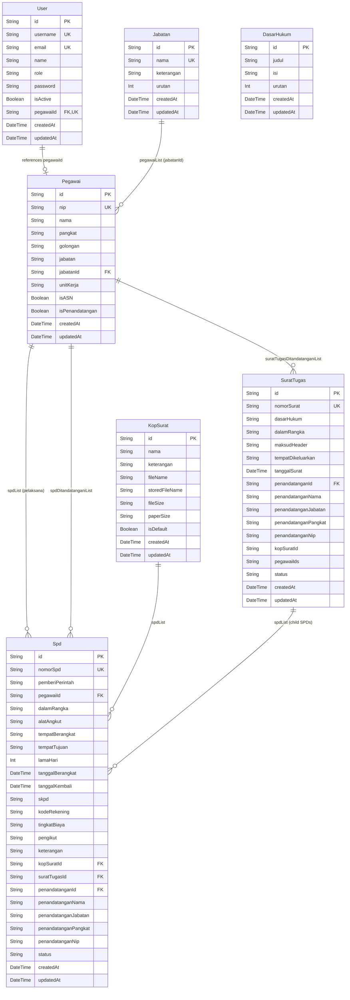
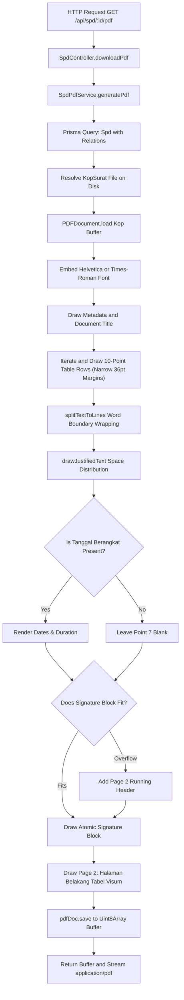
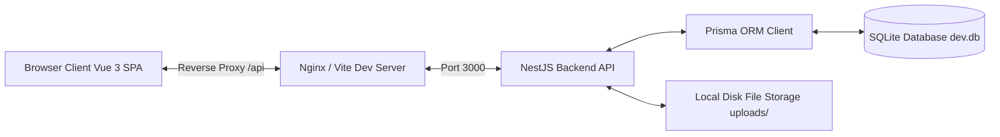
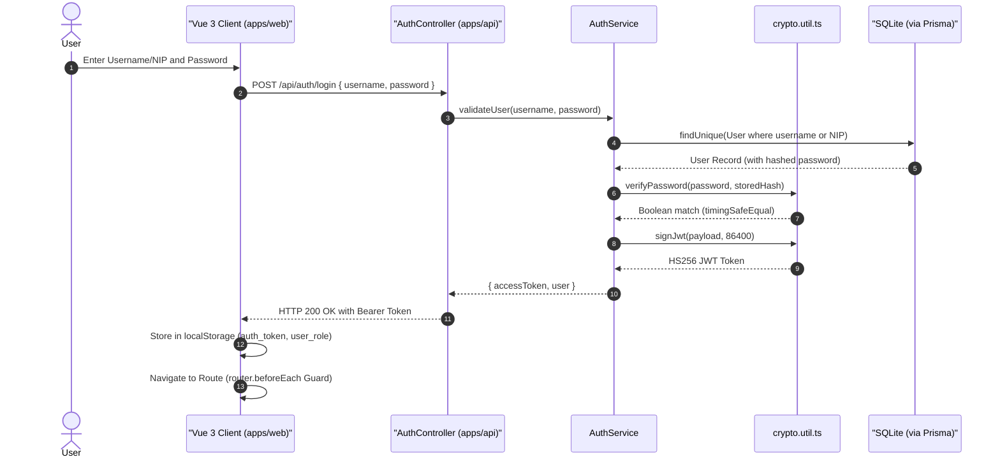
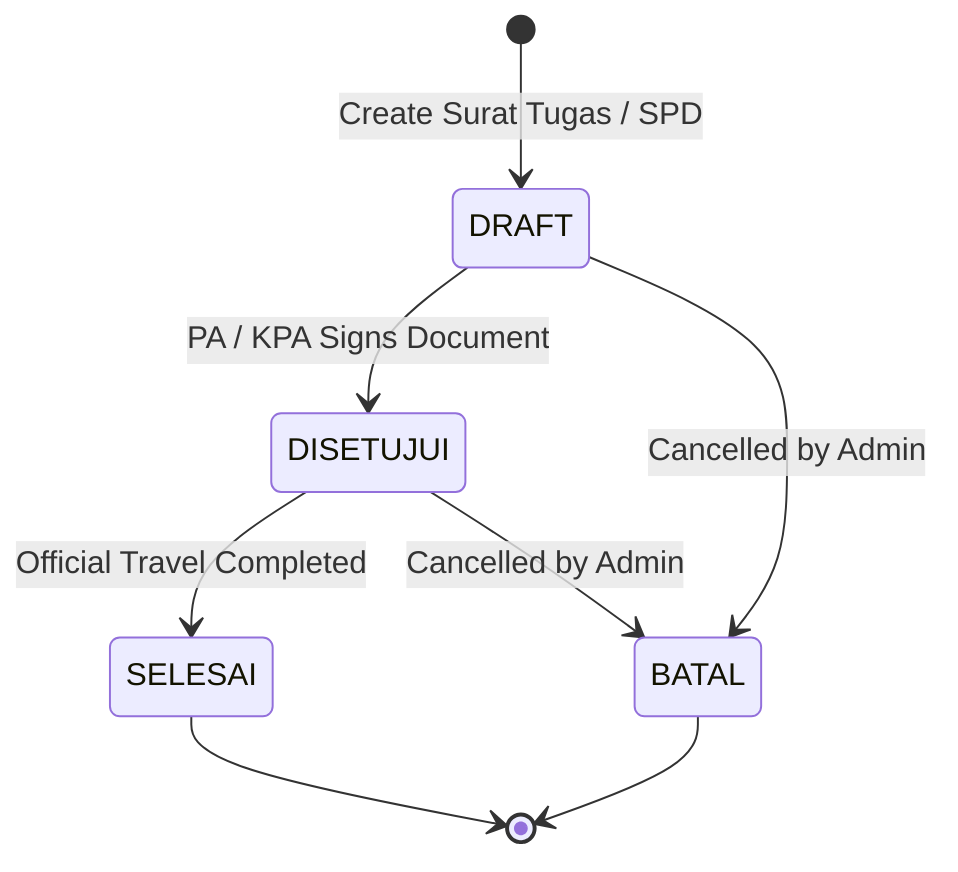
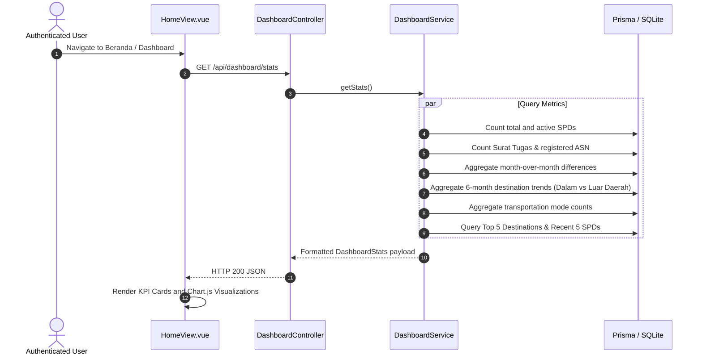

# Developer Documentation: SI-SPD Banggai Laut

This document provides a consolidated technical reference for the Sistem Informasi Surat Perjalanan Dinas (SI-SPD) of the Regional Secretariat of Banggai Laut Regency (Sulawesi Tengah). It covers the database schema, UI/UX standards, PDF generation mechanics, and end-to-end application workflows.

---

## 1. Database Architecture and Table Structure

### 1.1 Overview

The persistence layer is managed using Prisma ORM with SQLite as the default relational database engine. The schema is defined in `apps/api/prisma/schema.prisma`. Primary keys across all entities use Collision-resistant Unique Identifiers (CUID).

### 1.2 Entity-Relationship Diagram



### 1.3 Entity Specifications

#### 1.3.1 Table `User`
Manages system authentication and role-based permissions.

| Column | Data Type | Nullable | Default | Constraints | Description |
|---|---|---|---|---|---|
| `id` | String | No | `cuid()` | Primary Key | Unique record identifier |
| `username` | String | No | None | Unique | Login identifier (NIP or alphanumeric username) |
| `email` | String | Yes | `null` | Unique | User email address |
| `name` | String | No | None | None | Display name of the user |
| `role` | String | No | `'USER'` | Enum Check | Values: `SUPER_ADMIN`, `ADMIN`, `STAFF`, `USER` |
| `password` | String | No | None | None | Scrypt-hashed password string (`salt:derivedKey`) |
| `isActive` | Boolean | No | `true` | None | Account activity toggle |
| `pegawaiId` | String | Yes | `null` | Unique, FK -> `Pegawai.id` | Relation to employee record; `ON DELETE SET NULL` |
| `createdAt` | DateTime | No | `now()` | None | Record creation timestamp |
| `updatedAt` | DateTime | No | Triggered | None | Record modification timestamp |

#### 1.3.2 Table `Pegawai`
Master record of civil servants (ASN) and official signatories within the Regional Secretariat.

| Column | Data Type | Nullable | Default | Constraints | Description |
|---|---|---|---|---|---|
| `id` | String | No | `cuid()` | Primary Key | Unique record identifier |
| `nip` | String | No | None | Unique | 18-digit Civil Servant Identification Number |
| `nama` | String | No | None | None | Full legal name including academic degrees |
| `pangkat` | String | No | None | None | Official rank (e.g., `Pembina Utama Muda`, `Penata`) |
| `golongan` | String | No | None | None | Civil service grade (e.g., `IV/c`, `III/a`) |
| `jabatan` | String | No | None | None | Official government position snapshot |
| `jabatanId` | String | Yes | `null` | FK -> `Jabatan.id` | Relation to master Jabatan; `ON DELETE SET NULL` |
| `unitKerja` | String | No | `'Sekretariat Daerah'` | None | Organizational administrative unit |
| `isASN` | Boolean | No | `true` | None | ASN status indicator |
| `isPenandatangan` | Boolean | No | `false` | None | Flag indicating official signatory authorization |
| `createdAt` | DateTime | No | `now()` | None | Record creation timestamp |
| `updatedAt` | DateTime | No | Triggered | None | Record modification timestamp |

#### 1.3.3 Table `Jabatan`
Master table of government positions and job titles within the Regional Secretariat.

| Column | Data Type | Nullable | Default | Constraints | Description |
|---|---|---|---|---|---|
| `id` | String | No | `cuid()` | Primary Key | Unique record identifier |
| `nama` | String | No | None | Unique | Official government job title |
| `keterangan` | String | Yes | `null` | None | Echelon or scope description |
| `urutan` | Int | No | `0` | None | Sorting priority for display and selection |
| `createdAt` | DateTime | No | `now()` | None | Record creation timestamp |
| `updatedAt` | DateTime | No | Triggered | None | Record modification timestamp |

#### 1.3.4 Table `DasarHukum`
Stores reusable statutory bases and legal foundations for official travel assignments.

| Column | Data Type | Nullable | Default | Constraints | Description |
|---|---|---|---|---|---|
| `id` | String | No | `cuid()` | Primary Key | Unique statutory reference identifier |
| `judul` | String | No | None | None | Short title or label of statutory basis |
| `isi` | String | No | None | None | Complete statutory reference text |
| `urutan` | Int | No | `0` | None | Display sort order index |
| `createdAt` | DateTime | No | `now()` | None | Record creation timestamp |
| `updatedAt` | DateTime | No | Triggered | None | Record modification timestamp |

#### 1.3.5 Table `KopSurat`
Stores metadata and file locations for official letterhead PDF templates.

| Column | Data Type | Nullable | Default | Constraints | Description |
|---|---|---|---|---|---|
| `id` | String | No | `cuid()` | Primary Key | Unique record identifier |
| `nama` | String | No | None | None | Letterhead template label |
| `keterangan` | String | Yes | `null` | None | Optional description of template scope |
| `fileName` | String | No | None | None | Original upload filename |
| `storedFileName` | String | No | None | None | Filename on disk (`uploads/kop-surat/kop-[timestamp].pdf`) |
| `fileSize` | String | No | None | None | Human-readable file size string |
| `paperSize` | String | No | `'A4'` | None | Detected paper size (`Legal`, `A4`, `F4 / Folio`) |
| `isDefault` | Boolean | No | `false` | None | System-wide default letterhead flag |
| `createdAt` | DateTime | No | `now()` | None | Record creation timestamp |
| `updatedAt` | DateTime | No | Triggered | None | Record modification timestamp |

#### 1.3.6 Table `SuratTugas`
Records official assignment orders authorizing official travel for one or multiple civil servants.

| Column | Data Type | Nullable | Default | Constraints | Description |
|---|---|---|---|---|---|
| `id` | String | No | `cuid()` | Primary Key | Unique record identifier |
| `nomorSurat` | String | No | None | Unique | Formal letter reference code (`000.1.2.3/[Number]/[UnitCode]/[Year]`) |
| `dasarHukum` | String | No | `""` | None | Statutory reference empowering the assignment |
| `dalamRangka` | String | No | None | None | Purpose and task description (newline-separated multi-agenda) |
| `maksudHeader` | String | Yes | `null` | None | Optional unnumbered title or header for multi-agenda tasks |
| `tempatDikeluarkan` | String | No | `'Banggai'` | None | Issuing geographic location |
| `tanggalSurat` | DateTime | No | `now()` | None | Official letter issuance date |
| `penandatanganId` | String | Yes | `null` | FK -> `Pegawai.id` | Foreign key to signatory ASN; `ON DELETE SET NULL` |
| `penandatanganNama` | String | Yes | `null` | None | Signatory name snapshot |
| `penandatanganJabatan` | String | Yes | `null` | None | Signatory position title snapshot |
| `penandatanganPangkat` | String | Yes | `null` | None | Signatory rank snapshot |
| `penandatanganNip` | String | Yes | `null` | None | Signatory NIP snapshot |
| `kopSuratId` | String | Yes | `null` | None | Optional explicit letterhead reference ID |
| `pegawaiIds` | String | Yes | `null` | None | Serialized JSON array of assigned `Pegawai.id`s |
| `status` | String | No | `'DRAFT'` | None | Lifecycle state (`DRAFT`, `DISETUJUI`, `SELESAI`, `BATAL`) |
| `createdAt` | DateTime | No | `now()` | None | Record creation timestamp |
| `updatedAt` | DateTime | No | Triggered | None | Record modification timestamp |

#### 1.3.7 Table `Spd`
Stores individual Surat Perjalanan Dinas records formatted to standard official specifications.

| Column | Data Type | Nullable | Default | Constraints | Description |
|---|---|---|---|---|---|
| `id` | String | No | `cuid()` | Primary Key | Unique record identifier |
| `nomorSpd` | String | No | None | Unique | Formal reference (`[Prefix][Number]/SPD/[Year]`) |
| `pemberiPerintah` | String | No | None | None | Authorizing authority (`PA` or `KPA`) |
| `pegawaiId` | String | No | None | FK -> `Pegawai.id` | Relation to assigned traveling employee |
| `dalamRangka` | String | No | None | None | Travel purpose; supports newline-delimited multi-agenda |
| `alatAngkut` | String | No | None | None | Comma-delimited list of transportation modes |
| `tempatBerangkat` | String | No | None | None | Point of departure (default: `'Banggai'`) |
| `tempatTujuan` | String | No | None | None | Destination point |
| `lamaHari` | Int | Yes | `null` | Positive Int | Duration in days (optional) |
| `tanggalBerangkat` | DateTime | Yes | `null` | None | Departure timestamp (optional; if blank, Point 7 is left empty) |
| `tanggalKembali` | DateTime | Yes | `null` | None | Return timestamp (optional) |
| `skpd` | String | No | Bagian Umum SETDA | None | Regional work unit funding the travel |
| `kodeRekening` | String | Yes | `null` | None | Budget account classification code |
| `tingkatBiaya` | String | Yes | `null` | None | Budgetary allowance tier classification |
| `pengikut` | String | Yes | `null` | None | Serialized list or newline text of travel companions |
| `keterangan` | String | Yes | `null` | None | Supplementary notes or remarks |
| `kopSuratId` | String | Yes | `null` | FK -> `KopSurat.id` | Template reference; `ON DELETE SET NULL` |
| `suratTugasId` | String | Yes | `null` | FK -> `SuratTugas.id` | Parent assignment letter reference; `ON DELETE SET NULL` |
| `penandatanganId` | String | Yes | `null` | FK -> `Pegawai.id` | Signatory reference; `ON DELETE SET NULL` |
| `penandatanganNama` | String | Yes | `null` | None | Signatory name snapshot |
| `penandatanganJabatan` | String | Yes | `null` | None | Signatory position snapshot |
| `penandatanganPangkat` | String | Yes | `null` | None | Signatory rank snapshot |
| `penandatanganNip` | String | Yes | `null` | None | Signatory NIP snapshot |
| `status` | String | No | `'DRAFT'` | None | Status: `DRAFT`, `DISETUJUI`, `SELESAI`, `BATAL` |
| `createdAt` | DateTime | No | `now()` | None | Record creation timestamp |
| `updatedAt` | DateTime | No | Triggered | None | Record modification timestamp |

---

## 2. UI/UX Standards and Design System

### 2.1 Technology Stack & Architectural Foundation

The frontend application (`apps/web`) is built with:
- **Framework:** Vue 3 (Composition API with `<script setup lang="ts">`)
- **UI Component Library:** PrimeVue 4
- **CSS Architecture:** Tailwind CSS 3 with custom CSS Custom Properties
- **Theme Preset:** Custom `BanggaiLautCivicPreset` derived from `@primevue/themes/aura`
- **Iconography:** PrimeIcons (`primeicons/primeicons.css`)

### 2.2 Color Palettes and Tokens

The application enforces a Civic palette designed for institutional administrative software. Colors transition between Light and Dark mode using class-based switching (`.dark` on `document.documentElement`).

#### 2.2.1 CSS Variables Specification (`apps/web/src/style.css`)

| Token | Light Mode Value | Dark Mode Value | Semantic Role |
|---|---|---|---|
| `--color-primary` | `#0F4C81` (Civic Navy) | `#38BDF8` (Sky 400) | Primary brand color, primary buttons, active state |
| `--color-bg` | `#F8FAFC` (Slate 50) | `#0B132B` (Deep Navy) | Global canvas background |
| `--color-surface` | `#FFFFFF` | `#162238` (Dark Surface) | Cards, modals, sidebars, table containers |
| `--color-text-primary` | `#0F172A` (Slate 900) | `#F8FAFC` (Slate 50) | High-contrast body text, headings |
| `--color-text-muted` | `#64748B` (Slate 500) | `#94A3B8` (Slate 400) | Secondary labels, table headers, metadata |
| `--color-accent` | `#D97706` (Amber 600) | `#F59E0B` (Amber 500) | Warnings, draft badges, pending indicators |
| `--color-success` | `#059669` (Emerald 600) | `#10B981` (Emerald 500) | Success states, approved status badges |
| `--color-border` | `#E2E8F0` (Slate 200) | `#1E293B` (Slate 800) | Container outlines, table borders, dividers |
| `--color-primary-contrast` | `#FFFFFF` | `#0F172A` | Text rendered on top of `--color-primary` |

### 2.3 Typography Standards

The system maintains a separation between administrative UI typography and formal document typography:

1. **Administrative Interface Typography:**
   - Font Family: System sans-serif stack (`Inter`, system-ui, -apple-system, sans-serif)
   - Font Feature Settings: `'cv02', 'cv03', 'cv04', 'cv11'` for enhanced numeral and glyph clarity
   - Body Line Height: 1.5

2. **Official Government Document Typography (`SpdDocument.vue` & `SpdBackDocument.vue`):**
   - Font Family: Strict Serif stack (`'Times New Roman', Times, Georgia, serif !important`) with selectable Arial / Helvetica option
   - Document Text Color: Strict `#000000 !important` (isolated from UI dark mode)
   - Paper Background: Strict `#FFFFFF !important`
   - Document Base Sizing: 12pt (`16px @ 96 DPI`) with `1.35` line-height

### 2.4 Physical Document Layout & Print Media Standard

The document renderers conform to Indonesian Ministry of Home Affairs (Permendagri) and Regional Regulations (Perbup Banggai Laut):

#### 2.4.1 Paper Dimensions
- **Legal / F4 (Primary):** `215.9mm` x `355.6mm` (`8.5in x 14in` / `612pt x 1008pt`)
- **A4 (Secondary):** `210.0mm` x `297.0mm` (`595.28pt x 841.89pt`)

#### 2.4.2 Narrow Margins Standard
- **Left Margin:** `12.7mm` (`36pt` / `48px`)
- **Right Margin:** `12.7mm` (`36pt` / `48px`)
- **Top Margin (with letterhead):** `12mm` (`45px`)
- **Top Margin (without letterhead, for physical stationery):** `48mm` (`181px`)
- **Bottom Margin:** `15mm` (`56.7pt`)

#### 2.4.3 Multi-Page Document Architecture
The SPD document interface embeds both front and back pages in a continuous flow:
- Front Page: `SpdDocument.vue` (10-Point official table, width $540\text{ pt}$).
- Back Page: `SpdBackDocument.vue` (Tabel Visum Perjalanan Dinas, width $540\text{ pt}$).
- Page Break: Enforced via CSS `@media print { .page-break { break-before: page; page-break-before: always; } }`.

---

## 3. PDF Generation Architecture and Mechanics

### 3.1 Architecture Overview

PDF generation is implemented in the NestJS backend (`apps/api/src/spd/spd-pdf.service.ts` and `apps/api/src/surat-tugas/surat-tugas-pdf.service.ts`) using `pdf-lib` direct binary canvas drawing.



### 3.2 Coordinate System and Dimensions

`pdf-lib` uses standard PostScript points where:
$$\text{1 point} = \frac{1}{72} \text{ inch} \approx 0.352778 \text{ mm}$$

Origin $(0, 0)$ is situated at the bottom-left corner of the page. Y-coordinates increase upwards.
- **Legal Canvas:** Width = `612 pt`, Height = `1008 pt`
- **Narrow Margins:** Left = `36 pt`, Right = `576 pt`, Content Width = `540 pt`

### 3.3 Vector Drawing Pipeline & Calculations

#### 3.3.1 Table Coordinates (SPD Front Page)
Total table width: $540\text{ pt}$ starting at $X = 36\text{ pt}$ and ending at $X = 576\text{ pt}$.
- Column 1 (Item Index): $24\text{ pt}$
- Column 2 (Description): $190\text{ pt}$
- Column 3 (Value / Details): $326\text{ pt}$

#### 3.3.2 Point 7 Optional Departure Date Handling
When `tanggalBerangkat` is null, all three sub-items under Point 7 are set to empty strings (`['', '', '']`), leaving the value column clean and blank.

#### 3.3.3 Surat Tugas Specific Spacing Rules
- **Header Spacing:** Extra line space above `SURAT TUGAS` (+1 line space) and below the letter number before `Dasar :` (+1 line space).
- **Directive Spacing:** Exactly 3 line spaces before `MEMERINTAHKAN:` and 2 line spaces after `MEMERINTAHKAN:`.
- **Unnumbered Header (`maksudHeader`):** Renders an introductory header next to `Untuk :` without a number prefix, followed by numbered sub-agenda items below.

#### 3.3.4 Signatory Rules & Governance
- **Sekda Rule:** When signed by the *Sekretaris Daerah* (or acting Sekda), the prefix label `PENGGUNA ANGGARAN` or `PA` is omitted, rendering directly as:
  ```text
  SEKRETARIS DAERAH
  KABUPATEN BANGGAI LAUT
  ```
- **KPA Rule:** When issued by *Kuasa Pengguna Anggaran*, signatory locks to *Kepala Bagian Umum SETDA*, and the SPD number retains the `KPA` code prefix.
- **Atomic Signature Block:** If the complete signature block cannot fit above the bottom margin ($18\text{ pt}$), the entire block shifts to a new page as an atomic unit with a `- 2 -` running header.

### 3.4 Page 2: Halaman Belakang (Tabel Visum Perjalanan Dinas)

Every generated SPD PDF automatically appends Page 2 (Lembar Visum) formatted with Narrow margins:
- Left: $X = 36\text{ pt}$, Right: $X = 576\text{ pt}$ (Table Width: $540\text{ pt}$)
- Center Vertical Divider: $X = 306\text{ pt}$ (Half Width: $270\text{ pt}$)
- Includes Row I (Keberangkatan), Rows II-V (Transit / Kedatangan / Keberangkatan), Row VI (Kepulangan & Pemeriksaan), Row VII (Catatan Lain-lain), Row VIII (Perhatian), and Bottom Signatory Block.

### 3.5 Non-Collate Batch Printing Sequencer

When multiple SPDs are selected for printing or downloading simultaneously, `SpdPdfService.generateBulkPdf` supports non-collate ordering:
1. Group 1: Sequentially appends Front Sheets (Page 1) of all selected documents.
2. Group 2: Sequentially appends Back Sheets (Page 2) of all selected documents.

This facilitates direct duplex printing on standard office printers.

---

## 4. Application Workflow and Architecture

> Detailed functional use case specifications and interaction mappings are documented in [`docs/usecase-specification.md`](usecase-specification.md). The visual Draw.io diagram file is available at [`docs/usecase-diagram.drawio`](usecase-diagram.drawio).

### 4.1 System Topology



### 4.2 Authentication and Authorization Lifecycle



#### 4.2.1 Cryptographic Implementations (`apps/api/src/auth/crypto.util.ts`)
- **Password Hashing:** Node.js standard library `scryptSync` with 16-byte random salt and 64-byte key length (`${salt}:${hash}`).
- **Password Verification:** Constant-time comparison via `timingSafeEqual`.
- **JWT Generation & Verification:** Custom implementation using Node.js `createHmac('sha256', secret)` with Base64URL encoding. Secret minimum length of 32 characters enforced in production.

#### 4.2.2 Role Hierarchy and Access Levels
Roles defined in `@si-setda/shared-types`:
1. `SUPER_ADMIN` (Weight: 4): Full administrative and system management privileges.
2. `ADMIN` (Weight: 3): User management, master data, and document operations.
3. `STAFF` (Weight: 2): Operational data entry, drafting, and document updates.
4. `USER` (Weight: 1): Standard read-only access for assigned personnel.

### 4.3 Document Lifecycle: Surat Tugas and SPD



### 4.4 Dashboard Analytics Module (`DashboardModule`)

The dashboard analytics service (`apps/api/src/dashboard/dashboard.service.ts`) provides realtime statistics for `HomeView.vue` via `GET /api/dashboard/stats`:



- **KPI Cards:** Total SPD, Active SPD, Pelaksana ASN, and Total Surat Tugas (budget metrics excluded).
- **Geographic Classification:** Travel destinations containing local keywords (*Banggai, Banggai Laut, Bokan, Labobo, Bangkurung*) are automatically grouped as *Dalam Wilayah*; all others as *Luar Daerah*.
- **Transportation Modes:** Automatically categorized into Pesawat Udara, Kapal Laut / Feri, Speedboat Pemda, and Kendaraan Darat.

### 4.5 Reporting and CSV Export Pipeline

Exporting data to CSV (`DaftarSpdView.vue` and `DaftarSuratTugasView.vue`) is executed client-side:
1. Fetches filtered dataset from REST API.
2. Converts data into RFC 4180-compliant comma-separated rows.
3. Prepends Unicode Byte Order Mark (`\uFEFF`) to enforce UTF-8 parsing in Microsoft Excel.
4. Generates an in-memory `Blob` and triggers automated download as `Rekap_SPD_Banggai_Laut_[DATE].csv`.
