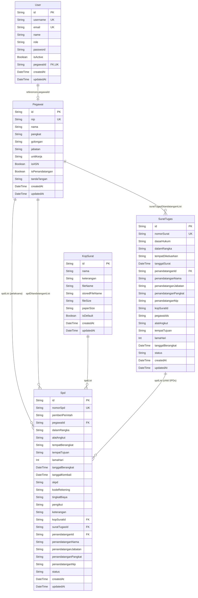
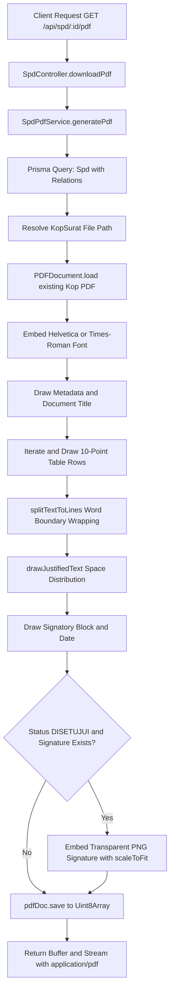
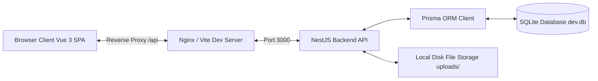
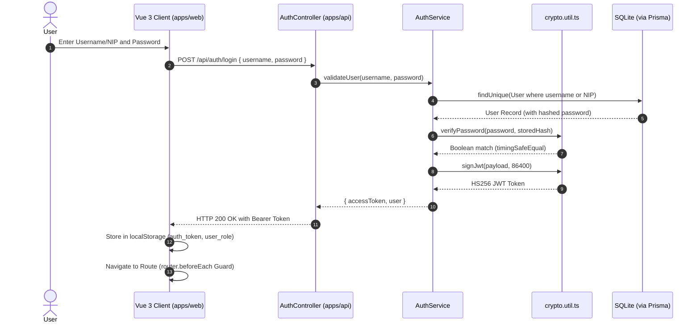
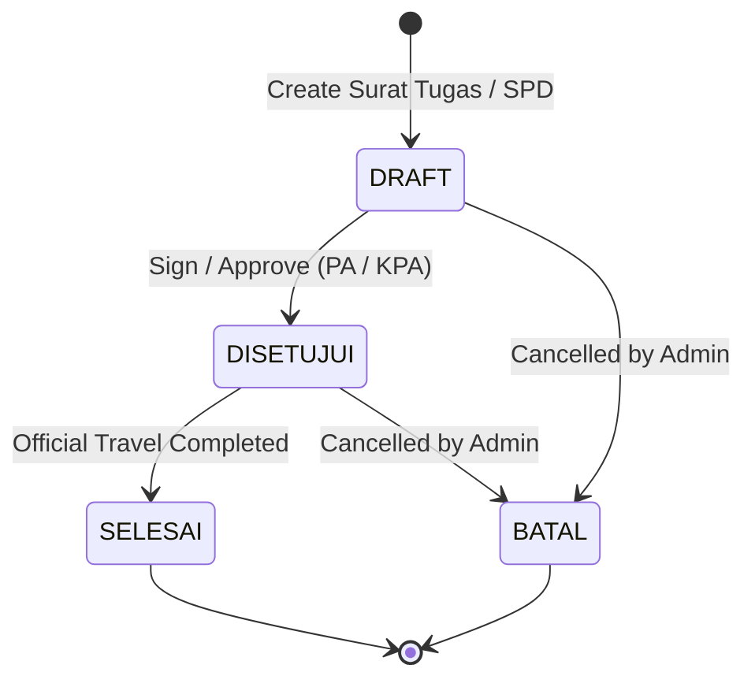
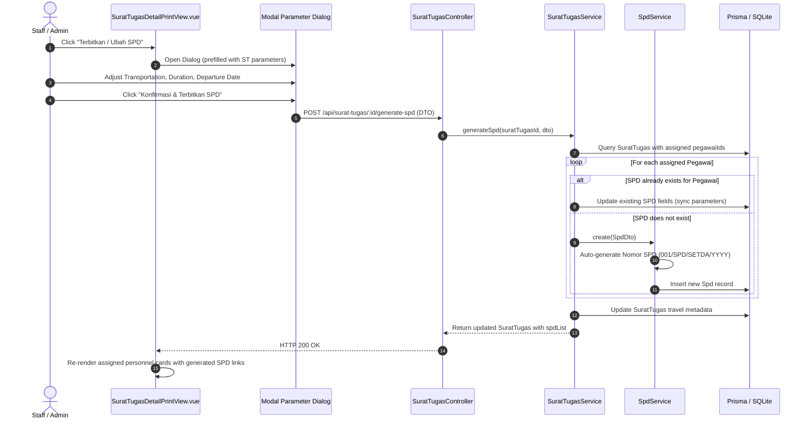

# Developer Documentation: SI-SPD Banggai Laut

This document provides technical reference for the Sistem Informasi Surat Perjalanan Dinas (SI-SPD) of the Regional Secretariat of Banggai Laut Regency (Sulawesi Tengah). It covers the database schema, UI/UX standards, PDF generation mechanics, and end-to-end application workflows.

---

## 1. Database Architecture and Table Structure

### 1.1 Overview

The persistence layer is managed using Prisma ORM with SQLite as the default relational database engine. The schema is defined in `apps/api/prisma/schema.prisma`. Primary keys across all entities use Collision-resistant Unique Identifiers (CUID).

### 1.2 Entity-Relationship Diagram



### 1.3 Entity Specifications

#### 1.3.1 Table `User`
Manages system authentication and role-based permissions.

| Column | Data Type | Nullable | Default | Constraints | Description |
|---|---|---|---|---|---|
| `id` | String | No | `cuid()` | Primary Key | Unique record identifier |
| `username` | String | No | None | Unique | Login identifier (NIP or alphanumeric username) |
| `email` | String | Yes | `null` | Unique | User email address |
| `name` | String | No | None | None | Display name of the user |
| `role` | String | No | `'USER'` | Enum Check | Values: `SUPER_ADMIN`, `ADMIN`, `PENANDATANGAN`, `STAFF`, `USER` |
| `password` | String | No | None | None | Scrypt-hashed password string (`salt:derivedKey`) |
| `isActive` | Boolean | No | `true` | None | Account activity toggle |
| `pegawaiId` | String | Yes | `null` | Unique, FK -> `Pegawai.id` | Relation to employee record; `ON DELETE SET NULL` |
| `createdAt` | DateTime | No | `now()` | None | Record creation timestamp |
| `updatedAt` | DateTime | No | Triggered | None | Record modification timestamp |

#### 1.3.2 Table `Pegawai`
Master record of civil servants (ASN) and official signatories within the Regional Secretariat.

| Column | Data Type | Nullable | Default | Constraints | Description |
|---|---|---|---|---|---|
| `id` | String | No | `cuid()` | Primary Key | Unique record identifier |
| `nip` | String | No | None | Unique | 18-digit Civil Servant Identification Number |
| `nama` | String | No | None | None | Full legal name including academic degrees |
| `pangkat` | String | No | None | None | Official rank (e.g., `Pembina Utama Muda`, `Penata`) |
| `golongan` | String | No | None | None | Civil service grade (e.g., `IV/c`, `III/a`) |
| `jabatan` | String | No | None | None | Official government position |
| `unitKerja` | String | No | `'Sekretariat Daerah'` | None | Organizational administrative unit |
| `isASN` | Boolean | No | `true` | None | ASN status indicator |
| `isPenandatangan` | Boolean | No | `false` | None | Flag indicating official signatory authorization |
| `tandaTangan` | String | Yes | `null` | None | Filename of uploaded transparent PNG signature image |
| `createdAt` | DateTime | No | `now()` | None | Record creation timestamp |
| `updatedAt` | DateTime | No | Triggered | None | Record modification timestamp |

#### 1.3.3 Table `KopSurat`
Stores metadata and file locations for official letterhead PDF templates.

| Column | Data Type | Nullable | Default | Constraints | Description |
|---|---|---|---|---|---|
| `id` | String | No | `cuid()` | Primary Key | Unique record identifier |
| `nama` | String | No | None | None | Letterhead template label |
| `keterangan` | String | Yes | `null` | None | Optional description of template scope |
| `fileName` | String | No | None | None | Original upload filename |
| `storedFileName` | String | No | None | None | Filename on disk (`uploads/kop-surat/kop-[timestamp].pdf`) |
| `fileSize` | String | No | None | None | Human-readable file size string |
| `paperSize` | String | No | `'A4'` | None | Detected paper size (`Legal`, `A4`, `F4 / Folio`) |
| `isDefault` | Boolean | No | `false` | None | System-wide default letterhead flag |
| `createdAt` | DateTime | No | `now()` | None | Record creation timestamp |
| `updatedAt` | DateTime | No | Triggered | None | Record modification timestamp |

#### 1.3.4 Table `SuratTugas`
Records official assignment orders authorizing official travel for one or multiple civil servants.

| Column | Data Type | Nullable | Default | Constraints | Description |
|---|---|---|---|---|---|
| `id` | String | No | `cuid()` | Primary Key | Unique record identifier |
| `nomorSurat` | String | No | None | Unique | Formal letter reference code (e.g., `090/001/ST-SETDA/2026`) |
| `dasarHukum` | String | No | Default Statute | None | Statutory reference empowering the assignment |
| `dalamRangka` | String | No | None | None | Purpose and task description |
| `tempatDikeluarkan` | String | No | `'Banggai'` | None | Issuing geographic location |
| `tanggalSurat` | DateTime | No | `now()` | None | Official letter issuance date |
| `penandatanganId` | String | Yes | `null` | FK -> `Pegawai.id` | Foreign key to signatory ASN; `ON DELETE SET NULL` |
| `penandatanganNama` | String | No | `'ARSID HAMIDI, SH'` | None | Signatory name snapshot |
| `penandatanganJabatan` | String | No | String | None | Signatory position title snapshot |
| `penandatanganPangkat` | String | No | `'Pembina, IV/a'` | None | Signatory rank snapshot |
| `penandatanganNip` | String | No | String | None | Signatory NIP snapshot |
| `kopSuratId` | String | Yes | `null` | None | Optional explicit letterhead reference ID |
| `pegawaiIds` | String | Yes | `null` | None | Serialized JSON array of assigned `Pegawai.id`s |
| `alatAngkut` | String | Yes | `null` | None | Transportation mode(s) |
| `tempatTujuan` | String | Yes | `null` | None | Destination location |
| `lamaHari` | Int | Yes | `1` | None | Duration in days |
| `tanggalBerangkat` | DateTime | Yes | `null` | None | Scheduled departure date |
| `status` | String | No | `'DRAFT'` | None | Lifecycle state (`DRAFT`, `DISETUJUI`, `SELESAI`, `BATAL`) |
| `createdAt` | DateTime | No | `now()` | None | Record creation timestamp |
| `updatedAt` | DateTime | No | Triggered | None | Record modification timestamp |

#### 1.3.5 Table `Spd`
Stores individual Surat Perjalanan Dinas records formatted to standard official specifications.

| Column | Data Type | Nullable | Default | Constraints | Description |
|---|---|---|---|---|---|
| `id` | String | No | `cuid()` | Primary Key | Unique record identifier |
| `nomorSpd` | String | No | None | Unique | Formal SPD reference (format: `XXX/SPD/SETDA/YYYY`) |
| `pemberiPerintah` | String | No | None | None | Authorizing authority (`Pengguna Anggaran (PA)` or `Kuasa Pengguna Anggaran (KPA)`) |
| `pegawaiId` | String | No | None | FK -> `Pegawai.id` | Relation to assigned traveling employee |
| `dalamRangka` | String | No | None | None | Travel purpose; supports newline-delimited multi-agenda |
| `alatAngkut` | String | No | None | None | Comma-delimited list of transportation modes |
| `tempatBerangkat` | String | No | None | None | Point of departure (default: `'Banggai'`) |
| `tempatTujuan` | String | No | None | None | Destination point |
| `lamaHari` | Int | No | None | Positive Int | Duration in days |
| `tanggalBerangkat` | DateTime | No | None | None | Departure timestamp |
| `tanggalKembali` | DateTime | No | None | None | Return timestamp (auto-calculated if omitted) |
| `skpd` | String | No | Bagian Umum SETDA | None | Regional work unit funding the travel |
| `kodeRekening` | String | Yes | `null` | None | Budget account classification code |
| `tingkatBiaya` | String | Yes | `null` | None | Budgetary allowance tier classification |
| `pengikut` | String | Yes | `null` | None | Serialized list or newline text of travel companions |
| `keterangan` | String | Yes | `null` | None | Supplementary notes or remarks |
| `kopSuratId` | String | Yes | `null` | FK -> `KopSurat.id` | Template reference; `ON DELETE SET NULL` |
| `suratTugasId` | String | Yes | `null` | FK -> `SuratTugas.id` | Parent assignment letter reference; `ON DELETE SET NULL` |
| `penandatanganId` | String | Yes | `null` | FK -> `Pegawai.id` | Signatory reference; `ON DELETE SET NULL` |
| `penandatanganNama` | String | Yes | `null` | None | Signatory name snapshot |
| `penandatanganJabatan` | String | Yes | `null` | None | Signatory position snapshot |
| `penandatanganPangkat` | String | Yes | `null` | None | Signatory rank snapshot |
| `penandatanganNip` | String | Yes | `null` | None | Signatory NIP snapshot |
| `status` | String | No | `'DRAFT'` | None | Status: `DRAFT`, `DISETUJUI`, `SELESAI`, `BATAL` |
| `createdAt` | DateTime | No | `now()` | None | Record creation timestamp |
| `updatedAt` | DateTime | No | Triggered | None | Record modification timestamp |

---

## 2. UI/UX Standards and Design System

### 2.1 Technology Stack & Architectural Foundation

The frontend application (`apps/web`) is built with:
- **Framework:** Vue 3 (Composition API with `<script setup lang="ts">`)
- **UI Component Library:** PrimeVue 4
- **CSS Architecture:** Tailwind CSS 3 with custom CSS Custom Properties
- **Theme Preset:** Custom `BanggaiLautCivicPreset` derived from `@primevue/themes/aura`
- **Iconography:** PrimeIcons (`primeicons/primeicons.css`)

### 2.2 Color Palettes and Tokens

The application enforces a Civic palette designed for institutional administrative software. Colors transition between Light and Dark mode using class-based switching (`.dark` on `document.documentElement`).

#### 2.2.1 CSS Variables Specification (`apps/web/src/style.css`)

| Token | Light Mode Value | Dark Mode Value | Semantic Role |
|---|---|---|---|
| `--color-primary` | `#0F4C81` (Civic Navy) | `#38BDF8` (Sky 400) | Primary brand color, primary buttons, active state |
| `--color-bg` | `#F8FAFC` (Slate 50) | `#0B132B` (Deep Navy) | Global canvas background |
| `--color-surface` | `#FFFFFF` | `#162238` (Dark Surface) | Cards, modals, sidebars, table containers |
| `--color-text-primary` | `#0F172A` (Slate 900) | `#F8FAFC` (Slate 50) | High-contrast body text, headings |
| `--color-text-muted` | `#64748B` (Slate 500) | `#94A3B8` (Slate 400) | Secondary labels, table headers, metadata |
| `--color-accent` | `#D97706` (Amber 600) | `#F59E0B` (Amber 500) | Warnings, draft badges, pending indicators |
| `--color-success` | `#059669` (Emerald 600) | `#10B981` (Emerald 500) | Success states, approved status badges |
| `--color-border` | `#E2E8F0` (Slate 200) | `#1E293B` (Slate 800) | Container outlines, table borders, dividers |
| `--color-primary-contrast` | `#FFFFFF` | `#0F172A` | Text rendered on top of `--color-primary` |

#### 2.2.2 PrimeVue Theme Preset (`apps/web/src/main.ts`)

```typescript
const BanggaiLautCivicPreset = definePreset(Aura, {
  semantic: {
    primary: {
      50: '#f0f6fa',
      100: '#dce8f3',
      200: '#bdd5e8',
      300: '#8eb9d8',
      400: '#5695c3',
      500: '#0F4C81',
      600: '#0d4373',
      700: '#0a365c',
      800: '#082a48',
      900: '#061f35',
      950: '#03111e',
    },
    colorScheme: {
      light: {
        primary: {
          color: '#0F4C81',
          contrastColor: '#FFFFFF',
          hoverColor: '#0d4373',
          activeColor: '#0a365c',
        },
        surface: {
          0: '#FFFFFF',
          50: '#F8FAFC',
          100: '#F1F5F9',
          200: '#E2E8F0',
          300: '#CBD5E1',
          400: '#94A3B8',
          500: '#64748B',
          600: '#475569',
          700: '#334155',
          800: '#1E293B',
          900: '#0F172A',
          950: '#020617',
        },
      },
      dark: {
        primary: {
          color: '#38BDF8',
          contrastColor: '#0F172A',
          hoverColor: '#7dd3fc',
          activeColor: '#0284c7',
        },
        surface: {
          0: '#162238',
          50: '#1A2740',
          100: '#1E293B',
          200: '#263859',
          300: '#334870',
          400: '#64748B',
          500: '#94A3B8',
          600: '#CBD5E1',
          700: '#E2E8F0',
          800: '#F1F5F9',
          900: '#F8FAFC',
          950: '#FFFFFF',
        },
      },
    },
  },
});
```

### 2.3 Typography Standards

The system maintains a separation between administrative UI typography and formal document typography:

1. **Administrative Interface Typography:**
   - Font Family: System sans-serif stack (`Inter`, system-ui, -apple-system, sans-serif)
   - Font Feature Settings: `'cv02', 'cv03', 'cv04', 'cv11'` for enhanced numeral and glyph clarity
   - Body Line Height: 1.5

2. **Official Government Document Typography (`SpdDetailPrintView.vue`):**
   - Font Family: Strict Serif stack (`'Times New Roman', Times, Georgia, serif !important`)
   - Document Text Color: Strict `#000000 !important` (completely isolated from UI dark mode)
   - Paper Background: Strict `#FFFFFF !important`
   - Document Base Sizing: 12pt (`16px @ 96 DPI`) with `1.35` line-height

### 2.4 Component Primitives (`apps/web/src/components/core/`)

All raw PrimeVue components are wrapped by custom governance primitives to ensure design uniformity:

- `GovButton`: Normalizes `severity`, `variant` (`outlined` / `text`), and `size` (`small` / `large`).
- `GovCard`: Enforces rounded corners (`0.75rem`), subtle borders, and background surface variables.
- `GovTable`: Custom-styled data table wrapper with fixed header, uppercase column descriptors, and responsive layout.
- `GovDatePicker`: Date picker with custom dark mode panel overrides, single/range mode, and Indonesian localization.
- `GovAutoComplete`: Async search input with debounce and chip-based selection for ASN profiles.
- `GovMultiSelect`: Chip-based selection input for multi-item arrays (e.g., transportation modes).
- `GovInputNumber`: Formatted integer input with automated verbal Indonesian number transformation (*angka terbilang*).
- `GovTextarea`: Auto-resizing textarea with integrated reactive character counter and limit enforcement.
- `GovToast`: Fixed overlay notification container.

### 2.5 Toast Notification and Feedback System

The application uses an overlay toast system via `GovToast.vue` and `useGovToast.ts`.

#### 2.5.1 Layout and Viewport Adaptability
The toast container is mounted at the root (`App.vue`) and styled via fixed positioning:
- **Navbar Offset:** Set to `top: 5rem !important` (`80px`) on desktop to prevent visual collision with the 64px (`h-16`) header bar.
- **Desktop (Viewport >= 769px):** Fixed width of `26rem` (`416px`) positioned at `right: 1.5rem`.
- **Tablet (Viewport <= 768px):** Auto width with boundaries `left: 1rem; right: 1rem; max-width: calc(100vw - 2rem)`.
- **Mobile (Viewport <= 480px):** Auto width with boundaries `left: 0.75rem; right: 0.75rem; max-width: calc(100vw - 1.5rem)`.

#### 2.5.2 Lifecycle Durations
- `toast.success(message, summary?, 4000)`
- `toast.info(message, summary?, 4000)`
- `toast.warn(message, summary?, 4500)`
- `toast.error(message, summary?, 5000)`

### 2.6 Physical Document Layout & Print Media Standard

The document renderer (`apps/web/src/views/SpdDetailPrintView.vue`) conforms to Indonesian Ministry of Home Affairs (Permendagri) and Regional Regulations (Perbup Banggai Laut):

#### 2.6.1 Paper Dimensions
- **Legal / F4 (Primary):** `215.9mm` x `355.6mm` (`8.5in x 14in` / `612pt x 1008pt`)
- **A4 (Secondary):** `210.0mm` x `297.0mm` (`595.28pt x 841.89pt`)

#### 2.6.2 Physical Margins
- **Left Margin:** `16mm` (`60px` / `45.35pt`)
- **Right Margin:** `16mm` (`60px` / `45.35pt`)
- **Top Margin (With Letterhead):** `12mm` (`45px` / `34.0pt`)
- **Top Margin (Without Letterhead, for pre-printed blanks):** `48mm` (`181px` / `136.0pt`)
- **Bottom Margin:** `20mm` (`75px` / `56.7pt`)

#### 2.6.3 10-Point Table Proportions
Total Table Width: `690px` (or `522pt` in PDF generator)
- **Column 1 (Item Number):** `36px` (~5.2%), centered text, right border omitted.
- **Column 2 (Description):** `287px` (~41.6%), left border omitted.
- **Column 3 (Value):** `367px` (~53.2%), text justified.

#### 2.6.4 Print Isolation Rules (`@media print`)
When invoking `window.print()`:
- Navigation bars, sidebars, buttons, alerts, and breadcrumbs are hidden via `.no-print` and `display: none !important`.
- Background elements are forced transparent (`background: transparent !important`).
- Document containers drop shadows and margins (`box-shadow: none !important; margin: 0 !important`).
- Page breaks inside the document sheet are suppressed (`page-break-inside: avoid; page-break-after: avoid`).

---

## 3. PDF Generation Architecture and Mechanics

### 3.1 Architecture Overview

PDF generation is implemented in the NestJS backend (`apps/api/src/spd/spd-pdf.service.ts` and `apps/api/src/surat-tugas/surat-tugas-pdf.service.ts`). The system uses `pdf-lib` to perform vector and raster canvas operations directly on the PDF binary buffer, avoiding the memory overhead of headless Chromium processes.



### 3.2 Coordinate System and Dimensions

`pdf-lib` uses standard PostScript points where:
$$\text{1 point} = \frac{1}{72} \text{ inch} \approx 0.352778 \text{ mm}$$

Origin $(0, 0)$ is situated at the bottom-left corner of the page. Y-coordinates increase upwards.
- **Legal Page Size:** Width = `612 pt`, Height = `1008 pt`
- **A4 Page Size:** Width = `595.28 pt`, Height = `841.89 pt`

### 3.3 Dynamic Paper Size Detection

The utility `detectPdfPaperSize` (`apps/api/src/kop-surat/pdf-size.util.ts`) evaluates the binary buffer of uploaded PDF letterheads:

1. Scans ASCII string representation for `/MediaBox [ x1 y1 x2 y2 ]`.
2. If missing (compressed object stream), parses deflate streams with `zlib.inflateSync` to extract the inflated MediaBox.
3. Computes width and height in points and matches against standard tolerances ($\pm 6\text{ pt}$):
   - Legal: $612 \times 1008\text{ pt}$
   - A4: $595.28 \times 841.89\text{ pt}$
   - F4 / Folio: $595.28 \times 935.43\text{ pt}$ or $612 \times 936\text{ pt}$

### 3.4 Vector Drawing Pipeline

#### 3.4.1 Baseline Calculation Under Letterhead
The official double-border line of the letterhead ends at approximately $Y = 879\text{ pt}$ on a Legal sheet. The dynamic start position is calculated as:
```typescript
const startY = height > 900 ? 864 : height - 140;
```

#### 3.4.2 Text Wrapping Algorithm (`splitTextToLines`)
Wraps strings on word boundaries against maximum column widths:
```typescript
private splitTextToLines(text: string, font: PDFFont, fontSize: number, maxWidth: number): string[] {
  if (!text) return [];
  const words = text.split(/\s+/);
  const lines: string[] = [];
  let currentLine = '';

  for (const word of words) {
    const testLine = currentLine ? `${currentLine} ${word}` : word;
    const width = font.widthOfTextAtSize(testLine, fontSize);
    if (width <= maxWidth) {
      currentLine = testLine;
    } else {
      if (currentLine) lines.push(currentLine);
      currentLine = word;
    }
  }
  if (currentLine) lines.push(currentLine);
  return lines;
}
```

#### 3.4.3 Justified Text Algorithm (`drawJustifiedText`)
Distributes additional whitespace evenly across words in a line to produce justified text:
```typescript
private drawJustifiedText(
  page: PDFPage,
  line: string,
  x: number,
  y: number,
  fontSize: number,
  font: PDFFont,
  color: any,
  targetWidth: number,
  isLastLine: boolean = false,
): void {
  const trimmed = line.trim();
  const words = trimmed.split(/\s+/);

  if (isLastLine || words.length <= 1) {
    page.drawText(trimmed, { x, y, size: fontSize, font, color });
    return;
  }

  const wordsTotalWidth = words.reduce((acc, w) => acc + font.widthOfTextAtSize(w, fontSize), 0);
  const spaceToDistribute = targetWidth - wordsTotalWidth;
  const gapWidth = spaceToDistribute / (words.length - 1);
  const normalSpaceWidth = font.widthOfTextAtSize(' ', fontSize);

  // Fallback if spacing produces distortion
  if (gapWidth > normalSpaceWidth * 3.5 || gapWidth < normalSpaceWidth * 0.5) {
    page.drawText(trimmed, { x, y, size: fontSize, font, color });
    return;
  }

  let curX = x;
  for (let i = 0; i < words.length; i++) {
    page.drawText(words[i], { x: curX, y, size: fontSize, font, color });
    curX += font.widthOfTextAtSize(words[i], fontSize) + gapWidth;
  }
}
```

#### 3.4.4 Hanging Indent Implementation (Multi-Agenda Items)
In Point 4 (*Maksud Perjalanan Dinas*), when multiple agenda items are present:
1. The colon `:` is rendered at fixed coordinate $X = \text{col3X} + \text{cellPaddingX}$.
2. Item prefix index (e.g. `1. `, `2. `) occupies $16\text{ pt}$ width at $X = \text{colonX} + 10\text{ pt}$.
3. Text body wraps with width offset by $16\text{ pt}$, keeping wrapped subsequent lines vertically aligned with the first line of text rather than the index number.

#### 3.4.5 Companion Sub-Table Rendering (Point 8)
Row 8 (*Nama Pengikut*) is rendered with a fixed height of $96\text{ pt}$:
- Title banner height: $21\text{ pt}$
- Sub-header row height: $19\text{ pt}$ (`No`, `Nama`, `Umur`, `Keterangan`)
- Body space: $56\text{ pt}$ providing 3 numbered sub-rows ($15\text{ pt}$ each) with bottom boundary clearance.
- Vertical separator divides `Umur` and `Keterangan` down the middle of Column 3 ($X = \text{col3X} + \frac{\text{colWidths}[2]}{2}$).

### 3.5 Digital Signature Embedding

Digital signatures are conditionally embedded when:
1. Document status is `DISETUJUI`.
2. The resolving signatory record has a defined `tandaTangan` filename.

#### 3.5.1 Path Resolution Hierarchy
The service searches filesystem locations in order:
1. `process.env.SIGNATURE_UPLOAD_DIR`
2. `apps/api/uploads/signatures/<fileName>`
3. `uploads/signatures/<fileName>`
4. Production relative path offsets (`../../uploads/signatures`)

#### 3.5.2 Proportional Scaling & Placement
```typescript
const sigBytes = fs.readFileSync(targetPath);
const sigImage = await pdfDoc.embedPng(sigBytes);
const sigDims = sigImage.scaleToFit(140, 70);

page.drawImage(sigImage, {
  x: signX + 5,
  y: currentY + 12,
  width: sigDims.width,
  height: sigDims.height,
});
```
`scaleToFit` constrains width to $140\text{ pt}$ and height to $70\text{ pt}$ while maintaining aspect ratio. The signature image is positioned $12\text{ pt}$ above the text baseline of the signatory name.

### 3.6 HTTP Streaming Output

The controller serves generated buffers with standard binary streaming headers:
```typescript
res.setHeader('Content-Type', 'application/pdf');
res.setHeader('Content-Disposition', `inline; filename="${fileName}"`);
res.send(buffer);
```

---

## 4. Application Workflow and Architecture

### 4.1 System Topology



### 4.2 Authentication and Authorization Lifecycle



#### 4.2.1 Cryptographic Implementations (`apps/api/src/auth/crypto.util.ts`)
- **Password Hashing:** Implemented with Node.js standard library `scryptSync` using a 16-byte random salt and 64-byte key length. Stored format: `${salt}:${hash}`.
- **Password Verification:** Uses `timingSafeEqual` between derived key buffer and stored hash buffer to prevent timing attacks.
- **JWT Generation & Verification:** Custom implementation using Node.js `createHmac('sha256', secret)` with Base64URL encoding. Avoids external dependencies while ensuring HMAC-SHA256 integrity. Secret length minimum of 32 characters enforced in production.

#### 4.2.2 Role Hierarchy and Access Levels
Roles defined in `@si-setda/shared-types`:
1. `SUPER_ADMIN` (Weight: 5): Unrestricted administrative access across all modules.
2. `ADMIN` (Weight: 4): System administration, master data, user accounts, and letters.
3. `PENANDATANGAN` (Weight: 3): Signatory authority; access restricted to documents assigned to their NIP/name/title.
4. `STAFF` (Weight: 2): Operational data entry, document draft creation, and updates.
5. `USER` (Weight: 1): Read-only document viewing for assigned civil servants.

### 4.3 Document Lifecycle: Surat Tugas and SPD



### 4.4 Flow: Surat Tugas to On-Demand SPD Generation



#### 4.4.1 Dynamic Numbering Algorithm
When `nomorSpd` is not manually supplied, `SpdService.create` evaluates the current calendar year sequence:
```typescript
const year = new Date().getFullYear();
const count = await this.prisma.spd.count({
  where: {
    createdAt: {
      gte: new Date(`${year}-01-01T00:00:00.000Z`),
      lte: new Date(`${year}-12-31T23:59:59.999Z`),
    },
  },
});
const seq = String(count + 1).padStart(3, '0');
let nomorSpd = `${seq}/SPD/SETDA/${year}`;

// Collision prevention check
const existing = await this.prisma.spd.findUnique({ where: { nomorSpd } });
if (existing) {
  nomorSpd = `${String(count + 2).padStart(3, '0')}/SPD/SETDA/${year}`;
}
```

### 4.5 Row-Level Security for Signatories (`PENANDATANGAN`)

When an authenticated user has the `PENANDATANGAN` role:
1. `SpdService.findAll` and `SuratTugasService.findAll` inject conditional `where` clauses (`buildSignerOrConditions`).
2. Evaluates equality against `penandatanganId`, clean numerical NIP match against `penandatanganNip`, substring match on `penandatanganNama`, and position substring on `penandatanganJabatan`.
3. `findById` executes `verifySignerAccess`; attempts to read unassigned documents trigger an immediate `ForbiddenException` (HTTP 403).

### 4.6 Reporting and CSV Export Pipeline

Exporting data to CSV (`DaftarSpdView.vue` and `DaftarSuratTugasView.vue`) is executed entirely client-side to minimize server load:
1. Fetches filtered dataset from REST API.
2. Maps entity objects into standardized tabular columns with comma and quote escaping.
3. Prepends Unicode Byte Order Mark (`\uFEFF`) to enforce UTF-8 parsing in Microsoft Excel.
4. Generates an in-memory `Blob` and triggers automated download via temporary anchor element (`<a download="Rekap_SPD_Banggai_Laut_[DATE].csv">`).
