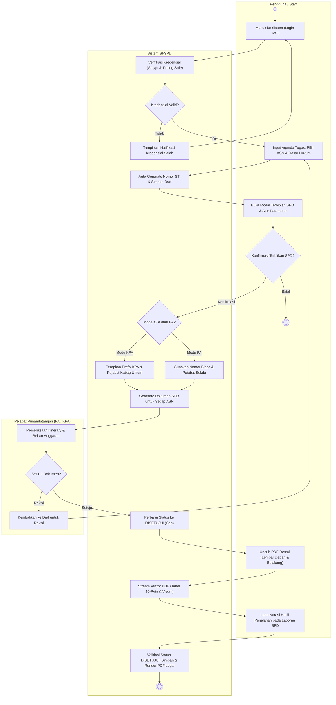
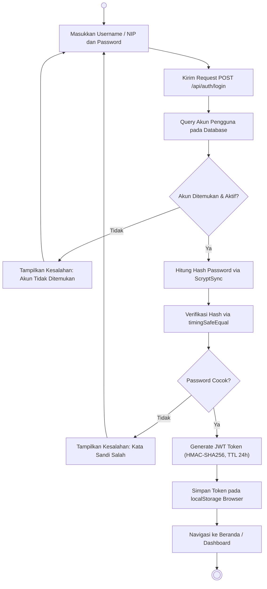
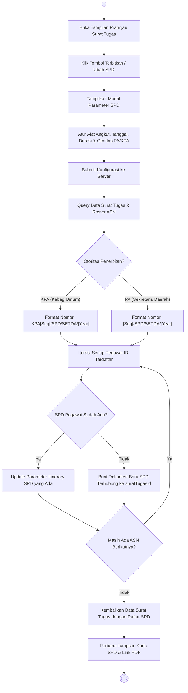
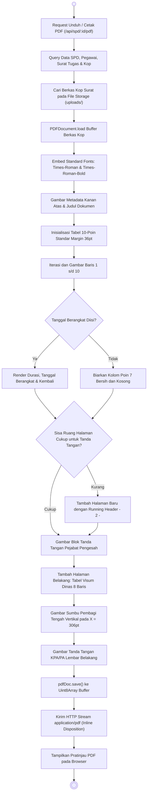
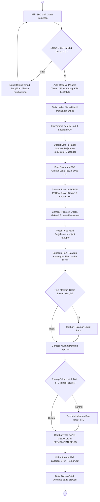

# Activity Diagram Specification: SI-SPD Banggai Laut

This document defines the behavioral Activity Diagrams and operational workflows for the Sistem Informasi Surat Perjalanan Dinas (SI-SPD) platform. It provides cross-functional swimlane maps illustrating human-to-system interactions, branching logic, asynchronous states, and document lifecycles. The visual Draw.io diagram file is available at [`docs/activity-diagram.drawio`](activity-diagram.drawio).

---

## 1. Notation and Modeling Standards

The activity diagrams adhere to standard UML 2.0 Activity Diagram specifications:
- **Initial Node:** Denotes the invocation entry point of a business process (solid circle).
- **Action State:** Represents an atomic executable operation or computational task (rounded rectangle).
- **Decision Node:** Evaluates runtime conditional guards with mutually exclusive outgoing branches (diamond).
- **Merge Node:** Recombines alternate control paths into a unified execution flow (diamond).
- **Swimlane / Partition:** Allocates operational responsibility across architectural actors or subsystems (vertical column).
- **Activity Final Node:** Terminates control flow across all active branches (concentric circle).

---

## 2. Activity Diagram 1: End-to-End Travel Document Issuance & Verification Map

The primary cross-functional activity map below coordinates user actions, automated backend procedures, and executive approval lifecycles across three distinct swimlanes:

---

## 3. Activity Diagram 2: User Authentication & Session Security Flow

This activity map models credential capture, brute-force mitigation, timing-safe verification, and JWT session initialization:

---

## 4. Activity Diagram 3: On-Demand Child SPD Generation & Parameter Synchronization

This workflow details how administrative staff issue individual child SPDs from an existing multi-assignee assignment order:

---

## 5. Activity Diagram 4: Official Document Vector PDF Compilation & Duplex Layout

This activity map describes how `SpdPdfService` assembles the front 10-point travel order table and reverse visum transit table:

---

## 6. Activity Diagram 5: Laporan Perjalanan Dinas Lifecycle & Reporting

This process controls narrative accountability reporting submitted after official travel:

---

## 7. Decision Guard Logic Matrix

| Decision Node | Evaluation Criteria | True Branch Flow | False / Alternate Branch Flow |
|---|---|---|---|
| **`DecAuth`** | `user != null && timingSafeEqual(hash)` | Proceed to administrative workspace. | Return HTTP 401 & display error. |
| **`DecConfirmSPD`** | User clicks confirm in parameter dialog. | Invoke server SPD generation. | Abort modal; no records created. |
| **`DecKpaMode`** | `pemberiPerintah.includes('Kuasa')` | Prepend `KPA` prefix; bind Kabag Umum. | Standard sequence; bind Sekda. |
| **`DecApprove`** | PA/KPA verifies trip budget & itinerary. | Transition document to `DISETUJUI`. | Mark as `DRAFT` for correction or `BATAL`. |
| **`CheckEligibility`** | `status === 'DISETUJUI' && lamaHari > 0` | Open narrative report authoring editor. | Disable actions with warning pill. |
| **`CheckSignSpace`** | Remaining vertical space $\ge 110\text{ pt}$ | Render signature block on current page. | Append new page with running header. |

---

## 8. Visual Diagram File

The native Draw.io XML diagram matching this layout is stored at:
- **File Path:** [`docs/activity-diagram.drawio`](activity-diagram.drawio)
- **Format:** Native Draw.io XML structured with 3 vertical cross-functional swimlanes (`Pengguna / Staff`, `Sistem SI-SPD`, `Pejabat Penandatangan`), start/end nodes, decision diamonds, and sequential activity flows importable into [app.diagrams.net](https://app.diagrams.net).
