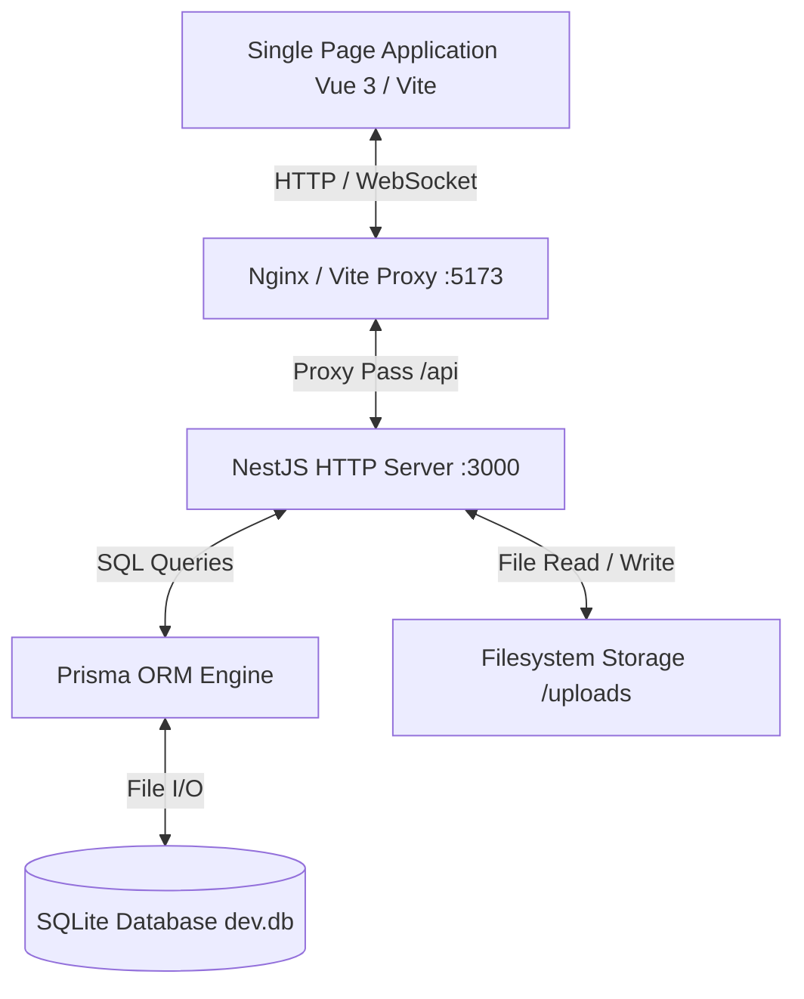
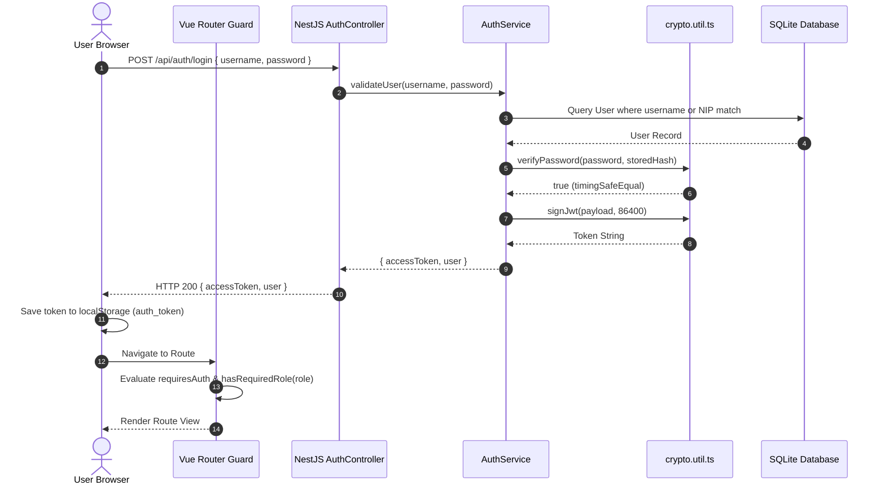
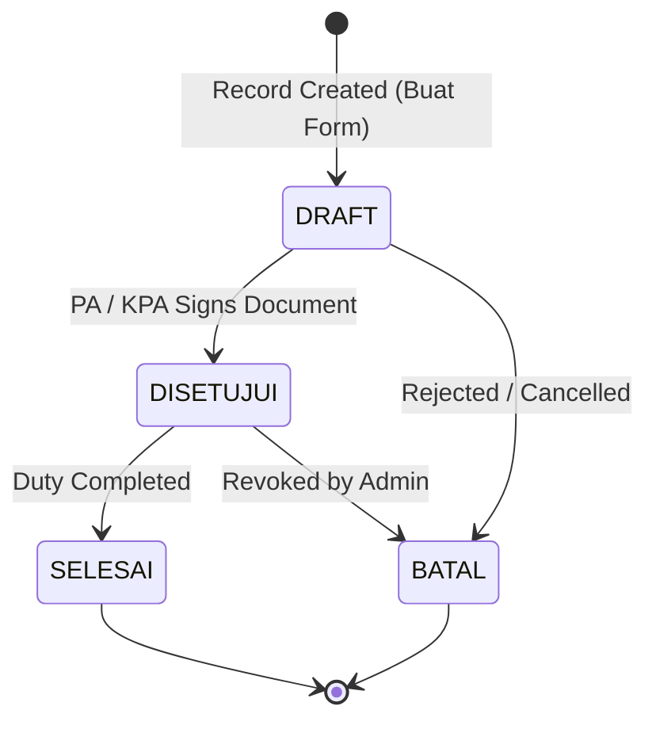
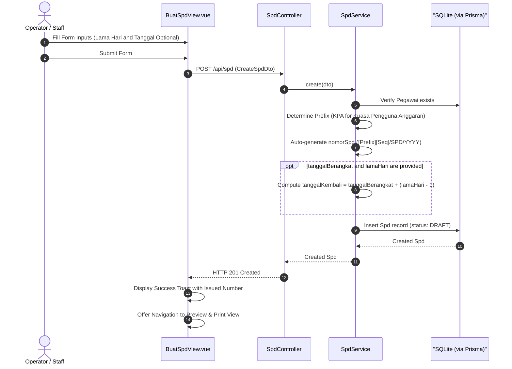
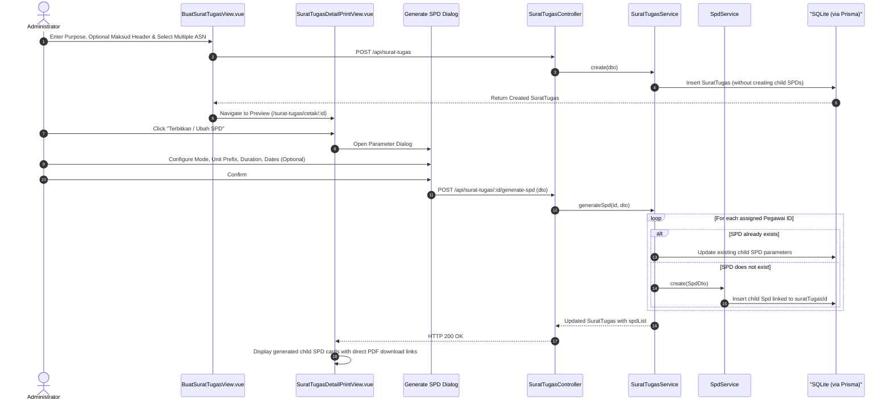
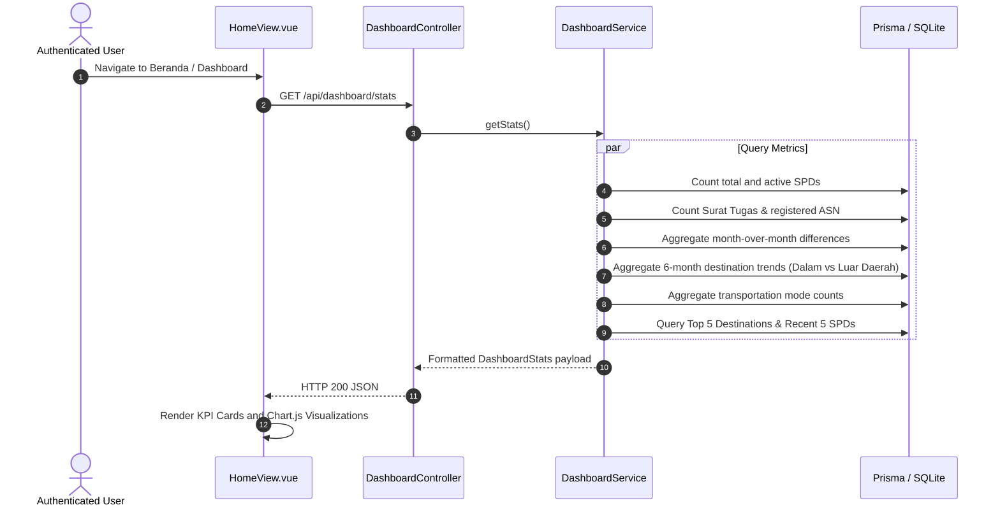

# Application Flow and System Architecture

This document describes the runtime execution flows, authentication lifecycles, document state transitions, and business processes in the SI-SPD platform.

---

## 1. System Architecture Topology

The application is structured as a monorepo managed by Turborepo and pnpm workspaces:

---

## 2. Authentication and Authorization Flow

### 2.1 Request Header Injection (`apiFetch`)
All client network requests route through `apps/web/src/utils/api.ts`:
1. Injects `x-app-client: si-spd-web` application signature.
2. Injects `Authorization: Bearer <token>` from `localStorage`.
3. Intercepts HTTP 401 Unauthorized responses to purge session storage and route to `/login`.

### 2.2 Backend Guards and Role Hierarchy
- `AuthGuard` (`apps/api/src/auth/auth.guard.ts`): Parses the Authorization Bearer header, validates JWT integrity via HMAC-SHA256, sets `req.user`, and verifies role permissions against `@Roles(...)` metadata.
- **RBAC Roles:**
  1. `SUPER_ADMIN` (Weight: 4): Full administrative and system management privileges.
  2. `ADMIN` (Weight: 3): User management, master data, and document operations.
  3. `STAFF` (Weight: 2): Operational data entry, drafting, and document updates.
  4. `USER` (Weight: 1): Standard read-only access for assigned personnel.

---

## 3. Document Lifecycles

### 3.1 State Transition Diagram

Both Surat Tugas and SPD share the following state machine:

### 3.2 State Definitions
- `DRAFT`: Initial editable state. Document can be altered, removed, or reviewed.
- `DISETUJUI`: Document has been formally approved and issued. In this state, official signatory titles render according to institutional governance rules.
- `SELESAI`: Assigned travel has occurred and reporting obligations are fulfilled.
- `BATAL`: Document was cancelled or revoked.

---

## 4. End-to-End Business Processes

### 4.1 Process 1: Standalone SPD Creation

### 4.2 Process 2: Surat Tugas Creation and On-Demand SPD Generation

### 4.3 Process 3: Parameter Synchronization on Surat Tugas Edit
When an existing Surat Tugas is updated via `PUT /api/surat-tugas/:id`:
1. If `dalamRangka`, `tempatDikeluarkan`, `kopSuratId`, or signatory information are modified, the service updates all active child SPD records linked to that `suratTugasId`.
2. If new personnel are added to `pegawaiIds` of a Surat Tugas that has active child SPDs, the system generates SPD records for the newly added personnel.
3. If personnel are removed from `pegawaiIds`, the corresponding child SPD records are pruned.

### 4.4 Process 4: Dashboard Analytics & Statistics (`DashboardModule`)

- **KPI Cards:** Total SPD, Active SPD, Pelaksana ASN, and Total Surat Tugas. Budget metrics are excluded.
- **Geographic Classification:** Travel destinations containing local terms (*Banggai, Banggai Laut, Bokan, Labobo, Bangkurung*) are grouped as *Dalam Wilayah*; all others are grouped as *Luar Daerah*.
- **Transportation Breakdown:** Aggregates records into Pesawat Udara, Kapal Laut / Feri, Speedboat Pemda, and Kendaraan Darat.

### 4.5 Process 5: Non-Collate Batch Printing Pipeline
1. In `DaftarSpdView.vue`, the user selects multiple documents using row checkboxes.
2. The user selects **Cetak Terpilih (Batch Non-Collate)**.
3. The frontend requests `POST /api/spd/bulk/pdf` with payload `{ ids: string[], sequence: 'non-collate' }`.
4. `SpdPdfService.generateBulkPdf`:
   - Loads all target documents into memory.
   - Appends all Front Sheets (Page 1 of Document 1..N) sequentially.
   - Appends all Back Sheets (Page 2 of Document 1..N) sequentially.
5. The unified PDF stream returns to the browser for duplex printing.

### 4.6 Process 6: Client-Side Tabular Data Export (CSV)
1. User clicks "Ekspor CSV" on `DaftarSpdView.vue` or `DaftarSuratTugasView.vue`.
2. Filtered data set is collected from reactive table state.
3. Fields are converted to RFC 4180-compliant comma-separated rows.
4. Output is encoded with UTF-8 BOM (`\uFEFF`) to prevent character distortion in spreadsheet software.
5. Automated anchor element triggers download as `Rekap_SPD_Banggai_Laut_[YYYY-MM-DD].csv`.
