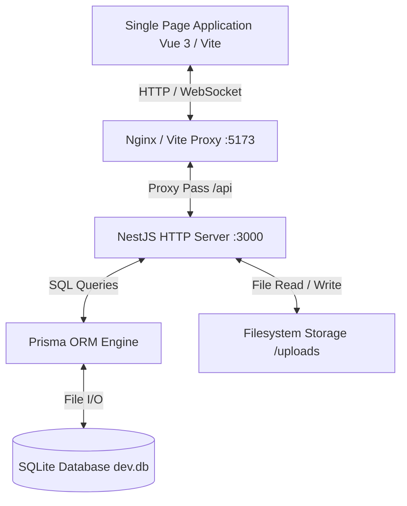
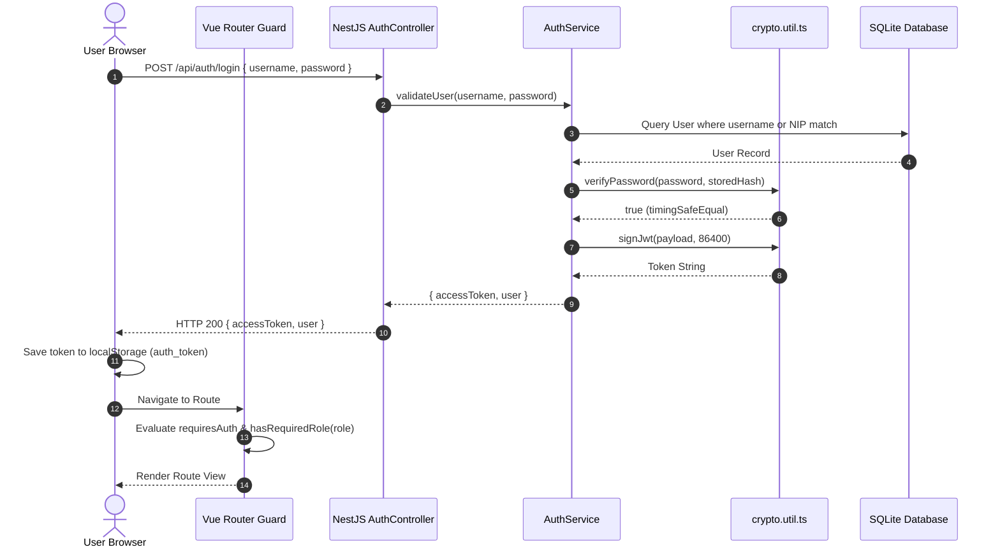
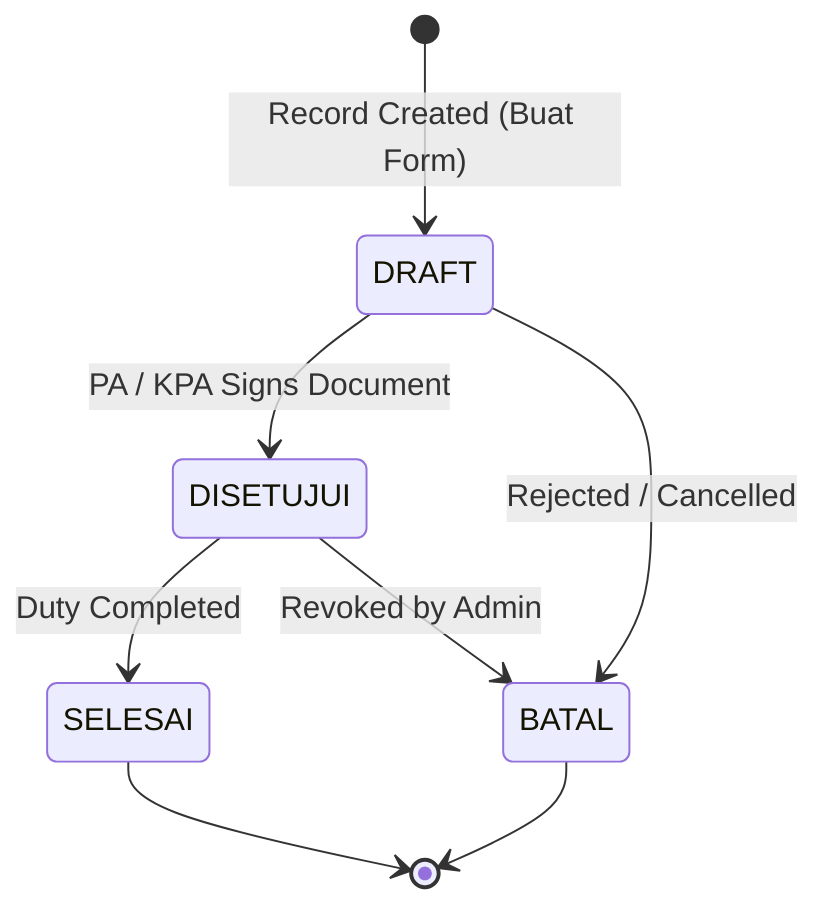
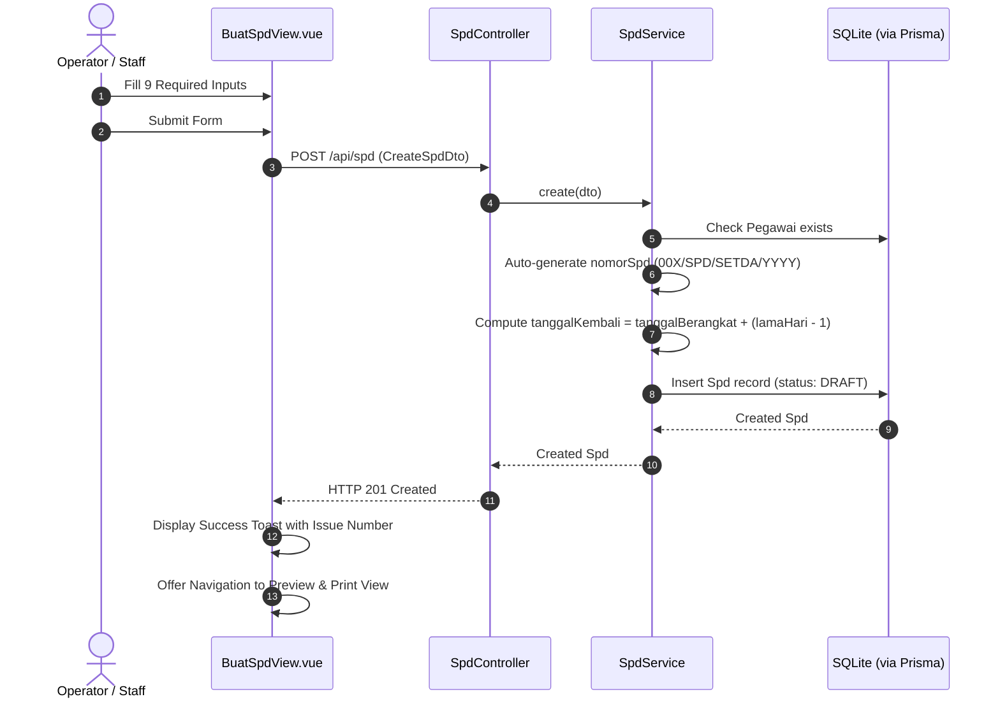
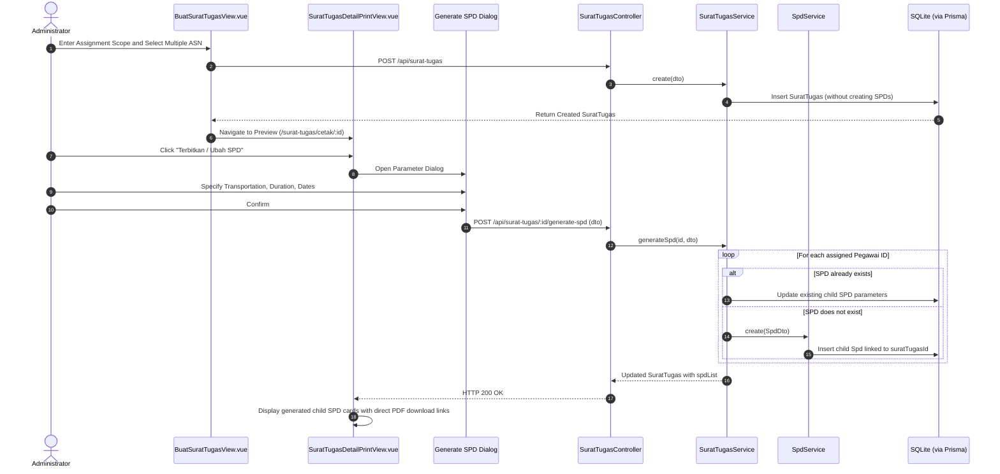

# Application Flow and System Architecture

This document describes the runtime execution flows, authentication lifecycles, document state transitions, and business processes in the SI-SPD platform.

---

## 1. System Architecture Topology

The application is structured as a monorepo managed by Turborepo and pnpm workspaces:

---

## 2. Authentication and Authorization Flow

### 2.1 Request Header Injection (`apiFetch`)
All client network requests route through `apps/web/src/utils/api.ts`:
1. Injects `x-app-client: si-spd-web` application signature.
2. Injects `Authorization: Bearer <token>` from `localStorage`.
3. Intercepts HTTP 401 Unauthorized responses to purge session storage and route to `/login`.

### 2.2 Backend Guards
- `AuthGuard` (`apps/api/src/auth/auth.guard.ts`): Parses the Authorization Bearer header, validates JWT integrity via HMAC-SHA256, checks expiration, and sets `req.user`.
- `RolesGuard` (`apps/api/src/auth/roles.guard.ts`): Reads `@Roles(...)` metadata and verifies user role authorization against the defined permissions list.

---

## 3. Document Lifecycles

### 3.1 State Transition Diagram

Both Surat Tugas and SPD share the following state machine:

### 3.2 State Definitions
- `DRAFT`: Initial editable state. Document can be altered, removed, or reviewed.
- `DISETUJUI`: Document has been formally approved and signed. In this state, the PDF engine renders the signatory's transparent digital signature image.
- `SELESAI`: Assigned travel has occurred and reporting obligations are fulfilled.
- `BATAL`: Document was cancelled or revoked.

---

## 4. End-to-End Business Processes

### 4.1 Process 1: Standalone SPD Creation

### 4.2 Process 2: Surat Tugas Creation and On-Demand SPD Generation

### 4.3 Process 3: Parameter Synchronization on Surat Tugas Edit
When an existing Surat Tugas is updated via `PUT /api/surat-tugas/:id`:
1. If `dalamRangka`, `tempatTujuan`, `lamaHari`, `tanggalBerangkat`, or `alatAngkut` are modified, the service updates all active child SPD records linked to that `suratTugasId`.
2. If new personnel are added to `pegawaiIds` of a Surat Tugas that has active child SPDs, the system generates SPD records for the newly added personnel.
3. If personnel are removed from `pegawaiIds`, the corresponding child SPD records are pruned.

### 4.4 Process 4: Signatory-Based Row-Level Access (`PENANDATANGAN`)
When a user logs in with role `PENANDATANGAN`:
1. `SpdService.findAll` and `SuratTugasService.findAll` inject conditional query filters matching the user's `pegawaiId`, NIP digits, full name substrings, or position strings.
2. In `findById`, `verifySignerAccess` checks if the requesting signatory matches the document's assigned signatory. Unmatched requests throw an immediate `ForbiddenException` (HTTP 403).

### 4.5 Process 5: Client-Side Tabular Data Export (CSV)
1. User clicks "Ekspor CSV" on `DaftarSpdView.vue` or `DaftarSuratTugasView.vue`.
2. The current filtered data set is collected from reactive state.
3. Fields are converted to RFC 4180-compliant comma-separated rows.
4. Output is encoded with UTF-8 BOM (`\uFEFF`) to prevent character distortion in Microsoft Excel.
5. An anchor element triggers an instant download with format `Rekap_SPD_Banggai_Laut_[YYYY-MM-DD].csv`.
