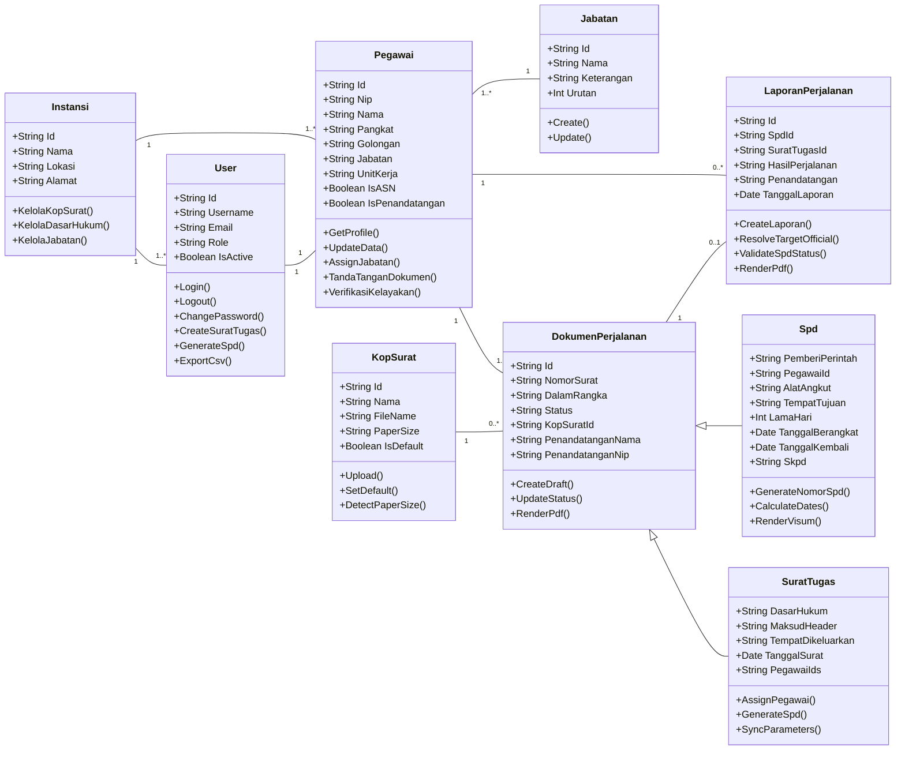

# UML Class Diagram Specification: SI-SPD Banggai Laut

This document presents the object-oriented UML Class Diagram for the Sistem Informasi Surat Perjalanan Dinas (SI-SPD) platform. It follows the standard 3-compartment UML specification (Class Name, Attributes, and Operations) with explicit multiplicities and generalization hierarchies. The visual Draw.io diagram file is available at [`docs/class-diagram.drawio`](class-diagram.drawio).

---

## 1. Domain Model Class Diagram

The following diagram models the domain entities, business operations, generalization relationships, and association multiplicities:

---

## 2. Class Definitions and Structural Responsibilities

### 2.1 `Instansi` (Governing Organization)
Represents the regional government secretariat (`Sekretariat Daerah Kabupaten Banggai Laut`) acting as the administrative root entity.
- **Attributes:**
  - `+Id: string`: Unique institutional code.
  - `+Nama: string`: Official legal entity name.
  - `+Lokasi: string`: Administrative seat (`Banggai`).
  - `+Alamat: string`: Physical headquarters location.
- **Operations:**
  - `+KelolaKopSurat()`: Configures official PDF letterhead graphic templates.
  - `+KelolaDasarHukum()`: Maintains statutory legislative references.
  - `+KelolaJabatan()`: Defines organizational echelon hierarchies.

### 2.2 `Pegawai` (Civil Servant / Personnel)
Represents government employees executing travel or authorizing official orders.
- **Attributes:**
  - `+Id: string`: Primary identifier.
  - `+Nip: string`: 18-digit Civil Servant Identification Number.
  - `+Nama: string`: Full legal name with academic degrees.
  - `+Pangkat: string`: Official rank (e.g. *Pembina Utama Muda*).
  - `+Golongan: string`: Civil service grade (e.g. *IV/c*).
  - `+Jabatan: string`: Structural or functional title snapshot.
  - `+UnitKerja: string`: Work unit (*Sekretariat Daerah*).
  - `+IsASN: boolean`: Flag identifying permanent civil servants vs contract staff.
  - `+IsPenandatangan: boolean`: Flag granting document signing clearance.
- **Operations:**
  - `+GetProfile()`: Returns employee data.
  - `+UpdateData()`: Updates rank, title, and profile details.
  - `+AssignJabatan()`: Links employee to official position master.
  - `+TandaTanganDokumen()`: Executes formal sign-off for PA or KPA.
  - `+VerifikasiKelayakan()`: Validates whether employee is eligible for travel assignments.

### 2.3 `User` (System Operator Account)
Represents authenticated system accounts with role-based permissions (`SUPER_ADMIN`, `ADMIN`, `STAFF`, `USER`).
- **Attributes:**
  - `+Id: string`: Unique account identifier.
  - `+Username: string`: Login identifier or employee NIP.
  - `+Email: string`: Optional email address.
  - `+Role: string`: RBAC permission level.
  - `+IsActive: boolean`: Account activation status.
- **Operations:**
  - `+Login()`: Authenticates credentials via salted Scrypt hashing and issues JWT.
  - `+Logout()`: Terminates active session.
  - `+ChangePassword()`: Updates hashed credentials with timing-safe validation.
  - `+CreateSuratTugas()`: Initiates new duty assignment order draft.
  - `+GenerateSpd()`: Triggers child SPD generation with parameter synchronization.
  - `+ExportCsv()`: Exports filtered tabular data to UTF-8 CSV format.

### 2.4 `DokumenPerjalanan` (Abstract Travel Document Base)
Abstract generalization encapsulating common attributes and behaviors shared by official travel records.
- **Attributes:**
  - `+Id: string`: Document primary key.
  - `+NomorSurat: string`: Official reference code.
  - `+DalamRangka: string`: Purpose and duty assignment description.
  - `+Status: string`: Lifecycle state (`DRAFT`, `DISETUJUI`, `SELESAI`, `BATAL`).
  - `+KopSuratId: string`: Reference to active letterhead template.
  - `+PenandatanganNama: string`: Snapshot of authorizing official.
  - `+PenandatanganNip: string`: Snapshot of authorizing official NIP.
- **Operations:**
  - `+CreateDraft()`: Initializes document in editable state.
  - `+UpdateStatus()`: Transitions document through approval lifecycles.
  - `+RenderPdf()`: Abstract method executed by vector PDF generation engines.

### 2.5 `SuratTugas` (Assignment Order)
Specialized travel document authorizing single or multiple civil servants to perform official travel.
- **Inherits from:** `DokumenPerjalanan`
- **Attributes:**
  - `+DasarHukum: string`: Statutory basis references.
  - `+MaksudHeader: string`: Optional unnumbered introductory header for multi-agenda tasks.
  - `+TempatDikeluarkan: string`: Issuing geographic location (default: *Banggai*).
  - `+TanggalSurat: date`: Official issuance date.
  - `+PegawaiIds: string`: Serialized array of assigned traveling employees.
- **Operations:**
  - `+AssignPegawai()`: Attaches personnel to assignment roster.
  - `+GenerateSpd()`: Generates child SPDs for all assigned personnel.
  - `+SyncParameters()`: Synchronizes updated agenda, dates, and locations to child SPDs.

### 2.6 `Spd` (Surat Perjalanan Dinas)
Specialized individual official travel order formatted to the standardized 10-point civil service sheet.
- **Inherits from:** `DokumenPerjalanan`
- **Attributes:**
  - `+PemberiPerintah: string`: Authorizing classification (`PA` or `KPA`).
  - `+PegawaiId: string`: Reference to assigned traveling civil servant.
  - `+AlatAngkut: string`: Transit mode(s) (*Pesawat Udara*, *Kapal Laut*, etc.).
  - `+TempatTujuan: string`: Travel destination.
  - `+LamaHari: int`: Travel duration in days (optional).
  - `+TanggalBerangkat: date`: Scheduled departure date (optional).
  - `+TanggalKembali: date`: Scheduled return date (optional).
  - `+Skpd: string`: Regional government department funding travel.
- **Operations:**
  - `+GenerateNomorSpd()`: Formats sequential number `[Prefix][Seq]/SPD/[Year]` (strictly enforcing `KPA` prefix for Kuasa Pengguna Anggaran).
  - `+CalculateDates()`: Derives return date based on duration and departure date.
  - `+RenderVisum()`: Generates Page 2 verification table (Tabel Visum Dinas).

### 2.7 `LaporanPerjalanan` (Trip Report)
Narrative accountability report submitted following completion of official travel.
- **Attributes:**
  - `+Id: string`: Primary identifier.
  - `+SpdId: string`: Foreign key to parent approved SPD.
  - `+SuratTugasId: string`: Optional foreign key to parent assignment letter.
  - `+HasilPerjalanan: string`: Narrative account of findings and outcomes.
  - `+Penandatangan: string`: Selected target recipient official (`Bupati`, `Wakil Bupati`, `Kepala Bagian`, `Sekertaris Daerah`).
  - `+TanggalLaporan: date`: Formal date displayed on report header.
- **Operations:**
  - `+CreateLaporan()`: Persists narrative trip report via upsertion.
  - `+ResolveTargetOfficial()`: Auto-resolves default recipient (PA to *Kepala Bagian*, KPA to *Sekertaris Daerah*).
  - `+ValidateSpdStatus()`: Enforces precondition that SPD is `DISETUJUI` and `lamaHari > 0`.
  - `+RenderPdf()`: Renders Legal-sized ($612 \times 1008\text{ pt}$) vector PDF with justified text and dynamic pagination.

### 2.8 Supporting Domain Classes
- **`KopSurat`:** Manages uploaded PDF letterheads (`+Upload()`, `+SetDefault()`, `+DetectPaperSize()`).
- **`Jabatan`:** Master organizational titles with sort weights (`+Create()`, `+Update()`).

---

## 3. Association and Multiplicity Matrix

| Relationship | Type | Multiplicity | Description |
|---|---|:---:|---|
| `Instansi` --- `Pegawai` | Association | `1` to `1..*` | An organization employs one or more civil servants. |
| `Instansi` --- `User` | Association | `1` to `1..*` | An organization provisions one or more user accounts. |
| `User` --- `Pegawai` | Association | `1` to `1` | A user account maps to exactly one employee profile. |
| `Pegawai` --- `DokumenPerjalanan` | Association | `1` to `1..*` | An employee is assigned to or authorizes multiple travel documents. |
| `Pegawai` --- `LaporanPerjalanan` | Association | `1` to `0..*` | An employee authors zero or more post-travel narrative reports. |
| `Pegawai` --- `Jabatan` | Association | `1..*` to `1` | Multiple employees hold a specific official position title. |
| `DokumenPerjalanan` <\|-- `SuratTugas` | Generalization | Inheritance | `SuratTugas` is a concrete specialized travel document. |
| `DokumenPerjalanan` <\|-- `Spd` | Generalization | Inheritance | `Spd` is a concrete specialized travel document. |
| `DokumenPerjalanan` --- `LaporanPerjalanan` | Association | `1` to `0..1` | An approved travel document may have at most one official trip report. |
| `KopSurat` --- `DokumenPerjalanan` | Association | `1` to `0..*` | A letterhead template is applied to zero or more travel documents. |

---

## 4. Visual Diagram Files

The native Draw.io XML diagram matching this layout is stored at:
- **File Path:** [`docs/class-diagram.drawio`](class-diagram.drawio)
- **Format:** Standard UML Class boxes with attributes, operations, multiplicities, and generalization arrows importable into [app.diagrams.net](https://app.diagrams.net).
