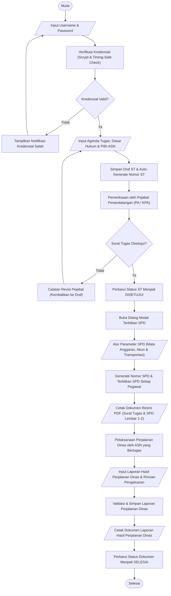
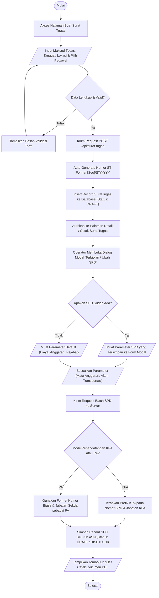
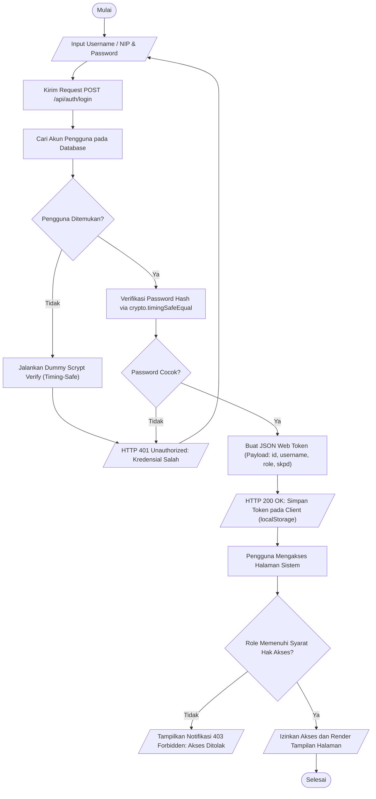
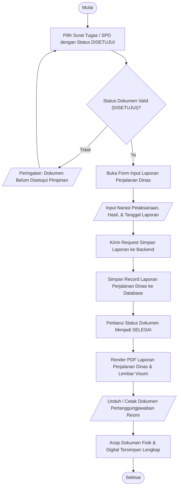

# Flowchart Specification: SI-SPD Banggai Laut

This document defines the standard ISO/ANSI system flowcharts for the Sistem Informasi Surat Perjalanan Dinas (SI-SPD) platform. It provides high-level and modular execution flowcharts illustrating sequential system operations, data input/output, automated decision paths, and document lifecycle progressions. The visual Draw.io diagram file is available at [`docs/flowchart.drawio`](flowchart.drawio).

---

## 1. Flowchart Standards and Symbology

The flowcharts in this document adhere to the standard ISO 5807 / ANSI flowchart conventions:
- **Terminal (Start / End):** Denotes the invocation start point or final termination state of a business process (stadium/pill shape).
- **Input / Output:** Represents data entry by a user or output delivery by the system (parallelogram).
- **Process:** Represents an internal computational action, database operation, or state change (rectangle).
- **Decision:** Evaluates a conditional expression or business rule with branching paths (diamond).
- **Document / Output:** Denotes physical or digital document generation, such as PDF compilation (document shape or output symbol).
- **Flow Line:** Indicates the chronological sequence of execution and direction of control flow (directional arrow).

---

## 2. Flowchart 1: Alur Utama Sistem SI-SPD (End-to-End System Flowchart)

This flowchart illustrates the overarching end-to-end lifecycle of travel document administration in SI-SPD, from user authentication to travel completion and final reporting:

---

## 3. Flowchart 2: Alur Pembuatan Surat Tugas & Penerbitan SPD (ST & SPD Lifecycle)

This flowchart details the granular logic of creating a Surat Tugas and issuing corresponding on-demand child SPD documents:

---

## 4. Flowchart 3: Alur Autentikasi Pengguna & Penegakan RBAC

This flowchart models the security verification process during user authentication and subsequent role-based route guard enforcement:

---

## 5. Flowchart 4: Alur Pelaporan Hasil Perjalanan Dinas (Laporan SPD)

This flowchart models the post-travel documentation and reporting workflow required for financial accountability:

---

## 6. Penjelasan Simbol dan Komponen Flowchart

| Simbol Flowchart | Bentuk Visual | Deskripsi Fungsi dalam Sistem SI-SPD |
| :--- | :--- | :--- |
| **Terminal** | Kapsul / Stadium `([ ... ])` | Menandai titik awal (Mulai) dan titik akhir (Selesai) dari suatu alur proses sistem. |
| **Input / Output** | Jajaran Genjang `[/ ... /]` | Mewakili interaksi input data oleh pengguna (seperti input formulir ST, parameter SPD) atau penerimaan dokumen luaran (seperti cetak PDF). |
| **Process** | Persegi Panjang `[ ... ]` | Menunjukkan aksi eksekusi pemrosesan data, kalkulasi otomatis, hashing kredensial, atau query database oleh backend NestJS. |
| **Decision** | Belah Ketupat / Diamond `{ ... }` | Menunjukkan titik percabangan kondisional yang menghasilkan dua alternatif jalur (seperti Valid/Tidak, Disetujui/Revisi, KPA/PA). |
| **Document** | Dokumen Tercetak `[/ ... /]` | Menggambarkan luaran dokumen fisik/digital resmi yang dihasilkan oleh sistem (Surat Tugas, SPD Lembar Depan, SPD Visum Belakang, Laporan Perjalanan). |
| **Flow Line** | Garis Berpanah `-->` | Menunjukkan arah aliran eksekusi instruksi dan urutan langkah sistem dari satu tahapan ke tahapan berikutnya. |

---

## 7. File Referensi Visual (Draw.io)

Model visual diagram alir sistem ini tersedia dalam format asli Draw.io pada:
- **Draw.io XML File:** [`docs/flowchart.drawio`](flowchart.drawio)
- **Kompatibilitas:** Dapat dibuka, diedit, dan diekspor ke format SVG/PNG melalui [diagrams.net](https://app.diagrams.net/) atau ekstensi Draw.io Integration di IDE.
