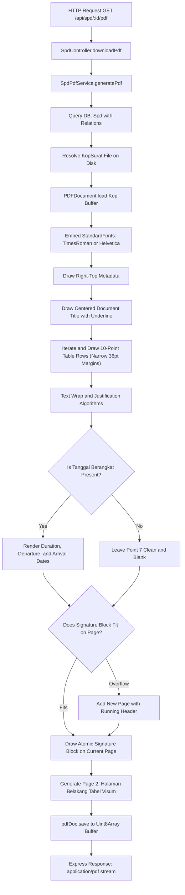

# PDF Generation Architecture and Mechanics

This document provides a technical explanation of how PDF documents (Surat Perjalanan Dinas and Surat Tugas) are generated in the SI-SPD backend service (`apps/api`).

---

## 1. Core Architecture

The PDF generation engine runs directly in Node.js using `pdf-lib`. It performs vector and raster operations on PDF binary buffers without running headless browser processes (such as Puppeteer or Playwright), minimizing RAM footprint and execution latency.



---

## 2. Coordinate System and Dimensional Metrics

`pdf-lib` adheres to standard PostScript typography points:
$$\text{1 point (pt)} = \frac{1}{72}\text{ inch} \approx 0.352778\text{ mm}$$

- **Origin $(0, 0)$:** Bottom-left corner of the page.
- **Y-axis:** Increases from bottom to top.
- **X-axis:** Increases from left to right.

### 2.1 Standard Paper Canvas Sizes
| Standard Format | Width (pt) | Height (pt) | Width (mm) | Height (mm) |
|---|---|---|---|---|
| **Legal** | 612.00 | 1008.00 | 215.9 | 355.6 |
| **A4** | 595.28 | 841.89 | 210.0 | 297.0 |
| **F4 / Folio** | 612.00 | 936.00 | 215.9 | 330.2 |

---

## 3. Letterhead Detection and Overlay Process

### 3.1 Binary Detection Algorithm (`pdf-size.util.ts`)
The server identifies the paper dimensions of uploaded PDF letterheads by inspecting stream chunks:
1. Regex match for `/MediaBox [ x1 y1 x2 y2 ]` across ASCII-decoded buffer content.
2. If the MediaBox is compressed inside an object stream, it detects deflate stream delimiters, executes `zlib.inflateSync`, and extracts the inflated MediaBox attributes.
3. Computes width and height and maps against standard paper sizes within a $\pm 6\text{ pt}$ boundary tolerance.

### 3.2 Loading and Page Geometry
The template PDF is read synchronously from disk (`fs.readFileSync`), parsed via `PDFDocument.load(kopBytes)`, and the target first page extracted:
```typescript
const pdfDoc = await PDFDocument.load(kopBytes);
const page = pdfDoc.getPages()[0];
const { width, height } = page.getSize();
```

---

## 4. Layout Math and Drawing Algorithms

### 4.1 Header Positioning
On a standard Legal sheet ($1008\text{ pt}$ height), the bottom line of the official letterhead sits at $Y \approx 879\text{ pt}$. Vertical coordinates begin at:
```typescript
const startY = height > 900 ? 865 : height - 138;
```

### 4.2 Document Margins (Narrow Standard)
Both Surat Tugas and Surat Perjalanan Dinas implement the **Narrow Margin Standard** ($36\text{ pt}$ / $0.5\text{ in}$ / $12.7\text{ mm}$):
- `leftMargin = 36 pt`
- `rightMargin = width - 36 pt` ($576\text{ pt}$ on Legal $612\text{ pt}$)
- `contentWidth = 540 pt`

### 4.3 Text Wrapping (`splitTextToLines`)
Breaks arbitrary text strings into lines based on font width measurements:
```typescript
private splitTextToLines(text: string, font: PDFFont, fontSize: number, maxWidth: number): string[] {
  if (!text) return [];
  const words = text.split(/\s+/);
  const lines: string[] = [];
  let currentLine = '';

  for (const word of words) {
    const testLine = currentLine ? `${currentLine} ${word}` : word;
    const width = font.widthOfTextAtSize(testLine, fontSize);
    if (width <= maxWidth) {
      currentLine = testLine;
    } else {
      if (currentLine) lines.push(currentLine);
      currentLine = word;
    }
  }
  if (currentLine) lines.push(currentLine);
  return lines;
}
```

### 4.4 Text Justification (`drawJustifiedText`)
Distributes inter-word spacing across a line to achieve flush left and right margins:
```typescript
private drawJustifiedText(
  page: PDFPage,
  line: string,
  x: number,
  y: number,
  fontSize: number,
  font: PDFFont,
  color: any,
  targetWidth: number,
  isLastLine: boolean = false,
): void {
  const trimmed = line.trim();
  const words = trimmed.split(/\s+/);

  if (isLastLine || words.length <= 1) {
    page.drawText(trimmed, { x, y, size: fontSize, font, color });
    return;
  }

  const wordsTotalWidth = words.reduce((acc, w) => acc + font.widthOfTextAtSize(w, fontSize), 0);
  const spaceToDistribute = targetWidth - wordsTotalWidth;
  const gapWidth = spaceToDistribute / (words.length - 1);
  const normalSpaceWidth = font.widthOfTextAtSize(' ', fontSize);

  // Safeguard: Fallback to standard drawing if distortion limits are exceeded
  if (gapWidth > normalSpaceWidth * 3.5 || gapWidth < normalSpaceWidth * 0.5) {
    page.drawText(trimmed, { x, y, size: fontSize, font, color });
    return;
  }

  let curX = x;
  for (let i = 0; i < words.length; i++) {
    page.drawText(words[i], { x: curX, y, size: fontSize, font, color });
    curX += font.widthOfTextAtSize(words[i], fontSize) + gapWidth;
  }
}
```

### 4.5 Table Structure and Coordinates (SPD Front Page)
Total table width: $540\text{ pt}$ starting at $X = 36\text{ pt}$ and ending at $X = 576\text{ pt}$.
- Column 1 Width: $24\text{ pt}$ (Item Index)
- Column 2 Width: $190\text{ pt}$ (Description)
- Column 3 Width: $326\text{ pt}$ (Value / Details)

Vertical grid borders:
- Left table boundary: $X = 36\text{ pt}$
- Vertical line dividing Column 2 and Column 3: $X = 36 + 24 + 190 = 250\text{ pt}$
- Right table boundary: $X = 250 + 326 = 576\text{ pt}$
*(The vertical border between Column 1 and Column 2 is omitted across all rows to format the number and description within a continuous visual block).*

### 4.6 Multi-Agenda Hanging Indent & Unnumbered Headers
1. **Surat Perjalanan Dinas (Point 4):**
   - The colon `:` occupies coordinate $X = \text{col3X} + \text{cellPaddingX}$.
   - Number prefixes (`1. `, `2. `) occupy a reserved width of $16\text{ pt}$ starting at $X = \text{colonX} + 10\text{ pt}$.
   - Subsequent lines of each item render at $X = \text{textStartX} + 16\text{ pt}$, vertically aligned beneath the text body of the first line.
2. **Surat Tugas (`maksudHeader`):**
   - If an unnumbered introductory title is defined (`maksudHeader`), it renders flush next to `Untuk :` without a number prefix.
   - Numbered sub-items (`1.`, `2.`, etc.) are rendered underneath with indented hanging paragraphs.

### 4.7 Surat Tugas Specific Spacing Rules
- **Header Spacing:** Includes extra line clearance above `SURAT TUGAS` (+1 line space) and below the letter number before `Dasar :` (+1 line space).
- **Directive Spacing:** Enforces exactly 3 line spaces before `MEMERINTAHKAN:` and 2 line spaces after `MEMERINTAHKAN:` before `Kepada :`:
  ```typescript
  currentY -= 3 * lineHeight; // Before MEMERINTAHKAN:
  // [Render MEMERINTAHKAN:]
  currentY -= 2 * lineHeight; // After MEMERINTAHKAN:
  ```

### 4.8 Point 7 Optional Departure Date Handling (SPD)
When `tanggalBerangkat` is not supplied:
- All three sub-items under Point 7 (*Lamanya perjalanan dinas*, *Tanggal berangkat*, *Tanggal harus kembali*) are rendered completely blank (`['', '', '']`), preventing partial or erroneous zero-day outputs.
- If `tanggalBerangkat` is provided, but `lamaHari` is null or zero, `a.` renders cleanly without duration values.

### 4.9 Companion Sub-Table Partitioning (SPD Point 8)
Row 8 (*Nama Pengikut*) contains an internal sub-grid ($96\text{ pt}$ total height):
- Row title banner: $21\text{ pt}$
- Sub-header row: $19\text{ pt}$ (`No`, `Nama`, `Umur`, `Keterangan`)
- Body area: $56\text{ pt}$ providing 3 numbered sub-rows ($15\text{ pt}$ line height each) with bottom boundary clearance
- Internal vertical border: divides Column 3 into equal halves ($163\text{ pt}$ each) between `Umur` and `Keterangan`

---

## 5. Signatory Alignment and Governance Rules

### 5.1 Centered Signature Blocks
Bottom signatures for both Surat Tugas and SPD use measured text widths within a $230\text{ pt}$ bounding box anchored to the right margin:
```typescript
const signBlockWidth = 230;
const signX = rightMargin - signBlockWidth;

// Centering calculation for each element
const textWidth = font.widthOfTextAtSize(text, fontSize);
const textX = signX + (signBlockWidth - textWidth) / 2;
```

### 5.2 Sekda Rule (No "PA" Prefix)
When signed by the *Sekretaris Daerah* (or acting Sekda):
- The prefix text `PA` or `PENGGUNA ANGGARAN` is stripped.
- The signatory title renders directly as:
  ```text
  SEKRETARIS DAERAH
  KABUPATEN BANGGAI LAUT
  ```

### 5.3 Surat Tugas Signatory Title
- Default title renders in two centered lines:
  ```text
  KEPALA BAGIAN UMUM
  SETDA KAB. BANGGAI LAUT
  ```

### 5.4 SPD Signatory Label & Governance
- Strictly labeled as `KUASA PENGGUNA ANGGARAN` or `PENGGUNA ANGGARAN`.
- When **KPA** is selected:
  - Signatory locks strictly to the *Kepala Bagian Umum SETDA*.
  - SPD numbering retains the `KPA` code prefix (e.g. `KPA001/SPD/SETDA/2026`).
- When **PA** is selected:
  - Signatory defaults to *Sekretaris Daerah* with support for acting officials.

### 5.5 Atomic Signature Block (Page Overflow Protection)
To prevent the signature block from breaking across pages or orphan elements, the system calculates the entire vertical height of the signature block:
```typescript
if (currentY - gapBeforeSign - totalSignBlockHeight < marginBottom) {
  currentPage = pdfDoc.addPage([width, height]);
  // Add running page number header: "- 2 -"
  currentY = height - 55;
}
```
If vertical clearance is insufficient, the entire signature block shifts to a new page as an atomic unit.

---

## 6. Page 2: Halaman Belakang (Tabel Visum Perjalanan Dinas)

Every generated SPD PDF automatically includes Page 2 (Lembar Visum) formatted according to official Permendagri / Perbup standards using Narrow margins:

```text
Table Boundaries (Narrow Margins):
Left: X = 36 pt, Right: X = 576 pt (Table Width: 540 pt)
Center Vertical Divider: X = 306 pt (Half Width: 270 pt)
```

### 6.1 Section Breakdown
1. **Row I (Keberangkatan Awal):**
   - Left quadrant: Empty whitespace with no borders above or to the left.
   - Right quadrant: `I. Berangkat dari (Tempat Kedudukan)`, `Ke`, `Pada Tanggal`, and the PA/KPA signatory with underlined name and NIP.
2. **Rows II s/d V (Catatan Tempat Transit / Tujuan Visum):**
   - Divided down the center ($X = 306\text{ pt}$).
   - Left: `Tiba di`, `Pada Tanggal`, centered dotted signature line `(....................................................................)`.
   - Right: `Berangkat dari`, `Ke`, `Pada Tanggal`, centered dotted signature line.
3. **Row VI (Kepulangan & Pemeriksaan):**
   - Left: Return arrival to home base (`Banggai`), return date, and PA/KPA signatory.
   - Right: Multi-line statutory inspection statement:
     > *"Telah diperiksa, dengan keterangan bahwa perjalanan Dinas tersebut diatas benar dilakukan atas perintahnya dan semata mata untuk kepentingan jabatan dalam waktu yang sesingkat - singkatnya."*
4. **Row VII (Catatan Lain-lain):**
   - Full width row across table ($540\text{ pt}$).
5. **Row VIII (Perhatian):**
   - Full width row with statutory financial liability warning for PPK, traveler, and certifying officials.
6. **Bottom Signature Block:**
   - Positioned below the table on the right side ($X = 346\text{ pt}$, width $230\text{ pt}$).
   - Centered uppercase title (`KUASA PENGGUNA ANGGARAN` or `SEKRETARIS DAERAH KABUPATEN BANGGAI LAUT`), physical signature clearance, underlined official name, and NIP.

---

## 7. Non-Collate Batch Printing Sequencer

When multiple SPDs are selected for printing or downloading simultaneously, `SpdPdfService.generateBulkPdf` supports non-collate ordering:

```typescript
if (sequence === 'non-collate') {
  // Group 1: All Front Sheets (Page 1 of Doc A, Doc B, Doc C...)
  for (const doc of loadedDocs) {
    const [front] = await mergedDoc.copyPages(doc, [0]);
    mergedDoc.addPage(front);
  }
  // Group 2: All Back Sheets (Page 2 of Doc A, Doc B, Doc C...)
  for (const doc of loadedDocs) {
    if (doc.getPageCount() > 1) {
      const [back] = await mergedDoc.copyPages(doc, [1]);
      mergedDoc.addPage(back);
    }
  }
}
```

This empowers administrative staff to perform high-volume duplex printing on standard office printers: print all front pages in batch, place the printed stack back into the input tray, and print all back pages on the reverse side.

---

## 8. Laporan Perjalanan Dinas PDF Mechanics (`generateLaporanPdf`)

The system provides on-demand generation of official Trip Reports (Laporan Perjalanan Dinas) adhering to regional secretariat formatting standards.

```mermaid
flowchart TD
    Req["HTTP Request POST /api/spd/:id/laporan-pdf"] --> Ctrl["SpdController.generateLaporanPdf"]
    Ctrl --> Svc["SpdPdfService.generateLaporanPdf"]
    Svc --> QueryDB["Query DB: Spd with Pegawai and SuratTugas"]
    QueryDB --> CreateDoc["PDFDocument.create on Legal Size (612 x 1008 pt)"]
    CreateDoc --> EmbedFont["Embed StandardFonts: TimesRoman & TimesRomanBold"]
    EmbedFont --> DrawTitle["Draw Centered Title LAPORAN PERJALANAN DINAS with Underline"]
    DrawTitle --> DrawHeader["Draw Perihal (Left) & Banggai Date + Kepada Yth (Right)"]
    DrawHeader --> DrawPoints["Draw Points 1-3: Dasar, Maksud Perjalanan, Lama Perjalanan"]
    DrawPoints --> CheckPoint4["Process Point 4: Multi-paragraph Hasil Perjalanan"]
    CheckPoint4 --> CheckOverflow{Does Current Paragraph Fit Page?}
    CheckOverflow -- Yes --> DrawText["Draw Justified Text Lines"]
    CheckOverflow -- Overflow --> NewPage["pdfDoc.addPage(Legal)"] --> DrawText
    DrawText --> DrawClosing["Draw Closing Statement"]
    DrawClosing --> CheckSignSpace{Does Sign Block Fit on Page?}
    CheckSignSpace -- Yes --> DrawSign["Draw Sign Block: YANG MELAKUKAN PERJALANAN DINAS"]
    CheckSignSpace -- Overflow --> AddSignPage["pdfDoc.addPage(Legal)"] --> DrawSign
    DrawSign --> SaveDoc["pdfDoc.save to Uint8Array Buffer"]
    SaveDoc --> StreamOut["Express Response: application/pdf stream"]
```



### 8.1 Page Geometry and Layout Standards
- **Page Size:** Legal standard ($612 \times 1008\text{ pt}$).
- **Margins:** Left $40\text{ pt}$, Right $40\text{ pt}$, Top $45\text{ pt}$, Bottom $45\text{ pt}$ ($contentWidth = 532\text{ pt}$).
- **Typography:** Standard `Times-Roman` and `Times-Roman-Bold` fonts.

### 8.2 Header and Recipient Hierarchy
1. **Title:** Centered `LAPORAN PERJALANAN DINAS` ($12\text{ pt}$ Bold, underline thickness $1\text{ pt}$).
2. **Left Metadata:** `Perihal : Laporan Perjalanan Dinas` at $X = 40\text{ pt}$.
3. **Right Metadata:** Positioned at $X = 330\text{ pt}$:
   - Location and date: `Banggai,      [Formatted Date]`
   - Greeting: `Kepada Yth,`
   - Recipient title mapped from form selection:
     - `Bupati` $\rightarrow$ `Bupati Banggai Laut`
     - `Wakil Bupati` $\rightarrow$ `Wakil Bupati Banggai Laut`
     - `Sekertaris Daerah` $\rightarrow$ `Sekretaris Daerah Kabupaten Banggai Laut`
     - `Kepala Bagian` $\rightarrow$ `Kepala Bagian Umum Setda Kab. Banggai Laut`
   - Address suffix: `di -` followed by indented `Tempat.`.

### 8.3 Body Sections and Text Wrapping
Body text uses font size $10.5\text{ pt}$ with line height $15\text{ pt}$. Colons align at $X = 145\text{ pt}$, and values start at $X = 155\text{ pt}$ with maximum width $417\text{ pt}$.

1. **Dasar (Statutory References):**
   - Line 1: `1. Surat Tugas Nomor : [nomorSurat] Tanggal [tanggalSurat]`
   - Line 2: `2. Surat Perjalanan Dinas Nomor : [nomorSpd] Tanggal [tanggalSpd]`
2. **Maksud Perjalanan (Purpose):** Strips numerical prefixes and executes justified text distribution across wrapped lines.
3. **Lama Perjalanan (Duration):** Renders duration formatted as `( [lamaHari] ) hari`.
4. **Hasil Perjalanan (Narrative Findings):**
   - Parses multi-paragraph inputs split by newlines.
   - Justifies all lines except the final line of each paragraph.
   - Evaluates remaining vertical space; automatically adds a new Legal page when $Y < 105\text{ pt}$ ($marginBottom + 60\text{ pt}$).

### 8.4 Closing Statement and Signatory Placement
- **Closing Sentence:** `Demikian Laporan Perjalanan Dinas ini dibuat, untuk menjadi bahan pertimbangan.`
- **Signatory Block:** Single block anchored at the bottom right ($X = 312\text{ pt}$, width $260\text{ pt}$, height $110\text{ pt}$):
  - Header: Centered `YANG MELAKUKAN PERJALANAN DINAS` ($10.5\text{ pt}$ Bold).
  - Clearance: $65\text{ pt}$ space for physical ink signature.
  - Footer: Left-aligned traveler name (`spd.pegawai.nama`) with right-aligned signature dotted rule (`.......................`).

---

## 9. HTTP Streaming Pipeline

Generated documents are returned directly to the client as an inline binary stream:

```typescript
const { buffer, fileName } = await this.spdPdfService.generatePdf(id, signer, fontFamily);
res.setHeader('Content-Type', 'application/pdf');
res.setHeader('Content-Disposition', `inline; filename="${fileName}"`);
res.send(buffer);
```
