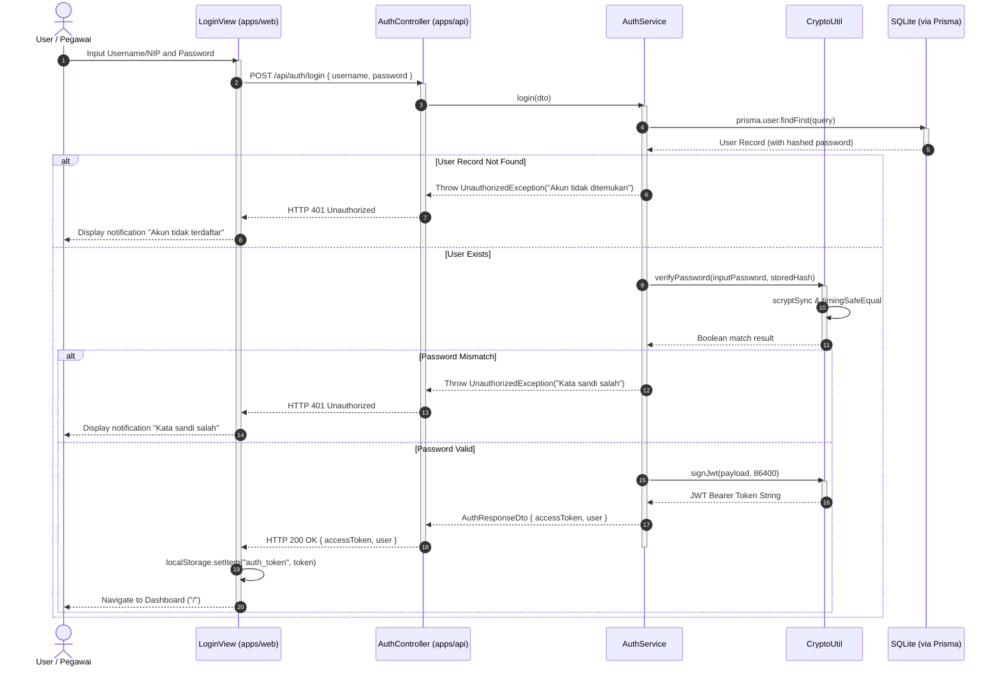
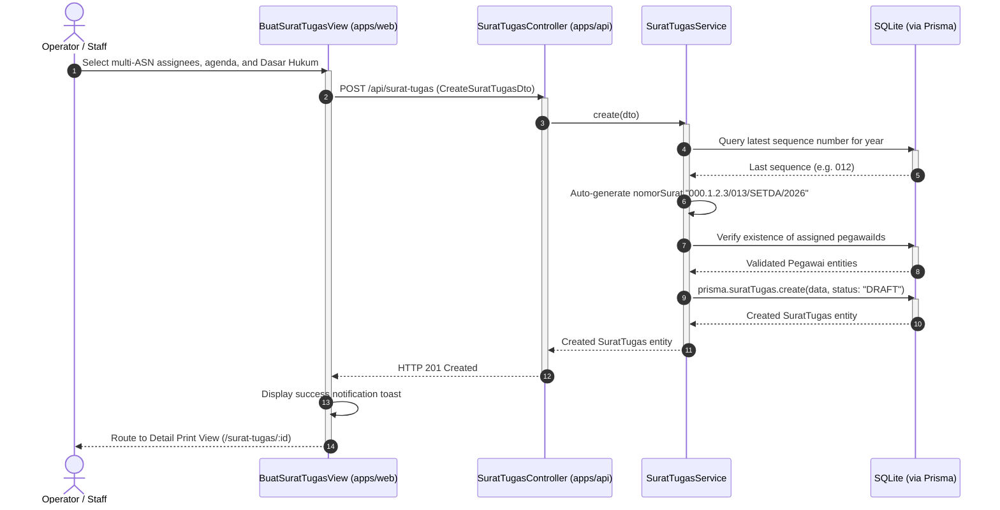
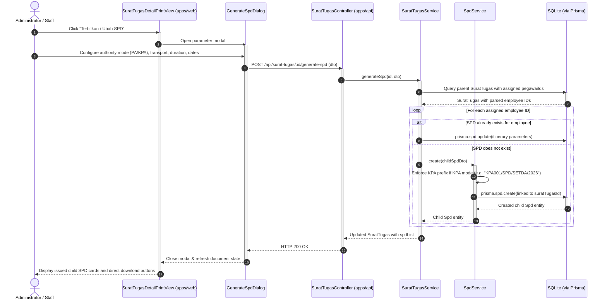
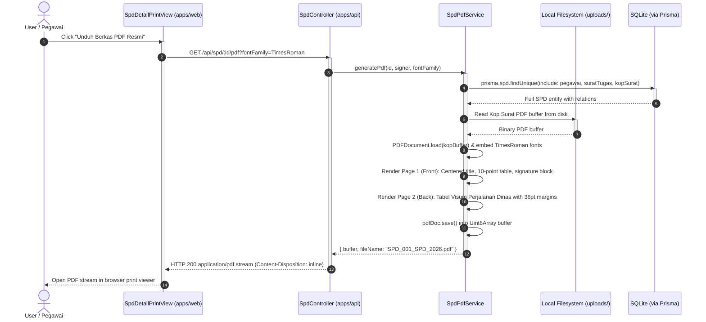
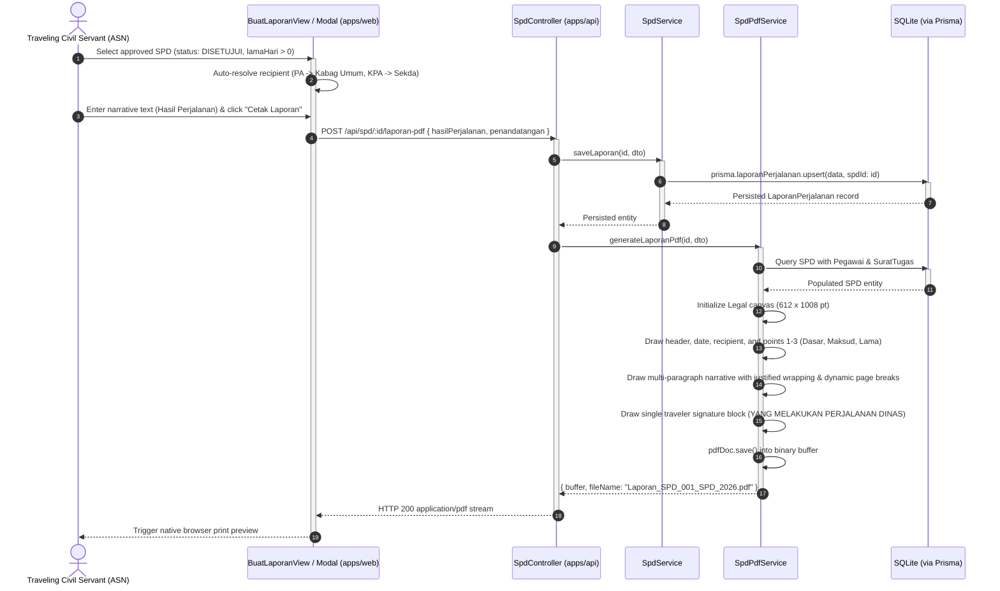

# Sequence Diagram Specification: SI-SPD Banggai Laut

This document specifies the dynamic runtime behavior, object interactions, message sequencing, and database persistence flows across the Sistem Informasi Surat Perjalanan Dinas (SI-SPD) platform. The visual Draw.io diagram file is available at [`docs/sequence-diagram.drawio`](class-diagram.drawio).

---

## 1. Architectural Interaction Model

The runtime sequence flows operate across five distinct execution tiers:
1. **User / Actor Tier:** Interactive input from civil servants (*Pegawai*), administrative operators (*Staff*), or certifying authorities (*Pejabat PA / KPA*).
2. **Frontend Client Interface Tier (`apps/web`):** Vue 3 reactive views, forms, and dialog modals communicating via `apiFetch`.
3. **API Controller & Security Tier (`apps/api`):** NestJS REST Controllers protected by `AuthGuard` and role metadata (`@Roles`).
4. **Domain Service & Logic Tier (`apps/api`):** Injectable services orchestrating business validations, numbering rules, and vector PDF rendering (`SpdPdfService`, `SuratTugasPdfService`).
5. **Persistence Tier (`apps/api/prisma`):** SQLite relational storage accessed through `PrismaService`.

---

## 2. Sequence Diagram 1: Authentication & Sesi Verification (Login Flow)

This sequence models user authentication, password verification using timing-safe Scrypt hashing, and session initialization via JWT:

---

## 3. Sequence Diagram 2: Surat Tugas Creation & Sequential Numbering

This sequence details the generation of an official duty assignment order authorizing travel for one or multiple civil servants:

---

## 4. Sequence Diagram 3: On-Demand Child SPD Generation & Synchronization

This sequence shows how child SPDs are issued on demand directly from a parent Surat Tugas, with automatic KPA prefixing and itinerary synchronization:

---

## 5. Sequence Diagram 4: Official Document Vector PDF Generation (Duplex Layout)

This sequence details the generation and HTTP streaming of an official 2-page duplex PDF document:

---

## 6. Sequence Diagram 5: Laporan Perjalanan Dinas Lifecycle & PDF Rendering

This sequence details the end-to-end authoring, database persistence, and vector PDF compilation of the official post-travel narrative report:

---

## 7. Participant Implementation Traceability

| Sequence Participant | Monorepo Source Implementation | Key Responsibilities |
|---|---|---|
| `LoginView` | `apps/web/src/views/LoginView.vue` | Credentials capture, form validation, and session token storage. |
| `BuatSuratTugasView` | `apps/web/src/views/BuatSuratTugasView.vue` | Multi-assignee selection, agenda drafting, and form dispatch. |
| `SuratTugasDetailPrintView` | `apps/web/src/views/SuratTugasDetailPrintView.vue` | Assignment preview, on-demand SPD generation modal, and child list rendering. |
| `SpdDetailPrintView` | `apps/web/src/views/SpdDetailPrintView.vue` | Continuous multi-page display and official PDF stream invocation. |
| `BuatLaporanView` | `apps/web/src/views/BuatLaporanView.vue` | Precondition validation, narrative report authoring, and PDF trigger. |
| `AuthController` | `apps/api/src/auth/auth.controller.ts` | Endpoint routing for `/api/auth/login` and `/api/auth/me`. |
| `SuratTugasController`| `apps/api/src/surat-tugas/surat-tugas.controller.ts` | CRUD routing, on-demand child generation, and bulk deletions. |
| `SpdController` | `apps/api/src/spd/spd.controller.ts` | SPD endpoints, report persistence, and PDF streaming. |
| `AuthService` | `apps/api/src/auth/auth.service.ts` | Alias resolution, password verification, and JWT generation. |
| `SuratTugasService` | `apps/api/src/surat-tugas/surat-tugas.service.ts` | Sequence number resolution and child SPD synchronization. |
| `SpdService` | `apps/api/src/spd/spd.service.ts` | KPA prefix enforcement, date derivation, and report upsertion. |
| `SpdPdfService` | `apps/api/src/spd/spd-pdf.service.ts` | Vector drawing algorithms, visum verification grid, and Legal report rendering. |
| `CryptoUtil` | `apps/api/src/auth/crypto.util.ts` | Salted Scrypt hashing, constant-time verification, and HMAC signing. |
| `PrismaService` | `apps/api/src/prisma/prisma.service.ts` | Database connection pooling, ORM client lifecycle, and query execution. |

---

## 8. Visual Diagram File

The native Draw.io XML diagram matching this layout is stored at:
- **File Path:** [`docs/sequence-diagram.drawio`](sequence-diagram.drawio)
- **Format:** Native Draw.io XML with dark blue participant headers, lifelines, activation blocks, and numbered message sequences importable into [app.diagrams.net](https://app.diagrams.net).
