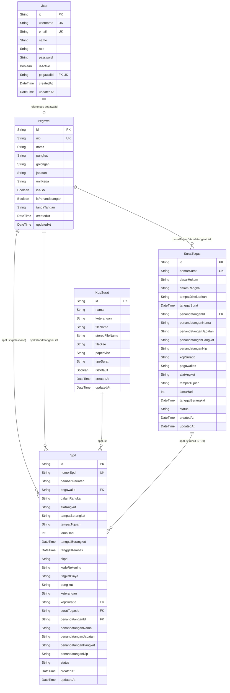

# Database Schema and Table Structure

This document details the relational database structure, column definitions, data types, constraints, and relationships for the SI-SPD system.

---

## 1. Database Configuration

- **ORM:** Prisma Client
- **Provider:** SQLite (`DATABASE_URL="file:./dev.db"`)
- **Key Generation:** Collision-resistant Unique Identifiers (CUID)
- **Primary Configuration File:** `apps/api/prisma/schema.prisma`

---

## 2. Entity Relationship Diagram

---

## 3. Table Column Specifications

### 3.1 Table `User`

| Column | Type | Nullable | Default | Constraints | Description |
|---|---|---|---|---|---|
| `id` | String | No | `cuid()` | Primary Key | Unique identifier |
| `username` | String | No | None | Unique | Login username or NIP |
| `email` | String | Yes | `null` | Unique | User email address |
| `name` | String | No | None | None | User legal or display name |
| `role` | String | No | `'USER'` | Enum Check | Values: `SUPER_ADMIN`, `ADMIN`, `PENANDATANGAN`, `STAFF`, `USER` |
| `password` | String | No | None | None | Salted Scrypt hash formatted as `${salt}:${hash}` |
| `isActive` | Boolean | No | `true` | None | Account status |
| `pegawaiId` | String | Yes | `null` | Unique, FK -> `Pegawai.id` | Reference to employee profile; `ON DELETE SET NULL` |
| `createdAt` | DateTime | No | `now()` | None | Creation timestamp |
| `updatedAt` | DateTime | No | Triggered | None | Last update timestamp |

### 3.2 Table `Pegawai`

| Column | Type | Nullable | Default | Constraints | Description |
|---|---|---|---|---|---|
| `id` | String | No | `cuid()` | Primary Key | Unique employee identifier |
| `nip` | String | No | None | Unique | 18-digit Civil Servant Identification Number |
| `nama` | String | No | None | None | Complete legal name with academic degrees |
| `pangkat` | String | No | None | None | Civil service rank (e.g. `Pembina Utama Muda`) |
| `golongan` | String | No | None | None | Grade tier (e.g. `IV/c`) |
| `jabatan` | String | No | None | None | Civil service job title |
| `unitKerja` | String | No | `'Sekretariat Daerah'` | None | Organizational sub-division |
| `isASN` | Boolean | No | `true` | None | ASN employment type flag |
| `isPenandatangan` | Boolean | No | `false` | None | Flag indicating authorized letter signatory |
| `tandaTangan` | String | Yes | `null` | None | Filename of signature image in uploads storage |
| `createdAt` | DateTime | No | `now()` | None | Creation timestamp |
| `updatedAt` | DateTime | No | Triggered | None | Last update timestamp |

### 3.3 Table `KopSurat`

| Column | Type | Nullable | Default | Constraints | Description |
|---|---|---|---|---|---|
| `id` | String | No | `cuid()` | Primary Key | Unique template identifier |
| `nama` | String | No | None | None | Template description name |
| `keterangan` | String | Yes | `null` | None | Descriptive remarks |
| `fileName` | String | No | None | None | Original upload filename |
| `storedFileName` | String | No | None | None | Physical filename stored on disk |
| `fileSize` | String | No | None | None | Formatted file size string |
| `paperSize` | String | No | `'A4'` | None | Detected paper standard (`Legal`, `A4`, `F4 / Folio`) |
| `tipeSurat` | String | Yes | `'SPD'` | None | Target letter type |
| `isDefault` | Boolean | No | `false` | None | System-wide active default template flag |
| `createdAt` | DateTime | No | `now()` | None | Creation timestamp |
| `updatedAt` | DateTime | No | Triggered | None | Last update timestamp |

### 3.4 Table `SuratTugas`

| Column | Type | Nullable | Default | Constraints | Description |
|---|---|---|---|---|---|
| `id` | String | No | `cuid()` | Primary Key | Unique assignment order identifier |
| `nomorSurat` | String | No | None | Unique | Official letter code |
| `dasarHukum` | String | No | Statutory text | None | Legal statutory basis for assignment |
| `dalamRangka` | String | No | None | None | Purpose and scope of duty |
| `tempatDikeluarkan` | String | No | `'Banggai'` | None | Geographic issuance location |
| `tanggalSurat` | DateTime | No | `now()` | None | Issuance date |
| `penandatanganId` | String | Yes | `null` | FK -> `Pegawai.id` | Signatory employee reference; `ON DELETE SET NULL` |
| `penandatanganNama` | String | No | `'ARSID HAMIDI, SH'` | None | Signatory name snapshot |
| `penandatanganJabatan` | String | No | Standard string | None | Signatory job title snapshot |
| `penandatanganPangkat` | String | No | `'Pembina, IV/a'` | None | Signatory rank snapshot |
| `penandatanganNip` | String | No | Standard string | None | Signatory NIP snapshot |
| `kopSuratId` | String | Yes | `null` | None | Optional explicit letterhead ID |
| `pegawaiIds` | String | Yes | `null` | None | Serialized JSON array of assigned employee CUIDs |
| `alatAngkut` | String | Yes | `null` | None | Transportation mode selection |
| `tempatTujuan` | String | Yes | `null` | None | Destination |
| `lamaHari` | Int | Yes | `1` | None | Duration in days |
| `tanggalBerangkat` | DateTime | Yes | `null` | None | Departure date |
| `status` | String | No | `'DRAFT'` | None | Status: `DRAFT`, `DISETUJUI`, `SELESAI`, `BATAL` |
| `createdAt` | DateTime | No | `now()` | None | Creation timestamp |
| `updatedAt` | DateTime | No | Triggered | None | Last update timestamp |

### 3.5 Table `Spd`

| Column | Type | Nullable | Default | Constraints | Description |
|---|---|---|---|---|---|
| `id` | String | No | `cuid()` | Primary Key | Unique SPD identifier |
| `nomorSpd` | String | No | None | Unique | Standardized reference (`XXX/SPD/SETDA/YYYY`) |
| `pemberiPerintah` | String | No | None | None | Issuing authority classification |
| `pegawaiId` | String | No | None | FK -> `Pegawai.id` | Traveling employee reference |
| `dalamRangka` | String | No | None | None | Purpose text or numbered multi-agenda |
| `alatAngkut` | String | No | None | None | Chosen mode(s) of transit |
| `tempatBerangkat` | String | No | None | None | Origin location |
| `tempatTujuan` | String | No | None | None | Destination location |
| `lamaHari` | Int | No | None | Positive Int | Duration in days |
| `tanggalBerangkat` | DateTime | No | None | None | Scheduled departure date |
| `tanggalKembali` | DateTime | No | None | None | Scheduled return date |
| `skpd` | String | No | Bagian Umum SETDA | None | Regional work unit funding travel |
| `kodeRekening` | String | Yes | `null` | None | Budget accounting line |
| `tingkatBiaya` | String | Yes | `null` | None | Allowance level tier |
| `pengikut` | String | Yes | `null` | None | Companion personnel list |
| `keterangan` | String | Yes | `null` | None | Remarks |
| `kopSuratId` | String | Yes | `null` | FK -> `KopSurat.id` | Reference to letterhead template; `ON DELETE SET NULL` |
| `suratTugasId` | String | Yes | `null` | FK -> `SuratTugas.id` | Parent assignment letter; `ON DELETE SET NULL` |
| `penandatanganId` | String | Yes | `null` | FK -> `Pegawai.id` | Signatory employee reference; `ON DELETE SET NULL` |
| `penandatanganNama` | String | Yes | `null` | None | Signatory name snapshot |
| `penandatanganJabatan` | String | Yes | `null` | None | Signatory position snapshot |
| `penandatanganPangkat` | String | Yes | `null` | None | Signatory rank snapshot |
| `penandatanganNip` | String | Yes | `null` | None | Signatory NIP snapshot |
| `status` | String | No | `'DRAFT'` | None | Status: `DRAFT`, `DISETUJUI`, `SELESAI`, `BATAL` |
| `createdAt` | DateTime | No | `now()` | None | Creation timestamp |
| `updatedAt` | DateTime | No | Triggered | None | Last update timestamp |

---

## 4. Referential Integrity and Cascade Rules

- **`User.pegawaiId -> Pegawai.id`:** Foreign key with `onDelete: SetNull`. Deleting an employee record leaves the user account intact with an unlinked profile.
- **`Spd.pegawaiId -> Pegawai.id`:** Foreign key without cascade deletion. Deleting an employee with active historical SPD records is blocked to prevent broken administrative audits.
- **`Spd.kopSuratId -> KopSurat.id`:** Foreign key with `onDelete: SetNull`. Deleting a letterhead template does not destroy associated SPD records; the system falls back to the active default letterhead.
- **`Spd.suratTugasId -> SuratTugas.id`:** Foreign key with `onDelete: SetNull`. Deleting or disconnecting a parent assignment letter maintains the independent historical existence of issued child SPDs.
- **`Spd.penandatanganId -> Pegawai.id`:** Foreign key with `onDelete: SetNull`. Preserves stored text snapshots of signatory name, title, and NIP if the employee profile is removed.
