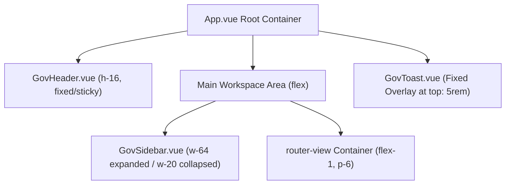

# UI/UX Standards and Design System

This document specifies the user interface architecture, design tokens, component standards, typography rules, and print rendering guidelines for the SI-SPD web application (`apps/web`).

---

## 1. Design System Architecture

The frontend interface combines:
1. **Core Framework:** Vue 3 Composition API with TypeScript.
2. **Component Framework:** PrimeVue 4 utilizing the unstyled theme engine with Aura preset extensions.
3. **CSS Engine:** Tailwind CSS 3 for atomic utility classes and layout composition.
4. **Theme Customization:** Custom `BanggaiLautCivicPreset` defined in `apps/web/src/main.ts`.

---

## 2. Color System and Design Tokens

The application employs a dual-palette system with CSS custom properties mapped in `apps/web/src/style.css` and bound to Tailwind in `apps/web/tailwind.config.js`.

### 2.1 Color Tokens Table

| Token Variable | Light Theme | Dark Theme (`.dark`) | Purpose |
|---|---|---|---|
| `--color-primary` | `#0F4C81` (Civic Navy) | `#38BDF8` (Sky 400) | Brand primary, action triggers, selected state |
| `--color-bg` | `#F8FAFC` (Slate 50) | `#0B132B` (Deep Navy Canvas) | Main body backdrop |
| `--color-surface` | `#FFFFFF` | `#162238` (Dark Surface) | Cards, modals, side navigation, data tables |
| `--color-text-primary` | `#0F172A` (Slate 900) | `#F8FAFC` (Slate 50) | High-emphasis body text and headings |
| `--color-text-muted` | `#64748B` (Slate 500) | `#94A3B8` (Slate 400) | Secondary labels, descriptions, column headers |
| `--color-accent` | `#D97706` (Amber 600) | `#F59E0B` (Amber 500) | Pending state indicators, warnings, highlights |
| `--color-success` | `#059669` (Emerald 600) | `#10B981` (Emerald 500) | Approved status, creation confirmations |
| `--color-border` | `#E2E8F0` (Slate 200) | `#1E293B` (Slate 800) | Container dividing lines, table grid borders |
| `--color-primary-contrast` | `#FFFFFF` | `#0F172A` | Inverted foreground text on primary buttons |

### 2.2 PrimeVue Theme Semantic Palette

```typescript
// apps/web/src/main.ts
const BanggaiLautCivicPreset = definePreset(Aura, {
  semantic: {
    primary: {
      50: '#f0f6fa',
      100: '#dce8f3',
      200: '#bdd5e8',
      300: '#8eb9d8',
      400: '#5695c3',
      500: '#0F4C81',
      600: '#0d4373',
      700: '#0a365c',
      800: '#082a48',
      900: '#061f35',
      950: '#03111e',
    },
    colorScheme: {
      light: {
        primary: {
          color: '#0F4C81',
          contrastColor: '#FFFFFF',
          hoverColor: '#0d4373',
          activeColor: '#0a365c',
        },
        surface: {
          0: '#FFFFFF',
          50: '#F8FAFC',
          100: '#F1F5F9',
          200: '#E2E8F0',
          300: '#CBD5E1',
          400: '#94A3B8',
          500: '#64748B',
          600: '#475569',
          700: '#334155',
          800: '#1E293B',
          900: '#0F172A',
          950: '#020617',
        },
      },
      dark: {
        primary: {
          color: '#38BDF8',
          contrastColor: '#0F172A',
          hoverColor: '#7dd3fc',
          activeColor: '#0284c7',
        },
        surface: {
          0: '#162238',
          50: '#1A2740',
          100: '#1E293B',
          200: '#263859',
          300: '#334870',
          400: '#64748B',
          500: '#94A3B8',
          600: '#CBD5E1',
          700: '#E2E8F0',
          800: '#F1F5F9',
          900: '#F8FAFC',
          950: '#FFFFFF',
        },
      },
    },
  },
});
```

---

## 3. Typography Standards

The system separates administrative UI fonts from official government document fonts:

### 3.1 UI Font Stack
- Font Family: `system-ui, -apple-system, BlinkMacSystemFont, "Segoe UI", Roboto, Helvetica, Arial, sans-serif`
- OpenType Features: `'cv02', 'cv03', 'cv04', 'cv11'` for enhanced tabular figure clarity and character disambiguation
- Contrast: Complies with WCAG 2.1 AA text contrast ratio ($\ge 4.5:1$ for normal body text)

### 3.2 Official Document Font Stack (`SpdDocument.vue` & `SpdBackDocument.vue`)
- Font Family: `'Times New Roman', Times, Georgia, serif !important` (with selectable Arial / Helvetica option)
- Color: Strict `#000000 !important`
- Background: Strict `#FFFFFF !important`
- Document Base Sizing: 12pt (`16px @ 96 DPI`) with `1.35` line-height

---

## 4. Layout Architecture and Navigation



### 4.1 Responsive Breakpoints
- **Mobile (`< 768px`):** Sidebar is hidden or off-canvas; top header displays toggle trigger.
- **Tablet / Laptop (`768px - 1024px`):** Sidebar defaults to collapsed icon-only mode (`w-20`).
- **Desktop (`>= 1024px`):** Sidebar defaults to full expanded state (`w-64`).

### 4.2 Sidebar Collapsed State Rules
When collapsed (`w-20`):
- Logo text is hidden to prevent container horizontal overflow.
- Menu categories display top-level icons only.
- Clicking an icon category with children automatically expands the sidebar and unrolls the active sub-menu tree.

---

## 5. Form Design and Validation UX

### 5.1 Real-time Feedback Principles
1. **Multi-Agenda Input:** Point 4 (*Dalam Rangka*) supports dynamic multi-item lists (`form.maksudList: string[]`). An item counter displays aggregate character quota against the 700-character maximum.
2. **Unnumbered Purpose Header:** `BuatSuratTugasView.vue` includes an optional introductory header input (`maksudHeader`) allowing unnumbered preamble text before numbered task lists.
3. **Optional Travel Duration & Dates:** Travel duration (`lamaHari`) and departure date (`tanggalBerangkat`) are optional across both forms. If left empty, Point 7 renders cleanly blank.
4. **Dynamic Number Words (*Angka Terbilang*):** `GovInputNumber` automatically computes and renders Indonesian verbal integers (e.g. `3` -> `Tiga Hari`) in real time to prevent clerical entry errors.
5. **KPA Numbering Enforcement:** When issuing an SPD as `Kuasa Pengguna Anggaran (KPA)`, the system automatically prefixes the letter number with `KPA` (e.g., `KPA001/SPD/SETDA/2026`).
6. **Bulk Action Controls:** `DaftarSpdView.vue` and `DaftarSuratTugasView.vue` provide multi-select checkboxes for batch actions: bulk delete with confirmation modal, and batch non-collate printing.

---

## 6. Feedback and Notification System (`GovToast.vue`)

### 6.1 Viewport Overlay Alignment
`GovToast` is mounted at `App.vue` and avoids header collision via explicit vertical offsets:

```css
/* apps/web/src/style.css */
.p-toast {
  top: 5rem !important; /* 80px: leaves 16px clearance beneath 64px navbar */
  z-index: 9999 !important;
}

@media (min-width: 769px) {
  .p-toast {
    right: 1.5rem !important;
    width: 26rem !important;
  }
}

@media (max-width: 768px) {
  .p-toast {
    left: 1rem !important;
    right: 1rem !important;
    width: auto !important;
    max-width: calc(100vw - 2rem) !important;
  }
}

@media (max-width: 480px) {
  .p-toast {
    left: 0.75rem !important;
    right: 0.75rem !important;
    max-width: calc(100vw - 1.5rem) !important;
  }
}
```

### 6.2 Standard Action Durations
- Success actions: 4000ms
- Informational updates: 4000ms
- Validation warnings: 4500ms
- Error exceptions: 5000ms

---

## 7. Official Document Sheet and Print Specifications

### 7.1 Physical Dimensions
- **Legal Sheet:** Width `215.9mm` x Height `355.6mm` (`8.5in x 14in` / `612pt x 1008pt`)
- **A4 Sheet:** Width `210.0mm` x Height `297.0mm`

### 7.2 Margins (Narrow Standard)
- **Left Margin:** `12.7mm` (`36pt` / `48px`)
- **Right Margin:** `12.7mm` (`36pt` / `48px`)
- **Top Margin (with letterhead):** `12mm` (`45px`)
- **Top Margin (without letterhead, for physical official stationery):** `48mm` (`181px`)
- **Bottom Margin:** `15mm` (`56.7pt`)

### 7.3 Combined Multi-Page Document Architecture
The SPD document interface embeds both front and back pages in a continuous flow:
- Front Page: `SpdDocument.vue` (10-Point official table).
- Back Page: `SpdBackDocument.vue` (Tabel Visum Perjalanan Dinas).
- Inter-page separation: Handled via `@media print { .page-break { break-before: page; page-break-before: always; } }`.

### 7.4 Print CSS Rules (`@media print`)
- Page size directive: `@page { size: 215.9mm 355.6mm; margin: 0; }`
- Body background: forced to `transparent !important`
- Body margins and padding: zeroed (`margin: 0 !important; padding: 0 !important`)
- Interface elements: `.no-print` classes set to `display: none !important`
- Sheet shadow: `box-shadow: none !important`
- Page breaks: suppressed within individual table cells and signature blocks (`page-break-inside: avoid; page-break-after: avoid`)
