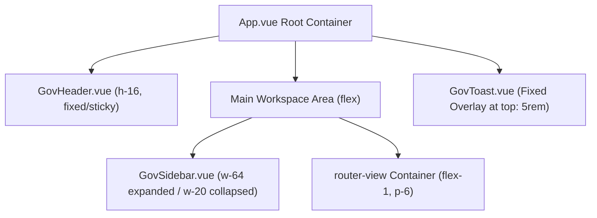

# UI/UX Standards and Design System

This document specifies the user interface architecture, design tokens, component standards, typography rules, and print rendering guidelines for the SI-SPD web application (`apps/web`).

---

## 1. Design System Architecture

The frontend interface combines:
1. **Core Framework:** Vue 3 Composition API with TypeScript.
2. **Component Framework:** PrimeVue 4 utilizing the unstyled theme engine with Aura preset extensions.
3. **CSS Engine:** Tailwind CSS 3 for atomic utility classes and layout composition.
4. **Theme Customization:** Custom `BanggaiLautCivicPreset` defined in `apps/web/src/main.ts`.

---

## 2. Color System and Design Tokens

The application employs a dual-palette system with CSS custom properties mapped in `apps/web/src/style.css` and bound to Tailwind in `apps/web/tailwind.config.js`.

### 2.1 Color Tokens Table

| Token Variable | Light Theme | Dark Theme (`.dark`) | Purpose |
|---|---|---|---|
| `--color-primary` | `#0F4C81` (Civic Navy) | `#38BDF8` (Sky 400) | Brand primary, action triggers, selected state |
| `--color-bg` | `#F8FAFC` (Slate 50) | `#0B132B` (Deep Navy Canvas) | Main body backdrop |
| `--color-surface` | `#FFFFFF` | `#162238` (Dark Surface) | Cards, modals, side navigation, data tables |
| `--color-text-primary` | `#0F172A` (Slate 900) | `#F8FAFC` (Slate 50) | High-emphasis body text and headings |
| `--color-text-muted` | `#64748B` (Slate 500) | `#94A3B8` (Slate 400) | Secondary labels, descriptions, column headers |
| `--color-accent` | `#D97706` (Amber 600) | `#F59E0B` (Amber 500) | Pending state indicators, warnings, highlights |
| `--color-success` | `#059669` (Emerald 600) | `#10B981` (Emerald 500) | Approved status, creation confirmations |
| `--color-border` | `#E2E8F0` (Slate 200) | `#1E293B` (Slate 800) | Container dividing lines, table grid borders |
| `--color-primary-contrast` | `#FFFFFF` | `#0F172A` | Inverted foreground text on primary buttons |

### 2.2 PrimeVue Theme Semantic Palette

```typescript
// apps/web/src/main.ts
const BanggaiLautCivicPreset = definePreset(Aura, {
  semantic: {
    primary: {
      50: '#f0f6fa',
      100: '#dce8f3',
      200: '#bdd5e8',
      300: '#8eb9d8',
      400: '#5695c3',
      500: '#0F4C81',
      600: '#0d4373',
      700: '#0a365c',
      800: '#082a48',
      900: '#061f35',
      950: '#03111e',
    },
    colorScheme: {
      light: {
        primary: {
          color: '#0F4C81',
          contrastColor: '#FFFFFF',
          hoverColor: '#0d4373',
          activeColor: '#0a365c',
        },
        surface: {
          0: '#FFFFFF',
          50: '#F8FAFC',
          100: '#F1F5F9',
          200: '#E2E8F0',
          300: '#CBD5E1',
          400: '#94A3B8',
          500: '#64748B',
          600: '#475569',
          700: '#334155',
          800: '#1E293B',
          900: '#0F172A',
          950: '#020617',
        },
      },
      dark: {
        primary: {
          color: '#38BDF8',
          contrastColor: '#0F172A',
          hoverColor: '#7dd3fc',
          activeColor: '#0284c7',
        },
        surface: {
          0: '#162238',
          50: '#1A2740',
          100: '#1E293B',
          200: '#263859',
          300: '#334870',
          400: '#64748B',
          500: '#94A3B8',
          600: '#CBD5E1',
          700: '#E2E8F0',
          800: '#F1F5F9',
          900: '#F8FAFC',
          950: '#FFFFFF',
        },
      },
    },
  },
});
```

---

## 3. Typography Standards

The system separates administrative UI fonts from official government document fonts:

### 3.1 UI Font Stack
- Font Family: `system-ui, -apple-system, BlinkMacSystemFont, "Segoe UI", Roboto, Helvetica, Arial, sans-serif`
- OpenType Features: `'cv02', 'cv03', 'cv04', 'cv11'` for enhanced tabular figure clarity and character disambiguation
- Contrast: Complies with WCAG 2.1 AA text contrast ratio ($\ge 4.5:1$ for normal body text)

### 3.2 Official Document Font Stack (`SpdDocument.vue` & `SpdBackDocument.vue`)
- Font Family: `'Times New Roman', Times, Georgia, serif !important` (with selectable Arial / Helvetica option)
- Color: Strict `#000000 !important`
- Background: Strict `#FFFFFF !important`
- Document Base Sizing: 12pt (`16px @ 96 DPI`) with `1.35` line-height

---

## 4. Layout Architecture and Navigation



### 4.1 Responsive Breakpoints
- **Mobile (`< 768px`):** Sidebar is hidden or off-canvas; top header displays toggle trigger.
- **Tablet / Laptop (`768px - 1024px`):** Sidebar defaults to collapsed icon-only mode (`w-20`).
- **Desktop (`>= 1024px`):** Sidebar defaults to full expanded state (`w-64`).

### 4.2 Sidebar Collapsed State Rules
When collapsed (`w-20`):
- Logo text is hidden to prevent container horizontal overflow.
- Menu categories display top-level icons only.
- Clicking an icon category with children automatically expands the sidebar and unrolls the active sub-menu tree.

### 4.3 Navigation Menu Structure (`GovSidebar.vue`)
The sidebar is structured into functional administrative categories:
1. **Beranda:** Route `/` (`pi pi-home`)
2. **Surat Tugas:** Route `/surat-tugas` (`pi pi-file`) with submenus *Daftar Surat Tugas* (`/surat-tugas`) and *Buat Surat Tugas* (`/surat-tugas/buat`).
3. **Surat Perjalanan Dinas:** Route `/spd` (`pi pi-briefcase`) with submenus *Daftar SPD* (`/spd`) and *Buat Dokumen Baru* (`/spd/buat`).
4. **Laporan Perjalanan:** Route `/laporan` (`pi pi-file-check`) with submenus *Daftar Laporan* (`/laporan`) and *Buat Laporan* (`/laporan/buat`).
5. **Kepegawaian:** Route `/kepegawaian` (`pi pi-users`) with submenu *Data ASN* (`/kepegawaian/asn`).
6. **Pengaturan:** Route `/pengaturan` (`pi pi-cog`) with submenus *Pengaturan Pengguna* (`/pengaturan/pengguna`), *Kop Surat* (`/pengaturan/kop-surat`), and *Dasar Hukum* (`/pengaturan/dasar-hukum`).

---

## 5. Form Design and Validation UX

### 5.1 Real-time Feedback Principles
1. **Multi-Agenda Input:** Point 4 (*Dalam Rangka*) supports dynamic multi-item lists (`form.maksudList: string[]`). An item counter displays aggregate character quota against the 700-character maximum.
2. **Unnumbered Purpose Header:** `BuatSuratTugasView.vue` includes an optional introductory header input (`maksudHeader`) allowing unnumbered preamble text before numbered task lists.
3. **Optional Travel Duration & Dates:** Travel duration (`lamaHari`) and departure date (`tanggalBerangkat`) are optional across both forms. If left empty, Point 7 renders cleanly blank.
4. **Dynamic Number Words (*Angka Terbilang*):** `GovInputNumber` automatically computes and renders Indonesian verbal integers (e.g. `3` -> `Tiga Hari`) in real time to prevent clerical entry errors.
5. **KPA Numbering Enforcement:** When issuing an SPD as `Kuasa Pengguna Anggaran (KPA)`, the system automatically prefixes the letter number with `KPA` (e.g., `KPA001/SPD/SETDA/2026`).
6. **Bulk Action Controls:** `DaftarSpdView.vue` and `DaftarSuratTugasView.vue` provide multi-select checkboxes for batch actions: bulk delete with confirmation modal, and batch non-collate printing.
7. **Laporan Perjalanan Dinas Workflows:**
   - **Inline Generation in Preview:** `SpdDetailPrintView.vue` provides a modal dialog with contextual SPD summaries, automatic recipient mapping, and direct PDF download/print triggers.
   - **Dedicated List and Authoring Views:** `DaftarLaporanView.vue` surfaces KPI metric cards (`Total Laporan`, `Menunggu Pembuatan`, `SPD Disetujui`) with instant search and status filters; `BuatLaporanView.vue` includes an auto-complete selector for approved SPDs, dynamic recipient resolution, and multiline narrative editing.

### 5.2 Component Customization Standards
- **`GovSelect.vue` Dynamic Slot Passthrough:** Configured with `<template v-for="(_, slotName) in $slots" #[slotName]="slotProps">` to forward all PrimeVue `Select` scoped slots (`option`, `value`, `header`, `footer`) transparently to child templates.

---

## 6. Data Table and Search Standardization (`DaftarLaporanView.vue` Reference)

The design system establishes `DaftarLaporanView.vue` as the normative benchmark for all master/transaction data table and filter-toolbar interfaces across the application. Any administrative listing page (`DaftarSpdView`, `DaftarSuratTugasView`, `KepegawaianAsnView`, etc.) must conform to these standard layout, typography, interaction, and styling specifications.

### 6.1 Page Header and Summary Metrics Layout

1. **Page Title and Subtitle:**
   - Hierarchy: Primary page header rendered in `text-2xl font-bold tracking-tight text-text-main`.
   - Descriptive Subtitle: Positioned below title in `text-sm text-text-muted mt-1` explaining the domain function of the view.
   - Primary Action Trigger: Top-right aligned primary action button (`GovButton` with `severity="primary"` and `icon="pi pi-plus"`), wrapped in role-based authorization check (e.g. `v-if="canCreate"`).

2. **KPI Summary Metric Cards (`GovCard` Grid):**
   - Responsive Layout: 3-column responsive grid (`grid grid-cols-1 sm:grid-cols-3 gap-4`).
   - Accent Border Indicator: Left indicator line (`border-l-4`) with semantic state colors:
     - Completed / Finished: `border-l-emerald-500` (Background: `bg-emerald-50 dark:bg-emerald-950/40`, Text: `text-emerald-600 dark:text-emerald-400`).
     - In-Progress / Pending: `border-l-amber-500` (Background: `bg-amber-50 dark:bg-amber-950/40`, Text: `text-amber-600 dark:text-amber-400`).
     - Total / Approved: `border-l-primary` (Background: `bg-blue-50 dark:bg-blue-950/40`, Text: `text-primary`).
   - Content Hierarchy:
     - Label: `text-xs font-semibold uppercase tracking-wider text-text-muted`.
     - Value: `text-2xl font-bold text-text-main mt-1`.
     - Icon Container: `p-3 rounded-xl` with semantic background and matching icon (`text-xl`).

### 6.2 Filter and Search Toolbar Standardization

The filter toolbar consolidates all query mechanisms into a cohesive, responsive panel:

```html
<!-- Standard Filter Toolbar Container -->
<div class="bg-surface border border-border rounded-xl p-4 shadow-sm flex flex-col md:flex-row md:items-center justify-between gap-3">
  <div class="flex-1 flex flex-wrap items-center gap-2.5">
    <!-- Keyword Search -->
    <div class="w-full sm:w-64 md:w-56 lg:w-72">
      <GovInputText v-model="searchQuery" placeholder="Cari..." block @keydown.enter="handleSearch" />
    </div>

    <!-- Status Dropdown Filter -->
    <div class="w-full sm:w-36 lg:w-44">
      <GovSelect v-model="filterStatus" :options="statusOptions" option-label="label" option-value="value" @change="handleSearch" />
    </div>

    <!-- Categorical / Entity Dropdown Filter -->
    <div class="w-full sm:w-36 lg:w-44">
      <GovSelect v-model="filterCategory" :options="categoryOptions" option-label="label" option-value="value" @change="handleSearch" />
    </div>

    <!-- Date Range Picker Filter -->
    <div class="w-full sm:w-48 lg:w-56">
      <GovDatePicker v-model="dateRange" selection-mode="range" placeholder="Rentang Tanggal" show-button-bar @update:model-value="handleDateChange" />
    </div>

    <!-- Explicit Action Buttons -->
    <GovButton label="Cari" icon="pi pi-search" severity="primary" @click="handleSearch" />
    <GovButton v-if="hasActiveFilters" label="Reset" icon="pi pi-filter-slash" severity="secondary" variant="outlined" @click="handleResetFilters" />
    <GovButton label="Segarkan" icon="pi pi-refresh" severity="secondary" variant="outlined" :loading="loading" @click="fetchList" />
  </div>

  <!-- Dynamic Data Count Indicator -->
  <div class="text-xs text-text-muted flex-shrink-0 self-end md:self-center">
    Menampilkan <strong class="text-text-main font-semibold">{{ filteredList.length }}</strong> data
  </div>
</div>
```

#### Specifications:
1. **Multi-Input Field Sizing:**
   - Text Search: Responsive min-width (`w-full sm:w-64 md:w-56 lg:w-72`) with keyboard Enter trigger support.
   - Dropdown Selectors: Width (`w-full sm:w-36 lg:w-44`) with default `'ALL'` option (e.g. `Semua Status`).
   - Range Date Picker: Width (`w-full sm:w-48 lg:w-56`) with `selection-mode="range"` and `show-button-bar`.
2. **Action Buttons:**
   - Primary `Cari` button (`severity="primary"`, `icon="pi pi-search"`).
   - Conditional `Reset` button (`severity="secondary"`, `variant="outlined"`, `icon="pi pi-filter-slash"`) visible only when search queries or non-default filters are active.
   - `Segarkan` button (`severity="secondary"`, `variant="outlined"`, `icon="pi pi-refresh"`) with dynamic reactive `:loading` state.
3. **Data Counter:** Right-aligned metadata readout (`Menampilkan X data`) in `text-xs text-text-muted` with the count highlighted in `font-semibold text-text-main`.

### 6.3 Data Table Layout and Column Geometry

Tables are housed inside a container with `bg-surface border border-border rounded-xl shadow-sm overflow-hidden` and use fixed table layout semantics:

1. **Table Container and Classes:**
   - PrimeVue `GovTable` overrides: `class="!border-0 !rounded-none !shadow-none [&_.p-datatable-table]:!table-fixed [&_.p-datatable-table]:!w-full"`.
   - Prevents table layout shifting, cell bleeding, and ensures strict horizontal column width enforcement.
2. **Empty State Display:**
   - Centered slot `#empty` with `py-12 text-center text-text-muted`.
   - Includes subtle iconography (`pi pi-inbox text-3xl mb-2 block opacity-40`) and descriptive empty state guidance.
3. **Standard Column Layout & Width Allocations:**

| Column Position | Header Title | Width | Alignment | Content Styling & Hierarchy |
| :--- | :--- | :--- | :--- | :--- |
| 1 | `No.` | `45px` | Left | `text-xs text-text-muted` with continuous sequence indexing (`index + 1`). |
| 2 | `Dokumen / Identitas Utama` | `200px - 220px` | Left | Primary code in `text-xs font-semibold text-text-main font-mono`; secondary reference in `text-[11px] text-text-muted font-mono flex items-center gap-1` with icon. |
| 3 | `Personil / Entitas` | `160px - 180px` | Left | Primary entity name in `font-medium text-xs text-text-main truncate`; secondary identifier (NIP/ID) in `text-[11px] text-text-muted`. |
| 4 | `Deskripsi / Maksud` | `180px - 220px` | Left | Multi-line description clamped to 2 lines (`line-clamp-2 text-xs text-text-main`); auxiliary badge/duration in `text-[11px] text-text-muted mt-0.5`. |
| 5 | `Kategori / Pejabat` | `110px - 130px` | Center | Centered category or official designation in `text-xs text-text-main`. |
| 6 | `Tanggal` | `100px - 110px` | Center | Centered localized date in `text-xs text-text-main` formatted as `DD MMM YYYY` (`id-ID`). |
| 7 | `Status Badge` | `125px - 140px` | Center | Rounded pill badge with pulsing dot (`w-1.5 h-1.5 rounded-full`) and semantic state colors. |
| 8 | `Aksi` | `120px - 140px` | Center | Icon action buttons with subtle circular hover states or contextual pill buttons. |

### 6.4 Status Badge Standardization

Status badges must use rounded-full borders, semantic pastel backgrounds, and internal indicator dots:

```html
<!-- Positive / Completed State -->
<span class="inline-flex items-center gap-1.5 px-2.5 py-1 rounded-full text-xs font-medium border whitespace-nowrap bg-emerald-50 text-emerald-700 border-emerald-200 dark:bg-emerald-950/40 dark:text-emerald-300 dark:border-emerald-800/60">
  <span class="w-1.5 h-1.5 rounded-full bg-emerald-500 dark:bg-emerald-400"></span>
  Sudah Dibuat / Disetujui
</span>

<!-- Pending / Incomplete State -->
<span class="inline-flex items-center gap-1.5 px-2.5 py-1 rounded-full text-xs font-medium border whitespace-nowrap bg-amber-50 text-amber-700 border-amber-200 dark:bg-amber-950/40 dark:text-amber-300 dark:border-amber-800/60">
  <span class="w-1.5 h-1.5 rounded-full bg-amber-500 dark:bg-amber-400"></span>
  Belum Dibuat / Menunggu
</span>
```

### 6.5 Action Buttons and Interaction Design

1. **Completed Records Actions:**
   - Print Action: `GovButton` with `icon="pi pi-print"`, `severity="primary"`, `variant="text"`, `size="small"`, `rounded`.
   - Download PDF Action: `GovButton` with `icon="pi pi-file-pdf"`, `severity="secondary"`, `variant="text"`, `size="small"`, `rounded`.
   - Edit / Update Action: `GovButton` with `icon="pi pi-pencil"`, `severity="secondary"`, `variant="text"`, `size="small"`, `rounded`, governed by permission check.
2. **Direct Creation Quick-Action:**
   - When a child entity (such as a report) has not yet been authored, the action column renders a prominent contextual button:
     ```html
     <button
       type="button"
       class="inline-flex items-center gap-1 px-2.5 py-1 rounded-md text-xs font-medium text-emerald-700 bg-emerald-50 hover:bg-emerald-100 border border-emerald-300 dark:bg-emerald-950/40 dark:text-emerald-300 dark:border-emerald-800/60 dark:hover:bg-emerald-900/50 transition-colors whitespace-nowrap shadow-2xs"
     >
       <i class="pi pi-plus text-[10px]"></i>
       <span>Buat Laporan</span>
     </button>
     ```

---

## 7. Feedback and Notification System (`GovToast.vue`)

### 7.1 Viewport Overlay Alignment
`GovToast` is mounted at `App.vue` and avoids header collision via explicit vertical offsets:

```css
/* apps/web/src/style.css */
.p-toast {
  top: 5rem !important; /* 80px: leaves 16px clearance beneath 64px navbar */
  z-index: 9999 !important;
}

@media (min-width: 769px) {
  .p-toast {
    right: 1.5rem !important;
    width: 26rem !important;
  }
}

@media (max-width: 768px) {
  .p-toast {
    left: 1rem !important;
    right: 1rem !important;
    width: auto !important;
    max-width: calc(100vw - 2rem) !important;
  }
}

@media (max-width: 480px) {
  .p-toast {
    left: 0.75rem !important;
    right: 0.75rem !important;
    max-width: calc(100vw - 1.5rem) !important;
  }
}
```

### 7.2 Standard Action Durations
- Success actions: 4000ms
- Informational updates: 4000ms
- Validation warnings: 4500ms
- Error exceptions: 5000ms

---

## 8. Official Document Sheet and Print Specifications

### 8.1 Physical Dimensions
- **Legal Sheet:** Width `215.9mm` x Height `355.6mm` (`8.5in x 14in` / `612pt x 1008pt`)
- **A4 Sheet:** Width `210.0mm` x Height `297.0mm`

### 8.2 Margins (Narrow Standard)
- **Left Margin:** `12.7mm` (`36pt` / `48px`)
- **Right Margin:** `12.7mm` (`36pt` / `48px`)
- **Top Margin (with letterhead):** `12mm` (`45px`)
- **Top Margin (without letterhead, for physical official stationery):** `48mm` (`181px`)
- **Bottom Margin:** `15mm` (`56.7pt`)

### 8.3 Combined Multi-Page Document Architecture
The SPD document interface embeds both front and back pages in a continuous flow:
- Front Page: `SpdDocument.vue` (10-Point official table).
- Back Page: `SpdBackDocument.vue` (Tabel Visum Perjalanan Dinas).
- Inter-page separation: Handled via `@media print { .page-break { break-before: page; page-break-before: always; } }`.

### 8.4 Print CSS Rules (`@media print`)
- Page size directive: `@page { size: 215.9mm 355.6mm; margin: 0; }`
- Body background: forced to `transparent !important`
- Body margins and padding: zeroed (`margin: 0 !important; padding: 0 !important`)
- Interface elements: `.no-print` classes set to `display: none !important`
- Sheet shadow: `box-shadow: none !important`
- Page breaks: suppressed within individual table cells and signature blocks (`page-break-inside: avoid; page-break-after: avoid`)
