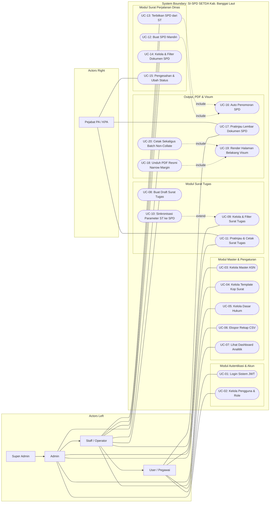

# Use Case Specification: SI-SPD Banggai Laut

This document details the functional Use Case specifications, Actor descriptions, and association rules for the SI-SPD system based on the consolidated architecture and technical reports. The visual diagram is provided in Draw.io format at [`docs/usecase-diagram.drawio`](usecase-diagram.drawio).

---

## 1. Actors Specification

| Actor | Category | Description | Access Weight |
|---|---|---|:---:|
| **Super Admin** | Primary System Actor | Full unrestricted access to system configurations, server administration, user roles, master data, and document operations. | 4 |
| **Admin** | Primary System Actor | Operational administrator managing user accounts, master ASN data, letterhead templates, statutory references (Dasar Hukum), and document status transitions. | 3 |
| **Staff / Operator** | Primary System Actor | Administrative staff executing day-to-day data entry: creating Surat Tugas drafts, generating SPDs, batch printing, and exporting CSV reports. | 2 |
| **User / Pegawai** | Secondary System Actor | Civil servants (ASN) who log in to view assigned duty orders, check travel itineraries, and preview official SPD sheets. | 1 |
| **Pejabat PA / KPA** | Business Authority Actor | Official signatories (Sekretaris Daerah as PA, Kepala Bagian Umum as KPA) who verify itineraries, validate travel records, and authorize document issuance (`DISETUJUI`). | Authority |

### 1.1 Actor Generalization Hierarchy
- **Super Admin** inherits all privileges of **Admin**.
- **Admin** inherits all operational privileges of **Staff / Operator**.
- **Staff / Operator** inherits all viewing privileges of **User / Pegawai**.

---

## 2. Use Case Diagram (System Interaction Model)

---

## 3. Detailed Use Case Specifications

### 3.1 UC-01: Login Sistem (Autentikasi JWT)
- **Primary Actor:** All Actors (Super Admin, Admin, Staff, User).
- **Preconditions:** User has an active registered account in database (`isActive = true`).
- **Main Flow:**
  1. User navigates to `/login` and inputs Username or 18-digit NIP along with password.
  2. Frontend sends `POST /api/auth/login`.
  3. Backend verifies password hash using constant-time `timingSafeEqual`.
  4. Backend generates an HS256 HMAC-SHA256 JWT access token.
  5. Frontend saves token and role in `localStorage` and routes to `/`.
- **Postconditions:** User is authenticated and granted role-appropriate navigation routes.

### 3.2 UC-02: Kelola Pengguna & Role
- **Primary Actor:** Admin, Super Admin.
- **Description:** Create, update, toggle active status, and reset passwords for administrative and staff accounts.
- **Rules:** Enforces unique username/email and restricts role assignments according to caller role weights.

### 3.3 UC-03: Kelola Master ASN (Data Pegawai)
- **Primary Actor:** Admin, Super Admin.
- **Description:** Maintain master records of civil servants (NIP, Nama, Pangkat, Golongan, Jabatan, Unit Kerja).
- **Rules:** Validates unique 18-digit NIP; blocks profile deletion if linked to historical SPD records.

### 3.4 UC-04: Kelola Template Kop Surat
- **Primary Actor:** Admin, Super Admin.
- **Description:** Upload PDF official letterheads, automatically detect paper size (Legal, A4, F4), and designate system-wide default letterhead.

### 3.5 UC-05: Kelola Dasar Hukum
- **Primary Actor:** Admin, Super Admin.
- **Description:** Maintain statutory bases and legal foundation records displayed in Surat Tugas dropdown inputs.

### 3.6 UC-06: Ekspor Rekap Data (Format CSV)
- **Primary Actor:** Staff / Operator, Admin, Super Admin.
- **Description:** Generates RFC 4180-compliant UTF-8 CSV exports with Byte Order Mark (`\uFEFF`) from filtered data tables.

### 3.7 UC-07: Lihat Dashboard & Statistik Analitik
- **Primary Actor:** All Actors.
- **Description:** Consumes `GET /api/dashboard/stats` to render real-time KPI metrics, 6-month monthly trends (*Dalam Wilayah* vs *Luar Daerah*), transportation mode distribution, duration trends, and top destinations. Budget metrics are excluded.

### 3.8 UC-08: Buat Surat Tugas
- **Primary Actor:** Staff / Operator, Admin, Super Admin.
- **Description:** Draft an official assignment order selecting multiple ASN participants, choosing statutory references, entering unnumbered introductory title (`maksudHeader`), and multi-line purpose items.

### 3.9 UC-09: Kelola, Filter & Hapus Surat Tugas
- **Primary Actor:** Staff / Operator, Admin, Super Admin.
- **Description:** Search, filter by date range, edit drafts, and perform bulk deletion using multi-select checkboxes.

### 3.10 UC-10: Sinkronisasi Parameter ST ke Child SPD
- **Primary Actor:** Staff / Operator, Admin.
- **Description:** Automatically propagates modified travel parameters (dates, duration, transport, purpose) from an edited Surat Tugas to all connected child SPD records.

### 3.11 UC-11: Pratinjau & Cetak Surat Tugas
- **Primary Actor:** All Actors, Pejabat PA / KPA.
- **Description:** Renders Surat Tugas document with Narrow margins ($36\text{ pt}$), header clearance, directive spacing ($3 \times / 2 \times$), and centered signatory title block.

### 3.12 UC-12: Buat SPD Mandiri
- **Primary Actor:** Staff / Operator, Admin, Super Admin.
- **Description:** Create an individual SPD by specifying issuing authority (`PA` or `KPA`), selecting traveler ASN, entering multi-agenda items, choosing transportation modes, and optionally providing duration/dates.

### 3.13 UC-13: Terbitkan SPD dari Surat Tugas (On-Demand)
- **Primary Actor:** Staff / Operator, Admin.
- **Description:** Interactive modal on Surat Tugas detail view allowing operators to generate child SPD records for all assigned ASN with synchronized itinerary parameters.

### 3.14 UC-14: Kelola Dokumen SPD
- **Primary Actor:** Staff / Operator, Admin, Super Admin.
- **Description:** Browse SPD records with status badges (`DRAFT`, `DISETUJUI`, `SELESAI`, `BATAL`), search across employee profiles, and execute single or bulk deletions.

### 3.15 UC-15: Pengesahan & Ubah Status Dokumen
- **Primary Actor:** Admin, Super Admin, Pejabat PA / KPA.
- **Description:** Transition document state from `DRAFT` to `DISETUJUI` upon formal review, or mark as `SELESAI` / `BATAL`.

### 3.16 UC-16: Auto Penomoran SPD
- **Primary Actor:** System (Automated via `SpdService`).
- **Description:** Generates formatted serial number `[Prefix][Seq]/SPD/[Year]`. When issued by KPA, strictly enforces the `KPA` code prefix.

### 3.17 UC-17: Pratinjau Lembar Dokumen SPD
- **Primary Actor:** All Actors, Pejabat PA / KPA.
- **Description:** Continuous multi-page document view rendering Front Page (`SpdDocument.vue`) and Back Page (`SpdBackDocument.vue`) with CSS print page-breaks.

### 3.18 UC-18: Unduh PDF Resmi (Narrow Margins)
- **Primary Actor:** All Actors.
- **Description:** Streams server-generated binary PDF with Narrow $36\text{ pt}$ margins ($540\text{ pt}$ content width), centered signatures, Sekda title formatting, and blank Point 7 when departure date is omitted.

### 3.19 UC-19: Render Halaman Belakang (Tabel Visum)
- **Primary Actor:** System (Automated via `SpdPdfService` / `SpdBackDocument.vue`).
- **Description:** Generates Page 2 official transit verification table (Rows I through VIII) with Narrow $36\text{ pt}$ margins and centered horizontal divider at $X = 306\text{ pt}$.

### 3.20 UC-20: Cetak Sekaligus Batch (Non-Collate Duplex)
- **Primary Actor:** Staff / Operator, Admin.
- **Description:** Compiles selected SPDs into a batch PDF ordered non-collate (all front pages sequentially, followed by all back pages) for seamless manual duplex printing on office hardware.

---

## 4. Draw.io Diagram File

The diagram XML file is stored at:
- **File Path:** [`docs/usecase-diagram.drawio`](usecase-diagram.drawio)
- **Compatibility:** Importable directly into [app.diagrams.net (Draw.io)](https://app.diagrams.net) or Draw.io desktop and IDE extensions.
